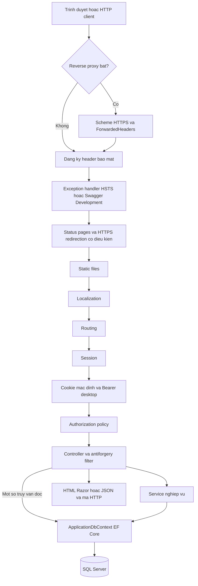
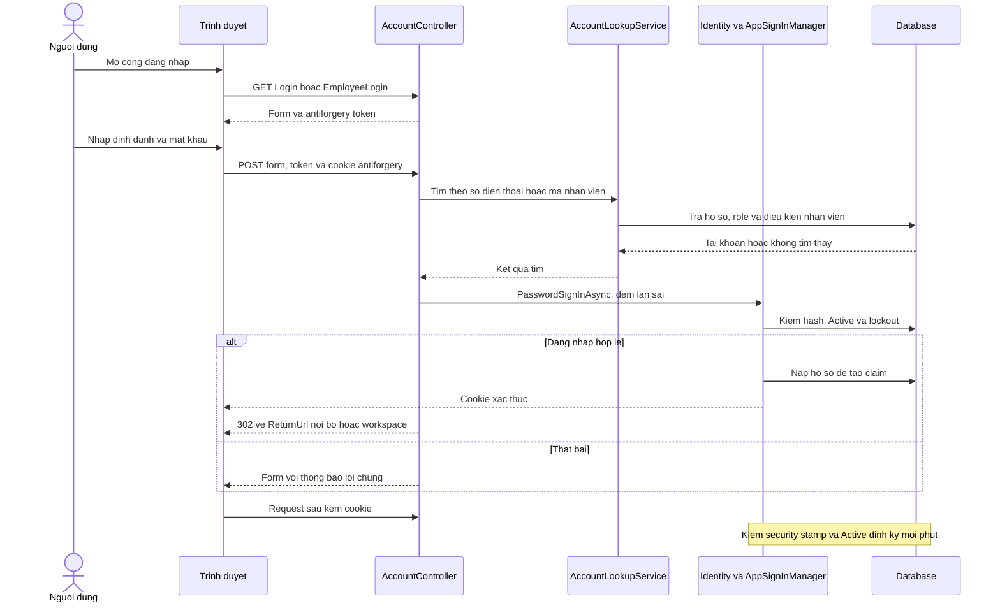

# Backend, đăng nhập và danh sách API Fuji Homestay

Tài liệu đối chiếu trực tiếp `Program.cs`, controller MVC/API, các service, Identity và test trong repo. Các ví dụ JSON minh họa **đúng cấu trúc DTO**, không phải dữ liệu lấy từ database đang chạy; ID, ngày, số tiền và mã đơn cần thay bằng dữ liệu demo thực tế. Chi tiết 45 bảng và các enum: [database.md](database.md).

## 1. Kiến trúc backend

Đường đi thông thường là **Controller → Service → ApplicationDbContext → SQL Server**. Controller nhận request, kiểm model/quyền và chọn response/view; service thực hiện nghiệp vụ; DbContext ánh xạ entity và lưu dữ liệu. Không có lớp repository riêng. Một số controller đọc trực tiếp DbContext để lọc/tóm tắt dữ liệu, ví dụ BookingsApiController, nên đây không phải kiến trúc bắt buộc mọi truy vấn đều qua service.

| Thư mục/tệp | Trách nhiệm |
|---|---|
| `Program.cs` | Đăng ký dependency injection, Identity, policy, cookie, localization, Swagger; dựng middleware, route, seed và bootstrap |
| `Controllers/` | Trang khách, tài khoản, đối tác, thông báo; một số action trả JSON hỗ trợ trang MVC |
| `Controllers/Api/` | 7 controller với 10 endpoint cũ ở phần 3; `Desktop/` có 43 endpoint mới ở phần 8 |
| `Areas/Owner`, `Areas/Staff`, `Areas/Accounting`, `Areas/Admin` | Các workspace MVC theo nghiệp vụ/vai trò |
| `Services/` | Đặt phòng, giá/tồn phòng, thanh toán, đổi/hủy, hợp đồng, giấy tờ, đối soát, tài khoản, báo cáo, thông báo |
| `Identity/` | Chuẩn hóa điện thoại, tìm/kiểm tài khoản, dựng claim, thông báo lỗi Identity tiếng Việt |
| `Models/Entities`, `Models/ViewModels` | Entity lưu database; dữ liệu form/trang. DTO API cũ khai báo trong controller; DTO desktop ở `DesktopApi/` |
| `Data/`, `Data/Migrations` | DbContext, cấu hình EF, migration và các phần SeedData |
| `BackgroundJobs/BookingTimeoutJob.cs` | Job chạy ngay lượt đầu và mỗi phút, mỗi tác vụ có scope/try-catch riêng |
| `Views/`, `TagHelpers/`, `ViewComponents/`, `Resources/` | Razor, thành phần giao diện và bản dịch |
| `HomestayBooking.Tests/` | Test service, ràng buộc, Identity và tích hợp HTTP; không phải tập endpoint triển khai |

### Middleware theo đúng thứ tự Program.cs

1. Nếu `ReverseProxy:Enabled`: có thể đặt scheme HTTPS cho kết nối từ loopback khi AssumeHttps bật; sau đó `UseForwardedHeaders` nhận X-Forwarded-For/Proto. Chỉ tin loopback, giới hạn một proxy.
2. Middleware đăng ký header bảo mật cho response: X-Content-Type-Options=nosniff, X-Frame-Options=DENY, Referrer-Policy=strict-origin-when-cross-origin, Permissions-Policy tắt camera/microphone/geolocation/payment, CSP gồm frame-ancestors/base-uri/form-action/object-src. CSP chưa siết đầy đủ script-src.
3. Ngoài Development: `UseExceptionHandler("/Home/Error")`; HSTS chỉ bật nếu không dùng reverse proxy. Trong Development: `UseSwagger`, `UseSwaggerUI`.
4. `UseStatusCodePagesWithReExecute("/Home/StatusCode/{0}")` giữ nguyên cho web/API cũ; `/api/desktop` dùng status pages JSON riêng, không re-execute HTML.
5. Nếu không dùng proxy: HTTPS redirection, riêng `/healthz` được bỏ qua chuyển hướng.
6. `UseStaticFiles` phục vụ file có sẵn và upload phát sinh lúc chạy.
7. `UseRequestLocalization`: mặc định vi-VN; hỗ trợ en-US. Ưu tiên query culture rồi cookie, không dùng ngôn ngữ trình duyệt.
8. `UseRouting` → `UseRateLimiter` (policy riêng cho desktop login và nhóm tra cứu/đăng ký công khai; không có global limiter) → `UseSession` → `UseAuthentication` → `UseAuthorization`.
9. Ánh xạ static assets; route area `{area:exists}/{controller=Dashboard}/{action=Index}/{id?}`, route MVC mặc định `{controller=Home}/{action=Index}/{id?}`; `MapControllers` cho attribute route API; `/healthz` cho phép ẩn danh.

`SeedData.InitializeAsync` và `AdminBootstrapService.RunAsync` được gọi trước `app.Run()`, không phải middleware cho từng request. AutoMigrate mặc định tắt; thiếu migration thì startup dừng. Startup Development có thể ghi dữ liệu mẫu và job nền có thể đổi dữ liệu sau khi ứng dụng chạy.



### Job, file và thông báo

`BookingTimeoutJob` thực hiện: hết hạn giữ phòng; hết hạn yêu cầu đổi chưa nộp tiền; cảnh báo đơn chậm chủ xác nhận; cảnh báo bill chậm duyệt; hết hạn voucher/hợp đồng; cảnh báo hồ sơ chủ quá hạn; nhắc khách nhận phòng/chủ đón khách; lập đối soát; từ chối khoản bù treo đủ điều kiện. Lỗi một tác vụ được ghi log rồi tiếp tục tác vụ sau.

- Giữ phòng mặc định 15 phút; hạn chủ xác nhận 30 phút. Quá hạn xác nhận chỉ cảnh báo, không tự từ chối đơn. Bill chờ duyệt được cảnh báo sau 120 phút hành chính, thứ Hai–thứ Sáu, 08–17 giờ Việt Nam.
- Nhắc khách trước 1 ngày; chỉ gửi trong khung mặc định [09:00, 21:00) giờ Việt Nam, có chống lặp. MessageService ghi Pending trong transaction ngắn, gửi ngoài transaction, rồi ghi Sent/Failed; Zalo lỗi có nhánh SMS. Pending quá 10 phút có cơ chế đánh Failed để thử lại theo giới hạn của caller.
- Đối soát mặc định xét 4 kỳ gần nhất, chờ 2 ngày sau kỳ, chạy lập kỳ mỗi 60 phút theo mốc thành công trong instance; các tác vụ khác vẫn mỗi phút.
- **SMS/Zalo đang giả lập bằng LoggingMessageSender**, chỉ log kênh, không gửi dịch vụ thật và không log nội dung tin. MessageLogs.Sent hiện không chứng minh khách đã nhận tin thật. Notifications là thông báo trong ứng dụng, độc lập kết quả giao tin ngoài.
- `ReceiptFileStore` lưu bill/giấy tờ ở `App_Data/receipts`, ngoài wwwroot; controller kiểm quyền rồi mới trả file. File 1 byte–5 MiB; kiểm tên, chữ ký/cấu trúc, đuôi và MIME; bill nhận JPG/PNG/WEBP, giấy tờ có thể nhận thêm PDF.
- `HomestayImageService` lưu ảnh công khai tại `wwwroot/uploads/homestays/{id}/`, tên file GUID; UseStaticFiles phục vụ ảnh upload. Nội dung HTML của homestay được HtmlSanitizer lọc ở service.
- Khóa Data Protection được lưu tại vị trí cấu hình `DataProtection:KeysPath`, mặc định `App_Data/keys`, application name FujiHomestay. `/healthz` dùng DatabaseHealthCheck kiểm CanConnectAsync, trả trạng thái sức khỏe, không công bố lỗi SQL/cấu hình kết nối; đây không phải Web API controller trong tổng 10 endpoint.

## 2. Đăng nhập và phân quyền

### Identity và hai cổng đăng nhập

ASP.NET Core Identity dùng `ApplicationUser`, `IdentityRole`, bảng AspNetUsers/AspNetRoles và **cookie là scheme mặc định cho web và 10 API cũ**. Nhóm `/api/desktop` đăng ký thêm JWT Bearer cho nhân viên và chủ homestay đã duyệt (phần 8). Cột token/login ngoài của Identity không đồng nghĩa đang có API JWT hoặc Google login hoạt động; Program.cs chưa cấu hình Google authentication. Khách tự đăng ký chưa có bước OTP.

| Cổng | Định danh gửi form | Cách tìm tài khoản |
|---|---|---|
| `/Account/Login` | PhoneNumber, Password, RememberMe, ReturnUrl | Chuẩn hóa điện thoại E.164 → PersonProfiles → tài khoản có Customer hoặc Owner |
| `/Account/EmployeeLogin` | EmployeeCode, Password, RememberMe, ReturnUrl | Mã nhân viên trim/viết hoa → Employees còn Active → tài khoản có role Employee |
| `/Account/Register` | Họ tên, điện thoại, email tùy chọn, mật khẩu, xác nhận mật khẩu, BookingCode tùy chọn | CustomerAccountService tạo hồ sơ và tài khoản Customer; hồ sơ có đơn cần xác minh mã đơn |

Khách **không cần tài khoản để đặt phòng**. GuestCustomerService tạo/tìm hồ sơ khách; sau tạo đơn, MVC giữ quyền xem bằng session. Tra cứu tại `/Bookings/Lookup` cần mã đơn + điện thoại của người liên hệ hoặc người đặt; khớp thì lưu mã đơn vào session. API tra cứu công khai chỉ trả tóm tắt, không thiết lập quyền session MVC. `/Bookings/Mine` cần đăng nhập; trang đổi của khách cần role Customer và đúng người đặt.

Đăng ký khách (`POST /Account/Register`) và chủ tự đăng ký (`POST /Partner/Index`, form tại `/Partner`) chỉ gắn tài khoản vào hồ sơ trùng SĐT chưa có Account sau khi xác minh **mã một đơn thuộc Customer của hồ sơ**, nếu Customer đã có ít nhất một đơn (mọi trạng thái). `BookingCode` được trim, so sánh không phân biệt hoa thường; mã của khách khác không hợp lệ, kể cả khi SĐT liên hệ của đơn đó trùng. Thiếu/sai mã bị từ chối trước mọi thao tác ghi DB. SĐT mới hoặc hồ sơ chưa có đơn vẫn theo luồng cũ. Nhân viên hỗ trợ đăng ký chủ và các trường hợp service đang từ chối giữ nguyên. Khi ghép sau xác minh, AccountActivityLog ghi AccountCreated với mô tả “xác minh bằng mã đơn”, không ghi mã đơn.

Hai luồng dùng chung bộ đếm theo SĐT E.164: sai (kể cả bỏ trống mã) 5 lần trong cửa sổ trượt 15 phút thì khóa xác minh 15 phút tính từ lần thứ 5; trong thời gian khóa, mã đúng cũng bị chặn. Bộ đếm dùng IMemoryCache trên một instance và TimeProvider; mất khi khởi động lại, cần DB/Redis nếu chạy nhiều instance.

`POST /Bookings/Lookup`, `GET /api/bookings/{code}?phone=`, `POST /Account/Register` và `POST /Partner/Index` dùng chung ngân sách theo IP, fixed window **10 lần/60 giây** mặc định, không xếp hàng. Cấu hình riêng `RateLimits:PermitLimit` và `RateLimits:WindowSeconds` (biến môi trường `RateLimits__PermitLimit`, `RateLimits__WindowSeconds`). Đổi route/mã đơn/SĐT không đặt lại ngân sách của IP đó. Vượt giới hạn trả **429 + Retry-After**: MVC hiển thị trang HTML `/Home/StatusCode/429`, API trả `application/problem+json`. GET các form, đăng nhập web và các API khác không chịu policy này. Desktop login vẫn dùng policy và cấu hình DesktopApi riêng. IP lấy từ kết nối sau cấu hình proxy tin cậy hiện có; không tin trực tiếp header do client gửi.

`AppSignInManager` chỉ cho AccountStatus.Active đăng nhập. Sai mật khẩu tối đa **5 lần → khóa tạm 5 phút** theo Identity; AccountStatus.Locked/Disabled là trạng thái nghiệp vụ riêng. Mọi thất bại đăng nhập dùng thông báo chung để hạn chế dò tài khoản. Mật khẩu tối thiểu 8 ký tự được đặt ở Program.cs; các yêu cầu Identity khác không được ghi đè tại đó.

Cookie có thời hạn 7 ngày, sliding expiration; HttpOnly, SameSite=Lax, Secure=Always ngoài Development và SameAsRequest ở Development. RememberMe quyết định lưu cookie bền qua phiên trình duyệt. Kiểm security stamp mỗi phút; tài khoản mất Active hoặc stamp thay đổi bị loại cookie khi kiểm lại. Claim chức vụ và chủ được duyệt được dựng lại từ database ở bước này.

**Đổi mật khẩu lần đầu:** code có PasswordChangedAt và `/Account/ChangePassword`; seed/bootstrap/tạo tài khoản nhân viên đều có ghi mốc đặt mật khẩu. Chưa thấy middleware hay nhánh đăng nhập bắt buộc đổi mật khẩu ở lần đầu, nên không trình bày đây là chức năng đã có. Đổi mật khẩu thành công cập nhật mốc, ghi AccountActivityLog và refresh cookie.

Ngoài Development, `AdminBootstrapService` chỉ tạo quản trị viên đầu tiên nếu chưa tồn tại bất kỳ Employee chức vụ Administrator nào, kể cả đã khóa/nghỉ. Đọc `Bootstrap:Administrator` từ cấu hình bí mật: EmployeeCode, FullName, Phone, Password bắt buộc, Email tùy chọn. Thiếu thì log lỗi, không tạo; tạo xong nhắc xóa giá trị mật khẩu khỏi cấu hình. Development dùng AD001 từ seed. Không có tài khoản quản trị Production mặc định bằng mật khẩu demo.

### Role, chức vụ và policy

AppRoles chỉ có **Customer, Owner, Employee**. Một tài khoản có thể nhiều role; kế toán/quản lý/quản trị là EmployeePosition, không phải role mới. Claim chức vụ chỉ sinh khi EmploymentStatus.Active. Claim OwnerApproved=true sinh khi chủ có ít nhất một hồ sơ Approved.

| Policy | Điều kiện trong Program.cs | Khu/chức năng chính |
|---|---|---|
| Employee | Role Employee + có claim chức vụ | Workspace Staff (vẫn có kiểm phạm vi ở service) |
| Management | Role Employee + Manager hoặc Administrator | Workspace Admin; duyệt danh mục/hợp đồng/homestay, báo cáo |
| Accounting | Role Employee + Accountant, Manager hoặc Administrator | Workspace Accounting thông thường |
| ApprovedOwner | Role Owner + OwnerApproved=true | Sửa cơ sở, lịch, đơn, đánh giá, đối soát của chính chủ; API ghi của chủ |
| ChangeRequestApprove | Role Employee + **Manager** | Duyệt nghiệp vụ yêu cầu đổi/hủy tại Staff/ChangeApprovals |
| ChangeRequestFinance | Role Employee + **Accountant** | Xác nhận cọc bổ sung tại Accounting/AdditionalDeposits |

Administrator không tự vượt qua hai policy cuối. Service còn kiểm chủ sở hữu/phạm vi dữ liệu và người thực hiện thực tế; qua policy không đồng nghĩa được sửa mọi bản ghi. Các giới hạn bổ sung đọc được trong code:

| Nghiệp vụ sau khi qua policy | Giới hạn thực tế |
|---|---|
| Controller kế thừa StaffController | Chỉ Consultant/Manager/Administrator thao tác; Accountant tới Staff/Dashboard được chuyển về Accounting/Dashboard, các action khác của lớp này trả Forbid |
| Staff/ChangeRequests | Kế thừa Controller trực tiếp, dùng policy Employee; không nhận bộ chặn chức vụ của StaffController |
| Duyệt bill cọc đầu, xử lý giao dịch và ghi hoàn cọc | ReceiptReviewService/AccountingService chỉ nhận Accountant hoặc Manager; Administrator có quyền đọc khu Accounting nhưng bị chặn các thao tác ghi này |
| Đối soát | Accountant/Manager/Administrator được đọc và lập Draft; chỉ Accountant được gửi, xác nhận hộ, mở lại và ghi đã chi |
| Khoản bù | Accountant/Manager/Administrator được xem khoản chờ đủ điều kiện; chỉ Accountant ghi đã trả/từ chối hoặc xem danh sách có thể từ chối |
| Tài khoản nhân viên | AccountAdminService chỉ cho Administrator sửa; Manager chỉ đọc |

Chủ PendingReview vẫn vào `/Owner/Dashboard` và `/Partner/Status`, chưa được dùng chức năng yêu cầu ApprovedOwner.



### API, CSRF và webhook

API công khai không cần đăng nhập. API của chủ và thông báo sử dụng cookie Identity vừa đăng nhập trên web; `/api/...` thiếu đăng nhập trả **401**, thiếu quyền **403**, không chuyển 302 tới trang đăng nhập/AccessDenied (đã cấu hình cookie events). Bộ status pages có thể bổ sung trang HTML cho lỗi chưa có body; không giả định mọi lỗi đều là JSON.

`AutoValidateAntiforgeryToken` áp dụng toàn cục: POST/DELETE API dùng cookie phải gửi **header RequestVerificationToken** cùng cookie antiforgery và cookie đăng nhập. Lấy request token từ input `__RequestVerificationToken` trên form, ví dụ `/Owner/Calendar` sau đăng nhập. Token lấy trước đăng nhập có thể không phù hợp principal sau đăng nhập; nên lấy lại từ trang đã xác thực trước lệnh ghi. GET không cần token CSRF.

Swagger UI ở `/swagger` và mô tả `/swagger/v1/swagger.json` **chỉ bật trong Development**. Production không đăng ký các middleware này và trả **404**. Swagger chỉ chứa route bắt đầu `api/`, không gom action MVC vào danh sách này. Có thể đăng nhập cùng origin bằng trang web rồi thử API đọc trong Swagger; chưa có cấu hình security scheme/nút cấp token đăng nhập riêng, cũng chưa khai báo tham số antiforgery tự động cho API ghi. Muốn thử POST/DELETE dùng cookie cần tự gửi header token, ví dụ bằng curl.

Ngoại lệ: `BankWebhookController` bỏ kiểm antiforgery, xác thực máy chủ bằng `Authorization: Apikey <khóa đã cấu hình>`. Không dùng cookie chủ/khách cho webhook. So khóa bằng so sánh thời gian cố định. Nếu `BankAccount:WebhookApiKey` chưa cấu hình, action trả **503 ProblemDetails** trước khi kiểm header; có khóa nhưng header thiếu/sai trả **401**. Dữ liệu không hợp lệ có thể bị model validation chặn 400 trước khi vào action. Chỉ có webhook SePay được triển khai ở Controllers/Api; enum Casso không phải bằng chứng có endpoint Casso.

## 3. Danh sách 10 endpoint Web API

**Đối chiếu nhóm API cũ: 7 controller, 10 action có `[Http*]` trực tiếp trong `Controllers/Api/` (không tính `Desktop/`): 1 webhook + 1 tra cứu đơn + 1 tìm homestay + 1 thông báo + 2 thao tác đơn của chủ + 2 thao tác khóa lịch + 2 API phòng = 10 endpoint.** Không tính action MVC, health check hay Swagger. Route có `{id:int}` yêu cầu ID số nguyên; `{code}` là mã đơn chuỗi. JSON response dùng camelCase. Các trường trạng thái/loại ngày/lý do trong DTO response dưới đây được controller chuyển **chuỗi**, không phải số enum.

Các mã trong bảng là nhánh nghiệp vụ/controller; API cần đăng nhập còn có 401/403. Binding/validation tự động có thể trả 400. Ví dụ GET dùng URL/query, **không gửi JSON body**; JSON đi kèm là response. Ví dụ POST có cả JSON body và response. Dữ liệu minh họa chỉ thể hiện cấu trúc và cần các điều kiện nghiệp vụ tương ứng.

### 3.1. HomestaysApiController — tìm kiếm công khai

| Method | Route | Quyền cần có | Tham số/Body | Kết quả (HTTP + dạng JSON) | Chức năng |
|---|---|---|---|---|---|
| GET | `/api/homestays` | Công khai | Query HomestaySearchQuery: areaId?, checkIn?, checkOut?, guests=2, minPrice?, maxPrice?, categoryId?, amenityIds (lặp), sort, q?, page? | 200 HomestayPage `{items,page,pageSize,totalCount,totalPages}`; 400 ProblemDetails | Tìm/lọc/sắp xếp/phân trang các cơ sở đủ điều kiện bán |

`sort`: Default=0, PriceAscending=1, PriceDescending=2, Rating=3; query có thể dùng tên enum. `guests` được service kẹp 1–20, ngày nhận quá khứ được nâng lên hôm nay. `pageSize` là kết quả, không phải tham số query; SearchAsync cố định **9** kết quả/trang (khác mặc định 10 của PaginatedList ở nơi khác). Khoảng có đủ ngày bị giới hạn BookingOptions.MaxNights mặc định **30**, dù comment API có nhắc 92; **92 chỉ áp dụng API availability bên dưới**. Giá âm/ngược hoặc sort không hợp lệ trả 400. Chỉ đủ cặp ngày hợp lệ mới dùng để lọc theo khoảng ở.

Request: `GET /api/homestays?guests=2&page=1&sort=PriceAscending`.

Response 200 minh họa một trang chỉ có một kết quả:

```json
{
  "items": [
    {
      "id": 1,
      "name": "Phố Cổ Corner House",
      "area": "Hoàn Kiếm",
      "coverUrl": null,
      "fromPrice": 400000,
      "maxGuests": 4,
      "rating": null,
      "reviewCount": 0,
      "amenities": ["Wifi", "Điều hòa"]
    }
  ],
  "page": 1,
  "pageSize": 9,
  "totalCount": 1,
  "totalPages": 1
}
```

HomestayItem có coverUrl, fromPrice, rating có thể NULL. Đối chiếu test `PublicApiTests.SearchReturnsPagedHomestaysAndRejectsReversedPriceRange`.

### 3.2. RoomsApiController — lịch kín và báo giá loại phòng

| Method | Route | Quyền cần có | Tham số/Body | Kết quả (HTTP + dạng JSON) | Chức năng |
|---|---|---|---|---|---|
| GET | `/api/rooms/{id:int}/availability` | Công khai | id = **RoomTypeId**; query from, to dạng yyyy-MM-dd | 200 mảng chuỗi ngày `[]` hoặc `["yyyy-MM-dd"]`; 400 ProblemDetails | Trả các đêm kín hết phòng của loại phòng trong [from,to), tối đa 92 đêm |
| GET | `/api/rooms/{id:int}/quote` | Công khai | id = **RoomTypeId**; query checkIn, checkOut | 200 RoomQuote `{roomTypeId,checkIn,checkOut,freeRooms,total,depositRate,deposit,nights}`; 400 ProblemDetails; 404 ProblemDetails khi thiếu bảng giá/loại không có giá | Báo giá từng đêm, tổng/cọc và số phòng còn trống; chưa tính voucher |

availability không tồn tại/không có phòng đủ điều kiện bán có thể trả toàn bộ khoảng là ngày kín, không có nhánh 404 riêng. Service cắt phần trước hôm nay. quote giới hạn MaxNights mặc định 30; còn giá nhưng hết phòng vẫn có thể trả báo giá với freeRooms=0. Không nên coi báo giá là thao tác giữ phòng.

Request: `GET /api/rooms/1/quote?checkIn=2027-01-04&checkOut=2027-01-06`.

Response 200 giả định giá hai đêm đều 400.000 và còn 2 phòng:

```json
{
  "roomTypeId": 1,
  "checkIn": "2027-01-04",
  "checkOut": "2027-01-06",
  "freeRooms": 2,
  "total": 800000,
  "depositRate": 0.3,
  "deposit": 240000,
  "nights": [
    {"date": "2027-01-04", "dayType": "Weekday", "price": 400000},
    {"date": "2027-01-05", "dayType": "Weekday", "price": 400000}
  ]
}
```

Đối chiếu `PublicApiTests.AvailabilityListsBlockedNightsAndRejectsBadRanges`, `QuoteReturnsNightlyPricesAndDepositOrProblem`. Khi thử về sau, chọn ngày tương lai còn hợp đồng/giá.

### 3.3. BookingsApiController — tra cứu đơn

| Method | Route | Quyền cần có | Tham số/Body | Kết quả (HTTP + dạng JSON) | Chức năng |
|---|---|---|---|---|---|
| GET | `/api/bookings/{code}` | Công khai, phải khớp mã + điện thoại | Query phone; chấp nhận số Việt Nam được PhoneNumberNormalizer chuẩn hóa | 200 BookingSummary `{code,status,homestay,roomType,checkIn,checkOut,guests,totalAmount,depositAmount,holdExpiresAt}`; 404 ProblemDetails; 429 ProblemDetails + Retry-After | Xem trạng thái/số tiền tóm tắt; thiếu/sai phone hay không có mã đều 404; rate limit IP dùng chung với tra cứu MVC/đăng ký |

Mã được trim/viết hoa; phone khớp điện thoại người liên hệ **hoặc** người đặt. Không trả địa chỉ/hướng dẫn nhận phòng hay toàn bộ entity.

Request: `GET /api/bookings/FJ261020-001?phone=0987000001`.

Response 200 minh họa khi cặp mã/điện thoại có thật:

```json
{
  "code": "FJ261020-001",
  "status": "Deposited",
  "homestay": "Phố Cổ Corner House",
  "roomType": "Phòng đôi",
  "checkIn": "2027-01-04",
  "checkOut": "2027-01-06",
  "guests": 2,
  "totalAmount": 800000,
  "depositAmount": 240000,
  "holdExpiresAt": "2026-10-20T03:15:00Z"
}
```

status là BookingStatus.ToString(); holdExpiresAt được gán DateTimeKind.Utc trước khi trả. Tóm tắt này không có AmountDue/DiscountAmount; depositAmount là cọc trước giảm voucher. Đối chiếu `PublicApiTests.BookingLookupNeedsMatchingPhoneAndHidesExistence`.

### 3.4. NotificationsApiController — số thông báo

| Method | Route | Quyền cần có | Tham số/Body | Kết quả (HTTP + dạng JSON) | Chức năng |
|---|---|---|---|---|---|
| GET | `/api/notifications/unread-count` | `[Authorize]`, mọi tài khoản đã đăng nhập | Không có; lấy AccountId từ claim NameIdentifier | 200 UnreadCount `{count}`; 401 nếu không có danh tính | Đếm thông báo chưa đọc của chính tài khoản |

Request: `GET /api/notifications/unread-count` kèm cookie đăng nhập.

Response 200 minh họa:

```json
{"count": 3}
```

Đối chiếu `PublicApiTests.UnreadCountRequiresSignInAndMatchesAccount`; số đếm thực phụ thuộc tài khoản và thông báo hiện có.

### 3.5. OwnerBookingsApiController — chủ xác nhận/từ chối đơn

| Method | Route | Quyền cần có | Tham số/Body | Kết quả (HTTP + dạng JSON) | Chức năng |
|---|---|---|---|---|---|
| POST | `/api/bookings/{id:int}/confirm` | ApprovedOwner, đơn của mình và đã có DepositedAt; cookie + CSRF | ConfirmRequest `{roomId: int hoặc null}`; có thể dùng `{}` để giữ phòng hiện tại | 200 BookingStatusResult `{id,code,status}`; 400 sai nghiệp vụ/token; 404 ProblemDetails nếu không thuộc phạm vi; 409 ProblemDetails nếu cập nhật đồng thời | Xác nhận đơn qua BookingService, có thể chỉ định phòng khác còn trống |
| POST | `/api/bookings/{id:int}/reject` | Như confirm | RejectRequest `{reason: string}`; trim, 1–500 ký tự | 200 BookingStatusResult; 400 ProblemDetails nếu lý do/trạng thái sai (hoặc lỗi token); 404/409 như trên | Chủ từ chối đơn; ghi số tiền phải hoàn đủ phần cọc khách thực chuyển |

Lọc có DepositedAt không thay cho kiểm trạng thái: service chỉ cho Deposited → Confirmed/Rejected. Gọi lại trên đơn Confirmed trả 400. ID ở đây là số nguyên Bookings.Id, khác mã chuỗi dùng API tra cứu. Reject mới ghi nghĩa vụ hoàn; kế toán vẫn phải thực hiện và ghi khoản Refund.

Request: `POST /api/bookings/12/confirm`, kèm cookie và header RequestVerificationToken, Content-Type application/json.

```json
{"roomId": null}
```

Response 200 khi đơn 12 thuộc chủ và đang Deposited:

```json
{"id": 12, "code": "FJ261020-001", "status": "Confirmed"}
```

Đối chiếu `OwnerApiTests.OwnerConfirmsOwnDepositedBookingButNotOthersAndNotWithoutToken`, `RejectNeedsReasonAndRefundsDeposit`, `NonOwnersGet401Or403WithoutRedirect`.

### 3.6. RoomBlocksApiController — khóa/mở lịch của chủ

| Method | Route | Quyền cần có | Tham số/Body | Kết quả (HTTP + dạng JSON) | Chức năng |
|---|---|---|---|---|---|
| POST | `/api/rooms/{roomId:int}/blocks` | ApprovedOwner, sở hữu phòng; cookie + CSRF | CreateBlockRequest `{start,end,reason,note}`; reason mặc định OtherChannel, note tùy chọn ≤255 ký tự | 201 BlockResult `{id,roomId,start,end,reason,note}` + Location; 400 ProblemDetails/validation/token; 404 ProblemDetails; 409 ConflictProblem `{detail,conflicts:[{date,code}]}` | Khóa các đêm [start,end), không khóa ngày quá khứ; trùng lịch trả các đêm xung đột |
| DELETE | `/api/rooms/{roomId:int}/blocks/{blockId:int}` | Như POST, khóa phải thuộc đúng phòng | Không body | 204 không nội dung; 400 nếu khóa đã kết thúc/token; 404 ProblemDetails | Mở phần đêm khóa từ hôm nay trở đi |

roomId là **Rooms.Id**, không phải RoomTypeId của API báo giá. reason có JsonStringEnumConverter riêng, nhận tên OtherChannel/Maintenance; converter mặc định còn cho phép số enum, service kiểm Enum.IsDefined. Response luôn là tên chuỗi. Location là đường dẫn tài nguyên được tạo, **không có GET chi tiết block** trong controller. Khóa hoàn toàn ở tương lai có thể bị xóa hẳn; khóa có lịch sử giữ phần đã qua.

Request: `POST /api/rooms/7/blocks`, kèm cookie + CSRF.

```json
{
  "start": "2027-03-01",
  "end": "2027-03-03",
  "reason": "Maintenance",
  "note": "Sơn lại phòng"
}
```

Response 201 khi phòng thuộc chủ và cả hai đêm còn trống:

```json
{
  "id": 9,
  "roomId": 7,
  "start": "2027-03-01",
  "end": "2027-03-03",
  "reason": "Maintenance",
  "note": "Sơn lại phòng"
}
```

Đối chiếu `OwnerApiTests.OwnerBlocksAndUnblocksOwnRoomWithConflictAndOwnershipChecks`.

### 3.7. BankWebhookController — giao dịch từ SePay

| Method | Route | Quyền cần có | Tham số/Body | Kết quả (HTTP + dạng JSON) | Chức năng |
|---|---|---|---|---|---|
| POST | `/api/bank-webhook/sepay` | Header Authorization: Apikey, không CSRF | SePayPayload: id (long), gateway?, transactionDate, accountNumber, code?, content?, transferType, transferAmount (decimal), referenceCode?, description? | 200 `{success:true,status,booking,duplicate}`; giao dịch bỏ qua trả `{success:true}`; 400 ProblemDetails/validation; 401; 503 ProblemDetails khi thiếu khóa cấu hình | Nhận tiền vào, đổi giờ Việt Nam sang UTC, chuyển BankMatchingService khớp đơn và chống gửi lặp |

transactionDate phải đúng `yyyy-MM-dd HH:mm:ss` giờ Việt Nam. transferType khác `in` hoặc transferAmount ≤0 được bỏ qua 200 sau khi xác thực. code trong payload không thay cho việc đọc mã đơn trong content. Giao dịch lặp cũng trả 200 để nhà cung cấp không gửi lại; status là BankMatchStatus.ToString(), booking có thể null. Khớp cọc bổ sung vẫn chờ kế toán, không tự áp đổi đơn.

Request: `POST /api/bank-webhook/sepay`, Content-Type application/json, header `Authorization: Apikey <khóa đã cấu hình>`.

```json
{
  "id": 123,
  "gateway": "MB",
  "transactionDate": "2026-10-20 10:00:00",
  "accountNumber": "<tài khoản nhận đã cấu hình>",
  "code": null,
  "content": "FJ261020-001 dat coc",
  "transferType": "in",
  "transferAmount": 240000,
  "referenceCode": "DEMO-123",
  "description": null
}
```

accountNumber trong ví dụ là chỗ điền cấu hình, không phải số tài khoản để gửi nguyên văn. Response 200 **giả định** đúng tài khoản nhận, đơn hợp lệ còn hạn, cọc thực phải chuyển 240.000 và giao dịch chưa được nhận:

```json
{"success": true, "status": "Matched", "booking": "FJ261020-001", "duplicate": false}
```

Đối chiếu DTO/nhánh trả trong BankWebhookController và `BankWebhookValidationTests`, `BankMatchingServiceTests`. Bộ API không có endpoint phát lệnh chuyển tiền ngân hàng.

## 4. Các trang MVC chính theo vai trò

Các route dưới đây là MVC/Razor (HTML/form), **không cộng vào 10 Web API**. Mặc định `/Area/Controller` tương ứng action Index; các route chứa `{id}` trong workspace dùng ID số, còn `/Bookings/.../{code}` dùng mã đơn.

| Người dùng/quyền | Route hoặc nhóm trang | Chức năng |
|---|---|---|
| Mọi người/khách vãng lai | `/`, `/Homestays`, `/Homestays/Details/{id}` | Trang chủ, tìm kiếm, xem cơ sở/loại phòng/giá/đánh giá |
| Khách vãng lai hoặc có tài khoản | `/Bookings/Create`, `/Bookings/Lookup`, `/Bookings/Details/{code}` | Đặt phòng, tra cứu bằng mã + điện thoại, xem QR và chi tiết theo quyền tài khoản/session |
| Khách có quyền đơn | `/Bookings/UploadReceipt/{code}`, `/Bookings/Cancel/{code}`, `/Bookings/Review/{code}` | Nộp ảnh bill, hủy trực tiếp, đánh giá đơn đủ điều kiện (POST) |
| Đã đăng nhập / Customer | `/Bookings/Mine`; `/Bookings/Change/{code}` | Danh sách đơn/voucher; Customer gửi đổi chính đơn của mình |
| Mọi người/đã đăng nhập tương ứng | `/Account/Login`, `/Account/EmployeeLogin`, `/Account/Register`, `/Account/ChangePassword` | Hai cổng đăng nhập, đăng ký khách, đổi mật khẩu |
| Người đăng ký đối tác / Owner | `/Partner`, `/Partner/Activate`, `/Partner/Status` | Đăng ký, kích hoạt theo lời mời, bổ sung giấy tờ và xem tiến độ |
| Mọi tài khoản đăng nhập | `/Notifications` | Danh sách thông báo, đánh dấu đã đọc |
| Owner kể cả chưa được duyệt | `/Owner/Dashboard` | Tổng quan và trạng thái hồ sơ; quyền thao tác tiếp theo phụ thuộc duyệt |
| ApprovedOwner | `/Owner/Homestays`, `/Owner/Homestays/Edit/{id}` | Nội dung/vị trí, phòng và giá, ảnh, tiện nghi, chính sách, giấy tờ của cơ sở mình |
| ApprovedOwner | `/Owner/Bookings`, `/Owner/Bookings/Details/{id}` | Xác nhận/từ chối, nhận phòng, hoàn thành, không đến theo service |
| ApprovedOwner | `/Owner/Calendar`, `/Owner/Schedule` | Lịch bận/khóa ngày, danh sách nhận–trả |
| ApprovedOwner | `/Owner/Reviews`, `/Owner/Settlements`, `/Owner/Settlements/Details/{id}` | Trả lời đánh giá; xem bảng đã gửi, xác nhận/báo lệch đối soát |
| Consultant/Manager/Administrator còn làm việc | `/Staff/Dashboard`, `/Staff/Bookings`, `/Staff/Bookings/Create` | Tổng quan, danh sách/chi tiết, đặt hộ và giao đơn theo quyền service; Accountant được chuyển khỏi dashboard Staff |
| Consultant/Manager/Administrator còn làm việc | `/Staff/Availability`, `/Staff/Customers` | Tra phòng trống, hồ sơ khách và lịch sử liên quan |
| Consultant/Manager/Administrator còn làm việc | `/Staff/Overbooking/Index/{id}` | Xử lý trùng phòng; hoàn toàn bộ khi trùng có kiểm Management riêng |
| Employee còn làm việc | `/Staff/ChangeRequests` | Gửi đổi/hủy thay khách, vẫn phải tách người gửi/duyệt/tài chính |
| Consultant/Manager/Administrator, quản lý duyệt cuối | `/Staff/OwnerRegistrations` | Danh sách, tiếp nhận, bổ sung hồ sơ/lời mời; Approve/Reject yêu cầu Management |
| Management | `/Staff/Homestays` | Chuyển tới workspace Admin/Homestays để duyệt cơ sở |
| **Manager** | `/Staff/ChangeApprovals` | Duyệt/từ chối nghiệp vụ yêu cầu đổi/hủy, tách người gửi |
| Accounting | `/Accounting/Dashboard`, `/Accounting/Receipts`, `/Accounting/Transactions` | Tổng quan/đọc; chỉ Accountant hoặc Manager duyệt bill, xử lý giao dịch thiếu/không khớp/chuyển muộn |
| Accounting | `/Accounting/Refunds`, `/Accounting/Compensations` | Đọc; ghi hoàn cần Accountant/Manager, ghi bù cần Accountant; không gọi API chuyển tiền thật |
| Accounting | `/Accounting/Settlements`, `/Accounting/Settlements/Details/{id}` | Đọc/lập Draft; gửi/ghi đã trả/xác nhận hộ/mở lại chỉ Accountant theo service |
| **Accountant** | `/Accounting/AdditionalDeposits` | Xác nhận/từ chối cọc bổ sung của yêu cầu đổi |
| Management | `/Admin/Dashboard`, `/Admin/Homestays`, `/Admin/Contracts` | Tổng quan quản lý, duyệt cơ sở, lập/gia hạn/kết thúc hợp đồng |
| Management | `/Admin/Reports` | Báo cáo đặt phòng, tài chính, nhân viên, homestay theo kỳ |
| Management | `/Admin/Areas`, `/Admin/RoomCategories`, `/Admin/Amenities`, `/Admin/Holidays`, `/Admin/Vouchers` | Danh mục và cấp/thu hồi voucher theo service |
| Manager đọc, Administrator sửa | `/Admin/Accounts` | Danh sách/chi tiết tài khoản; quản trị tạo nhân viên, đổi trạng thái/chức vụ, đặt lại mật khẩu |
| Management, chỉ Development | `/Dev/UiKit`, `/Dev/SimulateBank` | Thư viện UI và giả lập giao dịch qua BankMatchingService; ngoài Development controller bị loại, 404 |

Tư vấn (Consultant) không được mặc nhiên duyệt bill/đối soát; Accountant không được mặc nhiên sửa danh mục Admin. Manager/Administrator dùng workspace Staff và đọc Accounting theo policy, nhưng thao tác ghi còn bị giới hạn bởi chức vụ cụ thể trong từng service như bảng ở phần 2.

## 5. Các luồng nghiệp vụ chính

### Đặt phòng → QR → bill → duyệt cọc → chủ xác nhận

1. Khách tìm tại `/Homestays` hoặc `GET /api/homestays`; chọn loại phòng, xem `GET /api/rooms/{roomTypeId}/availability` và `/quote`. Các request này chưa giữ phòng.
2. GET/POST `/Bookings/Create` là MVC form. GuestCustomerService hỗ trợ khách chưa đăng nhập; BookingService kiểm hợp đồng/tồn phòng, chốt giá/cọc/chính sách và tạo Bookings + BookingNights + RoomNights trong giao dịch. Đơn mới AwaitingPayment, giữ 15 phút mặc định.
3. `/Bookings/Details/{code}` hiển thị VietQR do VietQrService dựng theo số tiền **AmountDue = DepositAmount − DiscountAmount**, nội dung chứa mã đơn. QR là hướng dẫn chuyển khoản, không phải API tự rút/chuyển tiền. Đặt cọc mặc định 30%, phần còn lại không có endpoint thu tự động trong danh sách Web API này.
4. POST multipart `/Bookings/UploadReceipt/{code}` với receipt và transferContent → ReceiptReviewService ghi Payment ManualReceipt/Submitted, đơn sang PaymentSubmitted. Chờ kế toán, không tự coi ảnh bill là bằng chứng đã đủ tiền.
5. Kế toán xem `/Accounting/Receipts`, POST `/Accounting/Receipts/Approve/{paymentId}` → Payment Approved, đơn Deposited, bắt đầu hạn xác nhận 30 phút. Từ chối qua `/Accounting/Receipts/Reject/{paymentId}` có lý do: đơn được quay về AwaitingPayment với hạn mới, hoặc Expired khi đạt giới hạn từ chối mặc định 2 lần.
6. Chủ thao tác tại `/Owner/Bookings/Details/{id}` hoặc POST `/api/bookings/{id}/confirm` → Confirmed. Thông tin liên hệ/hướng dẫn được mở theo BookingContactVisibility. Chủ nhận phòng/hoàn thành trên MVC; Web API hiện chỉ có confirm/reject, không có API check-in/check-out riêng.

Nhánh tự khớp: POST `/api/bank-webhook/sepay` nhận giao dịch → BankMatchingService kiểm tài khoản nhận, mã đơn, số tiền, trạng thái đơn và chống lặp; cọc đủ điều kiện đưa đơn thẳng sang Deposited. Với cọc đầu, service khớp khi đơn vẫn AwaitingPayment/PaymentSubmitted và tiền nhận ≥ AmountDue, chưa có kiểm trực tiếp TransactionTime so với HoldExpiresAt; LatePayment dựa vào đơn đã Expired/Cancelled/Rejected. Cọc bổ sung có kiểm khoảng thời gian riêng. Development có `/Dev/SimulateBank` dùng cùng service với provider Simulator. Webhook chưa có khóa thì nhánh ảnh bill/kế toán vẫn dùng độc lập.

### Đổi và hủy

Khách Customer vào `/Bookings/Change/{code}`, POST `/Bookings/QuoteChange/{code}` để xem báo giá, rồi `/Bookings/SubmitChange/{code}`; nhân viên gửi thay tại `/Staff/ChangeRequests/Create/{bookingId}`, `/Quote/{bookingId}`, `/Submit/{bookingId}`. Giá trị preview được ChangeRequestUiService kiểm trước khi gửi. Yêu cầu chỉ cho đơn đã cọc/xác nhận, chưa nhận phòng, chưa có đối soát/khoản hoàn; đổi mặc định trước ít nhất 3 ngày, tối đa 2 lần đã áp, ngày mới trong cửa sổ 90 ngày. Đổi đơn có voucher bị chặn để liên hệ nhân viên; hủy có nhánh riêng.

Manager tại `/Staff/ChangeApprovals` POST `Approve/{requestId}` hoặc `Reject/{requestId}`. Nếu không cần cọc thêm, yêu cầu được Applied; nếu cần, giữ đêm phòng mới, sang AwaitingPayment và hạn nộp mặc định 15 phút. Khách nộp bill qua `/Bookings/UploadChangeReceipt/{code}` kèm requestId, hoặc giao dịch mang nội dung `CR{requestId} {code}`. **Accountant** tại `/Accounting/AdditionalDeposits` POST `Confirm/{requestId}` mới áp đổi; tự khớp ngân hàng không tự bỏ bước này. Người gửi, người duyệt và người xác nhận tài chính phải khác nhau.

Khi đổi thành công, service cập nhật cùng đơn, giá/đêm mới và đưa về Deposited để chủ xác nhận lại. Cọc đã mang sang + cọc thêm và phí đổi được chốt theo service, không tạo tùy tiện một đơn mới. Hết hạn chưa nộp tiền thì yêu cầu Expired và nhả đêm đang giữ cho yêu cầu; không tự coi đơn gốc đã bị hủy.

**Hủy trực tiếp của khách** dùng POST `/Bookings/Cancel/{code}` sau khi đã có quyền tài khoản/session, chưa qua ngày nhận; BookingService kiểm trạng thái và tính tiền hoàn theo chính sách. Đây là luồng có thật, không qua ChangeApprovals. **Yêu cầu hủy do nhân viên gửi** chọn RequestType.Cancel tại Staff/ChangeRequests, chờ Manager duyệt và áp số tiền hoàn đã chốt khi gửi. Form đổi của khách chủ động chặn Cancel và hướng về nút hủy trực tiếp.

Chủ từ chối Deposited qua POST `/api/bookings/{id}/reject` hoặc MVC ghi Rejected và nghĩa vụ hoàn đủ cọc thực chuyển. Kế toán xem `/Accounting/Refunds`, POST `Record/{bookingId}` để ghi đã chuyển hoàn với mã tham chiếu. Việc ghi nhận không tự thực hiện chuyển khoản ngân hàng.

### Đối soát cho chủ

SettlementService lập theo homestay và kỳ 1 (ngày 1–15), kỳ 2 (16–cuối tháng), chọn đơn theo CheckOut đủ điều kiện và không lập trùng đơn. Job hoặc POST `/Accounting/Settlements/GenerateRecent`, `/Generate` tạo/cập nhật Draft; bảng đã gửi giữ số liệu chốt. Tổng trả chủ = tiền giữ lại − hoa hồng; voucher do Fuji chịu, không giảm phần chủ. Không gộp khoản Compensation chi riêng vào tổng payout của bảng.

Kế toán POST `/Accounting/Settlements/Send/{id}` khi không còn đơn chưa chốt cản gửi. Chủ xem `/Owner/Settlements/Details/{id}`, có thể POST `/Owner/Settlements/Confirm/{id}` hoặc `/Discrepancy/{id}` báo lệch. Chủ xác nhận là tùy chọn: service cho ghi Paid từ Sent hoặc Confirmed. Sau khi đã chuyển tiền thực tế, kế toán POST `/Accounting/Settlements/RecordPaid/{id}` với chứng từ/số tiền/thời điểm theo form. Bảng Paid không được mở lại qua transition thông thường; các thao tác ghi audit. Đây là luồng MVC, chưa có controller Web API đối soát.

## 6. Mã lỗi, JSON lỗi và validation

| HTTP | Khi gặp | Định dạng/đặc điểm |
|---|---|---|
| 200 / 201 / 204 | Đọc/thao tác thành công, tạo khóa lịch, xóa khóa lịch | DTO JSON / DTO + Location / không body |
| 400 | Binding JSON/query sai, model không hợp lệ; ngày/giá/lý do/trạng thái không hợp lệ; thiếu CSRF | `[ApiController]` tự trả ValidationProblemDetails cho lỗi model; controller thường dùng ProblemDetails cho BookingException; lỗi token không nên mặc định có cùng bộ trường |
| 401 | Thiếu cookie đăng nhập hoặc khóa webhook sai | Không redirect login; action có thể trả Unauthorized không tự định nghĩa JSON DTO, status pages có thể trả HTML |
| 403 | Đã đăng nhập nhưng không đạt policy | Không redirect AccessDenied; không có DTO lỗi riêng bảo đảm JSON |
| 404 | Không có bản ghi/không thuộc chủ, tra cứu sai điện thoại, không có giá | Nhánh API chủ động dùng ProblemDetails; route không tồn tại/Swagger Production có thể là trang lỗi HTML |
| 409 | Đơn bị cập nhật đồng thời hoặc trùng đêm khóa | OwnerBookings: ProblemDetails; RoomBlocks: ConflictProblem riêng, có danh sách conflicts |
| 429 | Vượt giới hạn IP ở tra cứu đơn/đăng ký | Retry-After; API tra cứu trả ProblemDetails JSON, MVC re-execute trang HTML `/Home/StatusCode/429` |
| 503 | Webhook chưa cấu hình khóa | ProblemDetails title `Bank webhook is disabled`; không có nghĩa toàn bộ website thanh toán bị tắt |
| 500 | Ngoại lệ không bắt được | Ngoài Development, ExceptionHandler re-execute `/Home/Error`, có thể trả HTML kể cả request API; không có global handler bảo đảm JSON ProblemDetails cho mọi lỗi |

ProblemDetails điển hình do API trả khi khoảng giá ngược (các trường title/type/traceId phụ thuộc framework, ví dụ dưới chỉ trích trường ổn định):

```json
{"status": 400, "detail": "Khoảng giá không hợp lệ."}
```

ValidationProblemDetails có `status`, `title`, `type` và `errors` ánh xạ tên trường tới mảng thông báo; có thể thêm traceId. Không có mã nghiệp vụ kiểu E001 chung cho toàn API. Không có envelope `{data,error}` toàn cục. Ngôn ngữ không hoàn toàn đồng nhất: một số API dùng localizer, một số trả trực tiếp thông báo tiếng Việt, webhook có title/detail tiếng Anh.

Xung đột khóa lịch có cấu trúc riêng, ví dụ đã khóa BL9:

```json
{
  "detail": "Lịch phòng bị trùng: 01/03/2027: BL9. Vui lòng chọn khoảng ngày khác.",
  "conflicts": [{"date": "2027-03-01", "code": "BL9"}]
}
```

Validation có ba lớp: DataAnnotations/model binding ở form/DTO; kiểm nghiệp vụ và quyền thực tế trong service; FK/UNIQUE/CHECK khi EF lưu. Không phải mọi ràng buộc đều có DataAnnotation: RejectRequest.Reason còn được trim/kiểm độ dài trong action, RoomBlockService kiểm ngày/enum/note. Chi tiết schema và mức bảo vệ nằm ở [database.md](database.md).

Test tham chiếu: `PublicApiTests`, `OwnerApiTests`, `BankWebhookValidationTests`, `ProductionErrorHandlingTests`, `TestWebApplicationFactory`. Factory tích hợp thay SQL Server bằng InMemory riêng và bỏ job nền; cookie/antiforgery đi qua pipeline thật. Ví dụ ở đây dựa cấu trúc/nhánh trong code và các test này, không phải báo cáo đã chạy test trong phiên viết tài liệu.

## 7. Cách chạy và thử

Chuẩn bị .NET SDK theo `global.json` (.NET 10), SQL Server 2022 và **database demo riêng đã áp đủ migration**. Chọn cách dựng SQL hoặc EF theo [database/README.md](../database/README.md). Cấu hình kết nối qua user-secrets/biến môi trường theo môi trường của người vận hành; không sao chép cấu hình thật vào tài liệu. Cả cấu hình chung/Development đều AutoMigrate=false.

Sau khi đã đặt biến cấu hình kết nối tới database demo, đứng ở gốc repo:

```bash
dotnet restore
: "${ConnectionStrings__Default:?Hãy cấu hình database demo riêng trước}"
ASPNETCORE_ENVIRONMENT=Development Database__AutoMigrate=false \
  dotnet run --project HomestayBooking.Web --no-launch-profile --urls http://localhost:5012
```

Đây là hướng dẫn cho người đọc tự chạy trên môi trường demo, không phải lệnh đã thực thi khi viết tài liệu. `--no-launch-profile` tránh dùng profile đang có cấu hình khác. Mở `http://localhost:5012/swagger`; mở cùng origin để đăng nhập web rồi dùng cookie khi Try it out. Nếu cấu hình yêu cầu HTTPS, dùng origin HTTPS đã chuẩn bị và giữ nguyên origin giữa đăng nhập/gọi API.

### Tài khoản mẫu Development

**Mật khẩu: xem `SeedData.DefaultPassword`**. Các định danh sau đúng SeedData.cs; không áp cho Production.

| Đăng nhập | Vai trò/chức vụ |
|---|---|
| AD001 | Employee / Administrator |
| QL001 | Employee / Manager |
| KT001 | Employee / Accountant |
| NV001, NV002 | Employee / Consultant |
| 0912000001 | Owner Approved + Customer |
| 0912000002, 0912000003, 0912000004, 0912000005 | Owner Approved |
| 0912000006 | Owner PendingReview |
| 0987000001, 0987000003, 0987000004, 0987000005, 0987000007, 0987000009, 0987000010, 0987000012, 0987000013 | Customer |

Khách 0987000002, 0987000006, 0987000008, 0987000011, 0987000014 là hồ sơ không tài khoản, không dùng các hồ sơ này để đăng nhập. Chi tiết tên/hồ sơ ở [database.md](database.md#7-dữ-liệu-mẫu-và-tài-khoản-để-thuyết-trình).

### curl lấy cookie qua form rồi gọi API

Ví dụ dùng tài khoản Customer 0987000001 và GET đếm thông báo. Đăng nhập là **form URL-encoded**, không phải POST JSON tới một API login. Mật khẩu được ghi bằng chỗ điền `<mật khẩu mẫu>`, không có giá trị thật trong tài liệu. Token lấy từ HTML giống cách TestWebApplicationFactory.TokenFromAsync làm; script giữ cả cookie antiforgery và cookie Identity.

```bash
FUJI_DEMO_URL='http://localhost:5012'
FUJI_DEMO_TMP=$(mktemp -d)
curl -sS -c "$FUJI_DEMO_TMP/cookies.txt" \
  "$FUJI_DEMO_URL/Account/Login" -o "$FUJI_DEMO_TMP/login.html"
FUJI_FORM_TOKEN=$(python3 - "$FUJI_DEMO_TMP/login.html" <<'PY'
import html
import sys
from html.parser import HTMLParser

class TokenParser(HTMLParser):
    def handle_starttag(self, tag, attrs):
        values = dict(attrs)
        if tag == "input" and values.get("name") == "__RequestVerificationToken":
            print(html.unescape(values["value"]))

TokenParser().feed(open(sys.argv[1], encoding="utf-8").read())
PY
)
curl -sS -i -b "$FUJI_DEMO_TMP/cookies.txt" -c "$FUJI_DEMO_TMP/cookies.txt" \
  --data-urlencode 'PhoneNumber=0987000001' \
  --data-urlencode 'Password=<mật khẩu mẫu>' \
  --data-urlencode "__RequestVerificationToken=$FUJI_FORM_TOKEN" \
  "$FUJI_DEMO_URL/Account/Login"
# Đăng nhập đúng: 302; 200 kèm form lỗi là đăng nhập chưa thành công.
curl -sS -i -b "$FUJI_DEMO_TMP/cookies.txt" \
  "$FUJI_DEMO_URL/api/notifications/unread-count"
# Thành công: 200 và {"count": ...}; chưa đăng nhập: 401.
rm -r "$FUJI_DEMO_TMP"
```

Để thử ghi khóa lịch bằng curl: đăng nhập bằng số chủ đã duyệt, GET `/Owner/Calendar` với cookie để lấy token mới, rồi POST JSON tới `/api/rooms/{roomId}/blocks` với `-H "RequestVerificationToken=$FUJI_FORM_TOKEN"`, `-H 'Content-Type: application/json'` và cookie jar. Chọn roomId thực sự thuộc chủ, khoảng ngày tương lai đang trống; xem mẫu JSON ở mục 3.6. Có cookie đăng nhập nhưng thiếu token vẫn trả 400.

Để trình diễn các lỗi mà không ghi dữ liệu, thử GET tìm kiếm với minPrice lớn hơn maxPrice (400), GET tra cứu thiếu phone (404), GET unread-count không cookie (401). Không gửi webhook Production hay dùng dữ liệu mẫu để ghi nhận một giao dịch tài chính thật.


## 8. API cho ứng dụng desktop

85 endpoint desktop: 43 endpoint nhân viên ở `/api/desktop/...` và 42 endpoint chủ ở `/api/desktop/owner/...`. Đây là lớp DTO/HTTP gọi các service hiện có; không thêm nghiệp vụ hoặc CORS. Web MVC và 10 API ở phần 3 vẫn dùng hợp đồng cũ. Các API desktop kế thừa `DesktopApiController` qua `DesktopController` (nhân viên) hoặc `DesktopOwnerController` (chủ), chỉ nhận Bearer, không chấp nhận cookie Identity, và bỏ antiforgery riêng cho nhóm này.

### Host SQLite độc lập trên Windows

Project [`HomestayBooking.DesktopHost`](../HomestayBooking.DesktopHost/README.md) phục vụ riêng đủ 85 endpoint bên dưới từ controller/service/Identity của Web, mặc định `http://localhost:5080`, Swagger `/swagger`. Chạy `dotnet run --project HomestayBooking.DesktopHost`; không cần SQL Server hay máy Mac, bản publish self-contained chạy offline. Dữ liệu demo đầy đủ nạp một lần vào `App_Data/fuji-desktop.db` cạnh executable; upload/bill/giấy tờ lưu dưới `App_Data`. Web vẫn dùng SQL Server và pipeline cũ. Cách publish/reset/cấu hình JWT/LAN cùng giới hạn ảnh static ở [README host](../HomestayBooking.DesktopHost/README.md), khác biệt SQLite và bằng chứng kiểm thử ở [báo cáo host](api/desktop-host-report.md).

### Đăng nhập và vòng đời token

`POST /api/desktop/auth/login`, JSON `{"employeeCode":"NV001","password":"<mật khẩu>"}` trả:

```json
{
  "accessToken": "<JWT>",
  "expiresAt": "2026-10-21T16:00:00Z",
  "employee": {"id": 1, "code": "NV001", "fullName": "Nhân viên mẫu", "position": "Consultant"}
}
```

Gửi `Authorization: Bearer <accessToken>` cho các request sau. `GET /api/desktop/auth/me` trả cùng cấu trúc employee. Không tạo cookie, không có refresh token; khi hết hạn đăng nhập lại. Sai mã/sai mật khẩu, khách/chủ, tài khoản không Active hoặc bị khóa đều trả 401 với cùng câu: “Thông tin đăng nhập không đúng hoặc tài khoản tạm thời không thể đăng nhập.” Identity vẫn đếm sai và khóa tạm giống web. API gọi `CheckPasswordSignInAsync` với `lockoutOnFailure: true` và dựng claim bằng `IUserClaimsPrincipalFactory<ApplicationUser>`; role, NameIdentifier, person_id và employee_position giữ nguyên tên claim, không map sang tên khác.

Token có security stamp. Mỗi request kiểm lại trạng thái Active, stamp và lockout; sau đó dựng lại claim từ factory. Token nhân viên vẫn yêu cầu nhân viên đang làm việc; token chủ vẫn yêu cầu Owner đã duyệt, không là nhân viên. Khóa tài khoản/đổi stamp/nghỉ việc/đổi chức vụ/hủy duyệt có hiệu lực ngay. Token cũ không được chuyển sang nhóm vai trò khác khi tài khoản đổi vai trò. Không ghi token hoặc mật khẩu vào log. `AccountController` hiện không ghi sự kiện đăng nhập vào AccountActivityLog; desktop giữ cùng hành vi.

Section `DesktopApi`: `SigningKey` tối thiểu 32 byte UTF-8 (HS256), `Issuer` mặc định `FujiHomestay`, `Audience` mặc định `FujiDesktop`, `TokenMinutes` mặc định 60 (1–1440). Khóa thật nằm trong user-secrets hoặc `DesktopApi__SigningKey`, không commit. Development/Testing thiếu khóa sinh ngẫu nhiên mỗi lần chạy; khởi động lại làm token cũ hết hiệu lực. Production thiếu/sai khóa hoặc cấu hình không hợp lệ: web vẫn chạy, desktop bị vô hiệu hóa, login trả 503 ProblemDetails và log cảnh báo. `LoginPermitLimit` mặc định 10, `LoginWindowSeconds` mặc định 60; fixed window theo IP, chỉ áp POST desktop login. Giới hạn có thể cấu hình qua biến `DesktopApi__...`. Mẫu và hướng dẫn: [runbook Mac](deploy/self-host-mac.md).

### Hợp đồng dữ liệu

Danh sách trả `{ "items": [...], "page": 1, "totalPages": 3, "totalCount": 24 }`, 10 mục/trang qua `PaginatedList`, page ngoài khoảng được kẹp về trang hợp lệ. Lựa chọn dropdown cũng phân trang; client lặp đến `totalPages`, riêng `/booking-homestays/{homestayId}/room-types` trả mảng không phân trang. Các mảng trong chi tiết đơn/khách và báo cáo tổng hợp là dữ liệu con của tài liệu, không phân trang độc lập. `DateOnly` là `yyyy-MM-dd`, mọi thời điểm là UTC hậu tố `Z` (kể cả datetime2 SQL Server). Enum trong DTO desktop là tên dạng chữ; không đổi JsonOptions toàn cục hoặc JSON báo giá MVC. `holidays/{id}` dùng ngày yyyy-MM-dd, ngày là khóa chính không đổi khi PUT.

### Endpoint và quyền

Các endpoint nhân viên trong bảng sau (trừ login) yêu cầu nhân viên đang làm việc, tài khoản Active và Bearer hợp lệ.

| Method | Đường dẫn sau `/api/desktop` | Service / dữ liệu | Quyền |
|---|---|---|---|
| POST | `/auth/login` | AccountLookupService + SignInManager; employeeCode/password | Anonymous, rate limit |
| GET | `/auth/me` | Hồ sơ nhân viên từ claim và database | Employee |
| GET | `/{areas,amenities,room-categories,holidays}` và `/{id}` | DTO danh mục, danh sách có page | Employee |
| POST | `/{areas,amenities,room-categories,holidays}` | CatalogEditorService dùng chung MVC, 201 + Location | Management |
| PUT | `/{areas,amenities,room-categories,holidays}/{id}` | CatalogEditorService; 200 | Management |
| DELETE | `/{areas,amenities,room-categories,holidays}/{id}` | CatalogDeletionService, giữ kiểm đang dùng/audit; 204 | Management |
| GET | `/bookings` | StaffBookingService.SearchAsync: q, status, homestayId, checkInFrom, checkInTo, assignedEmployeeId, unassigned, page | Consultant/Manager/Administrator |
| GET | `/bookings/{id}` | DetailsAsync: booking, nights, history, changes, payments, audit | Consultant/Manager/Administrator |
| POST | `/bookings` | CreateForCustomerAsync: phone, fullName, email?, roomTypeId, checkIn, checkOut, guests, specialRequests?, channel, submissionId (GUID bắt buộc khác rỗng); 201 | Consultant/Manager/Administrator |
| POST | `/bookings/{id}/assign` | AssignAsync: `{employeeId}` | Consultant/Manager/Administrator |
| POST | `/bookings/{id}/status` | ChangeStatusAsync: `{status,newRoomId?,note}` | Consultant/Manager/Administrator |
| GET | `/assignees` | AssigneesAsync, page | Consultant/Manager/Administrator |
| GET | `/booking-homestays` | HomestaysAsync, page | Consultant/Manager/Administrator |
| GET | `/booking-homestays/{homestayId:int}/room-types` | StaffBookingService.RoomTypesAsync; mảng loại phòng đặt hộ không phân trang | Consultant/Manager/Administrator |
| GET | `/availability` | StaffAvailabilityAsync: checkIn, checkOut, areaId?, guests=1, page | Consultant/Manager/Administrator |
| GET | `/customers` | CustomerService.SearchAsync: q?, page | Consultant/Manager/Administrator |
| GET | `/customers/{id}` | DetailsAsync, giữ che định danh của Tư vấn | Consultant/Manager/Administrator |
| PUT | `/customers/{id}` | UpdateAsync: note?, fullName?, email?, phoneNumber? (giữ luật không đổi điện thoại) | Consultant/Manager/Administrator |
| GET | `/receipts` | AccountingService.ReceiptsAsync: status=Submitted, page; trả fileUrl | Accounting |
| GET | `/receipts/{paymentId}/file` | ReceiptFileStore; MIME gốc, file riêng tư như web | Accounting |
| POST | `/receipts/{paymentId}/approve` | ReceiptReviewService.ApproveAsync; 204 | Accounting; service chỉ Accountant/Manager |
| POST | `/receipts/{paymentId}/reject` | RejectAsync: `{reason}`; 204 | Accounting; service chỉ Accountant/Manager |
| GET | `/reports/{management,bookings,financial,employees,homestays}` | ReportService tương ứng: from, to, homestayId?, areaId?; employees/homestays thêm page | Management |

`Accounting` gồm Accountant/Manager/Administrator; Administrator chỉ đọc bill, service giữ chặn duyệt/từ chối như web. `Management` gồm Manager/Administrator. Accountant bị 403 ở đơn/khách/phòng trống; Consultant bị 403 ở receipts/reports/ghi danh mục. Service vẫn kiểm quyền lần nữa. Khoảng báo cáo gồm hai ngày đầu/cuối theo giờ Việt Nam.

Form đặt hộ lấy homestay từ `/booking-homestays`, rồi gọi `/booking-homestays/{homestayId}/room-types`. Mỗi phần tử gồm `id`, `name`, `categoryId`, `categoryName`, `maxGuests`, `activeRoomCount`. Service dùng lại `AvailabilityService.SellableRooms()` không truyền ngày: homestay Active có hợp đồng Active đang hiệu lực, loại phòng Active có sức chứa ít nhất một khách và có phòng Active. `activeRoomCount` đếm phòng đang kinh doanh; `/availability` kiểm tồn phòng và giá theo ngày lưu trú, thao tác tạo đơn vẫn kiểm lại toàn bộ điều kiện. Homestay tồn tại nhưng không có loại phù hợp trả `200 []`; ID không tồn tại trả 404 ProblemDetails. Kế toán trả 403, thiếu Bearer trả 401.

### API chủ homestay (đợt 2)

`POST /api/desktop/owner/auth/login` nhận `{"phoneNumber":"0912000001","password":"<mật khẩu>"}`. SĐT được chuẩn hóa qua `FindForPhoneLoginAsync`, mật khẩu/khóa/không Active được xử lý bằng SignInManager giống web. Chỉ Owner đạt `AppPolicies.ApprovedOwner`, không có hồ sơ nhân viên, được cấp token. Khách, nhân viên, chủ chưa duyệt, SĐT/mật khẩu sai và tài khoản khóa đều nhận 401 với cùng thông báo của login nhân viên. Rate limiter `DesktopLogin` dùng chung giới hạn IP cho cả hai cổng login.

```json
{
  "accessToken": "<JWT>",
  "expiresAt": "2026-10-22T07:00:00Z",
  "owner": {"id": 1, "fullName": "Chủ homestay", "phoneNumber": "+84912000001"}
}
```

`GET /api/desktop/owner/auth/me` trả đối tượng `owner`. Dùng chung cấu hình khóa, issuer, audience và thời hạn `DesktopApi`; không tạo cookie, không có refresh token. Mọi endpoint chủ được bảo vệ bằng Bearer và `ApprovedOwner`; token nhân viên gọi nhóm chủ → 403, token chủ gọi nhóm nhân viên → 403, chỉ gửi cookie → 401. Dashboard web cho phép chủ chưa duyệt xem tiến độ hồ sơ vẫn giữ nguyên; desktop yêu cầu duyệt ngay từ login.

Mọi ID ngoài sở hữu của chủ hiện tại trả 404 giống ID không tồn tại, kể cả ID con nằm dưới homestay của mình. Đơn chưa cọc và đối soát nháp cũng trả 404. Không nhận ownerId/accountId của người khác từ client. Các thao tác dưới đây chỉ là lớp HTTP gọi service; kiểm quyền/trạng thái/ghi audit/thông báo/transaction của web vẫn chạy.

Đường dẫn trong bảng tính sau `/api/desktop/owner`. Tất cả trừ login yêu cầu **ApprovedOwner**.

| Method | Đường dẫn | Request / kết quả và service |
|---|---|---|
| POST | `/auth/login` | `{phoneNumber,password}`; JWT + owner, Anonymous + DesktopLogin |
| GET | `/auth/me` | Hồ sơ chủ theo claim hiện tại |
| GET | `/dashboard?page=` | OwnerDashboardService: trạng thái hồ sơ, homestay DesktopPage, số đơn chờ/quá hạn/nhận hôm nay |
| GET | `/schedule?period=today&homestayId=&date=` | OwnerScheduleService: today/tomorrow/week; date tùy chọn yyyy-MM-dd, khoảng gồm hai đầu |
| GET | `/bookings?status=&q=&page=` | OwnerBookingQueryService: chỉ đơn đã cọc, cùng tìm SĐT/tên/mã và thứ tự ưu tiên như web |
| GET | `/bookings/{id}` | Chi tiết, freeRooms, today, nights, history, changes; không có entity/định danh nội bộ nhân viên |
| POST | `/bookings/{id}/confirm` | `{roomId:null}` hoặc `{}`; BookingService.ConfirmAsync, trả `{id,code,status}` |
| POST | `/bookings/{id}/reject` | `{reason}` 1–500 ký tự; từ chối/hoàn cọc qua BookingService |
| POST | `/bookings/{id}/check-in` | Nhận phòng; giữ kiểm ngày nhận của service |
| POST | `/bookings/{id}/complete` | Hoàn thành đơn đang ở |
| POST | `/bookings/{id}/no-show` | Không đến từ ngày sau ngày nhận phòng |
| GET | `/calendar?homestayId=&roomId=&month=2026-11` | Lưới tuần của tháng như web, RoomBlockService; không có roomId trả mọi phòng, có roomId lọc đêm của phòng đó |
| POST | `/homestays/{id}/rooms/{roomId}/blocks` | `{start,end,reason,note?}`; end không tính đêm; 201, reason OtherChannel/Maintenance; trùng 409 ProblemDetails + conflicts |
| DELETE | `/homestays/{id}/rooms/{roomId}/blocks/{blockId}` | Mở khóa từ hôm nay, kiểm cả home/room/block; 204 |
| GET | `/homestays?q=&page=` | HomestayContentService.OwnerHomestaysAsync, mọi trạng thái, DesktopPage |
| GET | `/homestays/{id}` | Editor: thông tin, vị trí, roomTypes/rooms/prices, images, amenities, categories, policies, documents |
| GET | `/homestays/areas?page=` | Khu vực cho form vị trí, cùng nguồn AvailabilityService như web; DesktopPage |
| PUT | `/homestays/{id}/content` | `{name,descriptionHtml?,checkinGuideHtml?,contactPhone,checkinTime,checkoutTime}`; giữ tiện nghi, làm sạch HTML/SĐT qua service |
| PUT | `/homestays/{id}/location` | `{address,areaId,latitude?,longitude?}`; trả status và upcomingBookingCodes; thay vị trí có thể về PendingReview |
| PUT | `/homestays/{id}/amenities` | `{amenityIds:[1,2]}`; giữ các trường nội dung khác |
| POST | `/homestays/{id}/room-types` | `{name,categoryId,maxGuests,areaM2?,description?,weekdayPrice,weekendPrice,holidayPrice}`; RoomService, 201 + id |
| PUT | `/homestays/{id}/room-types/{typeId}` | `{name,categoryId,maxGuests,areaM2?,description?}` |
| PUT | `/homestays/{id}/room-types/{typeId}/active` | `{active}`; trả upcomingBookingCodes |
| PUT | `/homestays/{id}/room-types/{typeId}/prices` | `{dayType,effectiveFrom,price}`; dayType Weekday/Weekend/Holiday, chỉ sửa giá chưa có hiệu lực |
| POST | `/homestays/{id}/room-types/{typeId}/rooms` | `{code}`; 201 + phòng |
| PUT | `/homestays/{id}/rooms/{roomId}` | `{code}`; đổi mã phòng |
| PUT | `/homestays/{id}/rooms/{roomId}/active` | `{active}`; không tắt phòng bán cuối cùng; trả upcomingBookingCodes |
| POST | `/homestays/{id}/images` | multipart: file, typeId?, cover, sortOrder; HomestayImageService, 201 |
| PUT | `/homestays/{id}/images/{imageId}` | `{typeId:null,sortOrder:0}`; thay liên kết loại phòng/thứ tự |
| POST | `/homestays/{id}/images/{imageId}/cover` | Chọn ảnh bìa |
| DELETE | `/homestays/{id}/images/{imageId}` | Không xóa bìa duy nhất của homestay Active; 204 |
| PUT | `/homestays/{id}/policies` | `{scope,name,rules:[{minDaysBefore,refundPercent}]}`; scope All/Holiday, thay phiên bản qua HomestayPolicyService |
| DELETE | `/homestays/{id}/policies/{scope}` | Gỡ chính sách riêng theo All/Holiday, giữ snapshot đơn cũ; 204 |
| POST | `/homestays/{id}/documents` | multipart: file, type (BusinessLicense/FireSafety/PropertyPhoto/Other), expiry?; HomestayDocumentService, 201 + metadata/link riêng tư |
| DELETE | `/homestays/{id}/documents/{documentId}` | Chỉ nháp/chờ duyệt; giữ file lịch sử như web; 204 |
| GET | `/documents/{id}/file` | OwnerRegistrationQueryService.OpenDocumentAsync; MIME và tên tải gốc, kiểm cả giấy tờ hồ sơ lịch sử |
| GET | `/reviews?homestayId=&page=` | ReviewService.ListAsync, reviews DesktopPage + average/count; không hiện đánh giá ẩn |
| POST | `/reviews/{id}/reply` | `{reply}` 1–1000 ký tự; ReviewService.ReplyAsync, văn bản thuần |
| GET | `/settlements?status=&page=` | SettlementService.ListAsync; không có bảng nháp, DesktopPage |
| GET | `/settlements/{id}` | SettlementService.DetailsAsync: snapshot, dòng đơn, khoản bù riêng, lịch sử |
| POST | `/settlements/{id}/confirm` | SettlementService.ConfirmAsync, Sent → Confirmed |
| POST | `/settlements/{id}/discrepancy` | `{note}` 1–500 ký tự; ReportDiscrepancyAsync, audit và thông báo kế toán |

Danh sách độc lập dùng DesktopPage; mảng con trong editor/chi tiết/lịch là một tài liệu hoàn chỉnh, không phân trang riêng. `TimeOnly` là HH:mm:ss, ngày yyyy-MM-dd, timestamp UTC hậu tố Z; enum chỉ chuyển thành chữ trong DTO desktop. Sau upload giấy tờ pháp lý, client gọi lại editor để nhận trạng thái chờ duyệt mới. Editor trả đủ amenities/categories cho form chọn; chủ không có quyền thêm/xóa danh mục chung hoặc tạo/xóa homestay vì web không có các thao tác đó.

Ảnh công khai chỉ nhận JPG/PNG/WEBP; giấy tờ nhận thêm PDF. Cả hai dùng kiểm dung lượng 1 byte–5MB, tên, MIME, chữ ký và cấu trúc file hiện có; không tin đuôi/MIME của client. Giấy tờ ở ngoài wwwroot, DTO chỉ chứa `/api/desktop/owner/documents/{id}/file`, không có đường dẫn lưu trữ thật. Ảnh công khai giữ URL do service tạo. Swagger Development tách tag `Desktop Owner` và không yêu cầu Bearer cho hai endpoint login.

### Mã phản hồi

| HTTP | Ý nghĩa desktop |
|---|---|
| 200 / 201 / 204 | Đọc/sửa thành công; tạo có Location; xóa hoặc duyệt/từ chối bill không có body |
| 400 | ValidationProblemDetails của model binding/DataAnnotations, hoặc BookingException đã dịch bằng IStringLocalizer |
| 401 | Thiếu/hết hạn/sai chữ ký/issuer/audience, cookie không có Bearer, tài khoản bị thu hồi; ProblemDetails JSON |
| 403 | Không đạt policy vai trò/chức vụ; ProblemDetails JSON |
| 404 | Không có bản ghi/file/route desktop; ProblemDetails JSON |
| 409 | Trùng lịch khóa phòng (có `conflicts`), trùng giá trị duy nhất hoặc DbUpdateConcurrencyException; ProblemDetails JSON |
| 429 | Vượt số lần POST login theo IP; ProblemDetails JSON và Retry-After |
| 503 | Desktop chưa cấu hình hợp lệ; không làm web ngừng chạy |
| 500 | Lỗi bất ngờ trong action desktop, ProblemDetails chung, không lộ exception; log nội bộ |

Bộ lọc exception chỉ gắn trên base desktop. Status pages desktop không re-execute HTML; status/error pages và lỗi API cũ giữ nguyên. Swagger chỉ Development, có nút Authorize Bearer và security requirement riêng cho endpoint desktop được bảo vệ.

### Lệnh curl mẫu (không chứa token thật)

Chạy trên database demo riêng ở cổng 5016. Thay ngày theo dữ liệu thật và nhập mật khẩu mẫu qua terminal, không ghi vào file. `TOKEN` chỉ giữ trong bộ nhớ shell; không bật `set -x`.

```bash
FUJI_DESKTOP_URL='http://localhost:5016'
read -rs 'FUJI_DESKTOP_PASSWORD?Mật khẩu nhân viên: '; echo
export FUJI_DESKTOP_PASSWORD
# Lặp lần lượt NV001 (Staff), KT001 (Accounting), QL001 (Management).
FUJI_DESKTOP_CODE='NV001'
FUJI_DESKTOP_LOGIN=$(python3 -c 'import json,os,sys; print(json.dumps({"employeeCode":sys.argv[1],"password":os.environ["FUJI_DESKTOP_PASSWORD"]}))' "$FUJI_DESKTOP_CODE" |
  curl -fsS "$FUJI_DESKTOP_URL/api/desktop/auth/login" -H 'Content-Type: application/json' --data-binary @-)
TOKEN=$(printf '%s' "$FUJI_DESKTOP_LOGIN" | python3 -c 'import json,sys; print(json.load(sys.stdin)["accessToken"])')
curl -fsS "$FUJI_DESKTOP_URL/api/desktop/auth/me" -H "Authorization: Bearer $TOKEN"
curl -fsS "$FUJI_DESKTOP_URL/api/desktop/areas?page=1" -H "Authorization: Bearer $TOKEN"
curl -fsS "$FUJI_DESKTOP_URL/api/desktop/bookings?page=1" -H "Authorization: Bearer $TOKEN"
curl -fsS "$FUJI_DESKTOP_URL/api/desktop/assignees" -H "Authorization: Bearer $TOKEN"
curl -fsS "$FUJI_DESKTOP_URL/api/desktop/booking-homestays" -H "Authorization: Bearer $TOKEN"
# Thay 1 bằng id homestay vừa chọn:
curl -fsS "$FUJI_DESKTOP_URL/api/desktop/booking-homestays/1/room-types" -H "Authorization: Bearer $TOKEN"
curl -fsS "$FUJI_DESKTOP_URL/api/desktop/customers?q=&page=1" -H "Authorization: Bearer $TOKEN"
curl -fsS "$FUJI_DESKTOP_URL/api/desktop/availability?checkIn=2026-10-25&checkOut=2026-10-26&guests=2" -H "Authorization: Bearer $TOKEN"
# Sau khi đăng nhập lại bằng KT001:
curl -fsS "$FUJI_DESKTOP_URL/api/desktop/receipts?status=Submitted&page=1" -H "Authorization: Bearer $TOKEN"
# Sau khi đăng nhập lại bằng QL001:
curl -fsS "$FUJI_DESKTOP_URL/api/desktop/reports/management?from=2026-10-01&to=2026-10-31" -H "Authorization: Bearer $TOKEN"
unset TOKEN FUJI_DESKTOP_LOGIN FUJI_DESKTOP_PASSWORD
```

Ví dụ đặt hộ (chỉ trên demo riêng, thay ID/ngày, tái sử dụng cùng submissionId khi retry):

```bash
curl -i "$FUJI_DESKTOP_URL/api/desktop/bookings" \
  -H 'Authorization: Bearer <accessToken>' -H 'Content-Type: application/json' \
  --data '{"phone":"<số điện thoại>","fullName":"Khách mẫu","roomTypeId":1,"checkIn":"2026-10-25","checkOut":"2026-10-26","guests":2,"channel":"Phone","submissionId":"ab323187-95bf-4a38-9878-8ea7c280e3d9"}'
```

Tài liệu nền tảng chính thức dùng để đối chiếu cấu hình: [JWT Bearer và claim mapping](https://learn.microsoft.com/en-us/aspnet/core/security/authentication/configure-jwt-bearer-authentication?view=aspnetcore-10.0), [rate limiter và OnRejected](https://learn.microsoft.com/en-us/aspnet/core/performance/rate-limit-samples?view=aspnetcore-10.0). Kết quả xác minh thực tế ở [báo cáo desktop](api/desktop-api-report.md).

### Curl mẫu cho chủ (thực hiện trên database demo riêng)

```bash
FUJI_DESKTOP_URL='http://localhost:5016'
read -r 'FUJI_OWNER_PHONE?SĐT chủ đã duyệt: '
read -rs 'FUJI_OWNER_PASSWORD?Mật khẩu chủ: '; echo
export FUJI_OWNER_PHONE FUJI_OWNER_PASSWORD
FUJI_OWNER_LOGIN=$(python3 -c 'import json,os; print(json.dumps({"phoneNumber":os.environ["FUJI_OWNER_PHONE"],"password":os.environ["FUJI_OWNER_PASSWORD"]}))' |
  curl -fsS "$FUJI_DESKTOP_URL/api/desktop/owner/auth/login" -H 'Content-Type: application/json' --data-binary @-)
FUJI_OWNER_TOKEN=$(printf '%s' "$FUJI_OWNER_LOGIN" | python3 -c 'import json,sys; print(json.load(sys.stdin)["accessToken"])')
curl -fsS "$FUJI_DESKTOP_URL/api/desktop/owner/auth/me" -H "Authorization: Bearer $FUJI_OWNER_TOKEN"
curl -fsS "$FUJI_DESKTOP_URL/api/desktop/owner/dashboard" -H "Authorization: Bearer $FUJI_OWNER_TOKEN"
curl -fsS "$FUJI_DESKTOP_URL/api/desktop/owner/schedule?period=week" -H "Authorization: Bearer $FUJI_OWNER_TOKEN"
curl -fsS "$FUJI_DESKTOP_URL/api/desktop/owner/homestays?page=1" -H "Authorization: Bearer $FUJI_OWNER_TOKEN"
curl -fsS "$FUJI_DESKTOP_URL/api/desktop/owner/bookings?status=Deposited&page=1" -H "Authorization: Bearer $FUJI_OWNER_TOKEN"
# Thay các ID bằng dữ liệu thuộc chính chủ đang đăng nhập.
FUJI_OWNER_HOME_ID=1
FUJI_OWNER_BOOKING_ID=1
curl -fsS "$FUJI_DESKTOP_URL/api/desktop/owner/calendar?homestayId=$FUJI_OWNER_HOME_ID&month=2026-11" -H "Authorization: Bearer $FUJI_OWNER_TOKEN"
curl -fsS "$FUJI_DESKTOP_URL/api/desktop/owner/bookings/$FUJI_OWNER_BOOKING_ID/confirm"   -H "Authorization: Bearer $FUJI_OWNER_TOKEN" -H 'Content-Type: application/json' --data '{}'
curl -fsS "$FUJI_DESKTOP_URL/api/desktop/owner/homestays/$FUJI_OWNER_HOME_ID/images"   -H "Authorization: Bearer $FUJI_OWNER_TOKEN" -F 'file=@/path/to/photo.png;type=image/png' -F 'cover=false' -F 'sortOrder=0'
curl -fsS "$FUJI_DESKTOP_URL/api/desktop/owner/homestays/$FUJI_OWNER_HOME_ID/documents"   -H "Authorization: Bearer $FUJI_OWNER_TOKEN" -F 'file=@/path/to/license.pdf;type=application/pdf' -F 'type=BusinessLicense' -F 'expiry=2027-12-31'
curl -fsS "$FUJI_DESKTOP_URL/api/desktop/owner/reviews?homestayId=$FUJI_OWNER_HOME_ID" -H "Authorization: Bearer $FUJI_OWNER_TOKEN"
curl -fsS "$FUJI_DESKTOP_URL/api/desktop/owner/settlements" -H "Authorization: Bearer $FUJI_OWNER_TOKEN"
unset FUJI_OWNER_TOKEN FUJI_OWNER_LOGIN FUJI_OWNER_PASSWORD FUJI_OWNER_PHONE
```

Kết quả kiểm tra đợt 2 và giới hạn xác minh: [báo cáo API chủ](api/desktop-api-owner-report.md).
