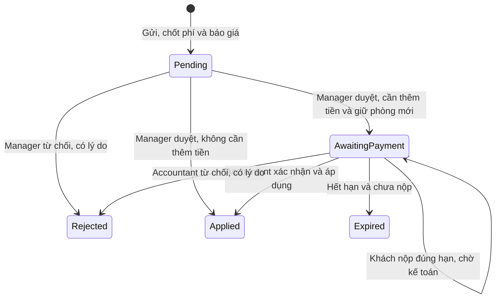

# Thiết kế rút gọn yêu cầu đổi/hủy đơn

Cập nhật **15/10/2026**, chốt Prompt 4C theo quyết định 14/10 và bổ sung 15/10. Đây là tài liệu thiết kế, **chưa sửa code, tạo hoặc áp migration**. Phương án rút gọn và các quyết định về chia phí, voucher, Pending cũ, concurrency đã được duyệt; sẵn sàng Prompt 5.

| Đã bỏ so với bản 15/10 trước đó | Thay thế và lý do |
|---|---|
| Tạo Booking mới, RootBookingId, ResultBookingId | Sửa đúng một Booking tại chỗ, giữ Id/mã đơn; đếm số lần đổi Applied trên BookingId |
| BookingDepositTransfers, CustomerDepositCredits, Bookings.DepositTransferredOut | Không chuyển tiền giữa các đơn; cập nhật cọc hiện tại, cộng phí vào ChangeFeeAmount; chặn xuống hạng nếu tổng mới nhỏ hơn cọc chuyển |
| BookingChangeRequestEvents | Dùng AuditLog sẵn có cho từng bước |
| BookingChangeRequestNights, QuoteSnapshotJson | Chỉ lưu NewTotalAmount; tính lại bằng PricingService trước duyệt/áp dụng |
| IsLegacy, SourceDepositAmount, QuotedDepositRate | Cột tiền nullable cho dữ liệu cũ; tỷ lệ lấy từ Booking, dữ liệu đầy đủ do service kiểm tra; không tạo cờ ngoại lệ |
| RowVersion | Status là concurrency token cho duyệt; job hết hạn dùng một UPDATE có điều kiện, kiểm tra khoản nộp hợp lệ |
| Migration hai pha | Một migration ChangeRequestWorkflow; chuyển Approved → Applied trong cửa sổ triển khai đã duyệt |
| Sửa IX_Payments_OneDepositPerBooking, FK ghép | PaymentType.AdditionalDeposit, FK ChangeRequestId đơn và unique riêng cho cọc bổ sung |
| Hạn kế toán xác nhận | Deadline là hạn khách nộp; nộp đúng hạn thì giữ phòng tới khi kế toán xử lý |

Nguồn đối chiếu: model Booking/BookingChangeRequest/Payment/RoomNight/Enums; ApplicationDbContext; RefundService, PricingService, BookingService, SettlementCalculator, VoucherService, BankMatchingService, ReceiptReviewService; SeedData.Operations.cs; AuditLog/BookingStatusHistory/Notification; tài liệu database mục 5.E và Q11. Số dòng code dưới đây tính theo HEAD `34ec9e6`.

## 1. Trạng thái, quyền và thời hạn



- Chọn `Applied` thay `Approved`: đã áp dụng hoàn chỉnh, không nhầm với mới qua bước quản lý. Migration đổi chuỗi Approved → Applied; không giữ enum Approved ở bản mới.
- `AwaitingPayment` có hai tình huống hiển thị, không thêm enum: **chưa nộp** hoặc **đã nộp, chờ kế toán**, suy từ Payment.AdditionalDeposit có Status Submitted/Approved và chứng cứ nộp đúng hạn.
- `PaymentDeadlineAt = DecidedAt + Booking:HoldMinutes`. BankAutoMatch dùng thời điểm giao dịch từ nguồn ngân hàng tin cậy; ManualReceipt dùng SubmittedAt do server ghi khi nhận bill. Nộp đúng hạn nghĩa `DecidedAt <= thời điểm nộp <= PaymentDeadlineAt`; job hết hạn khi `now > deadline` và không có khoản nộp hợp lệ đang chờ duyệt. Không nhận thời điểm bill do client tự khai.
- Đã nộp đúng hạn: không Expired chỉ vì kế toán duyệt sau deadline; giữ phòng tới khi Accountant xác nhận hoặc từ chối. FinanceConfirmedAt có thể muộn hơn PaymentDeadlineAt. Có cảnh báo chậm duyệt, không tự xác nhận tiền.
- Nếu webhook tới sau khi yêu cầu đã Expired và phòng đã nhả, vẫn lưu giao dịch thật và đưa vào hàng đợi đối chiếu/hoàn; không tự Applied hoặc chiếm lại phòng đã bán. Không thể bảo đảm giữ phòng cho giao dịch mà hệ thống chưa nhận biết; giao dịch đúng hạn nhưng báo trễ cần xử lý ngoại lệ có kiểm tra lại phòng.
- Từ chối khoản nộp ở luồng này kết thúc yêu cầu Rejected, nhả giữ phòng mới; không tự hủy Booking cũ, không dùng số lần từ chối bill cọc ban đầu của Booking để hết hạn yêu cầu đổi.
- Hủy thật: `Pending → Applied` sau Manager duyệt, dùng RefundAmount chốt lúc gửi. Applied không có nghĩa tiền hoàn đã chuyển; kế toán chuyển hoàn theo quy trình hiện có.

Policy riêng: đúng `EmployeePosition.Manager` duyệt nghiệp vụ, đúng `Accountant` xác nhận tiền; tài khoản và nhân viên phải đang hoạt động. Không tái dùng policy rộng đang cho Administrator/Owner/Consultant hoặc Manager xác nhận tiền. Người gửi không tự duyệt; người xác nhận tiền cũng không là người đã duyệt bước quản lý. Server suy actor từ principal, kiểm tra lại DB; không nhận ID người duyệt từ form.

Mỗi bước gửi, Manager duyệt/từ chối, Accountant xác nhận/từ chối, hệ thống hết hạn đều ghi AuditLog: AccountId, CreatedAt, OldValues/NewValues, ghi chú/lý do, RequestId và PaymentId liên quan. Action dùng Create/Update hiện có, loại bước đặt trong JSON. FinanceConfirmed* chỉ ghi khi xác nhận thành công; kế toán từ chối lưu actor/thời điểm/ghi chú trong AuditLog và RejectionReason, không giả ghi FinanceConfirmedAt.

## 2. Sửa đơn tại chỗ và xác nhận lại

Giữ nguyên Booking.Id, Code, CustomerId, HomestayId, DepositRate và CommissionRate snapshot. Thêm `ChangeDatesAndRoomType` bên cạnh ChangeDates/ChangeRoomType/Cancel; tên mới dài **22**, tăng RequestType từ nvarchar(20) lên **nvarchar(32)**. Status vẫn nvarchar(20).

Khi Applied một yêu cầu đổi, trong **một transaction**:

1. Kiểm tra Request/Booking và concurrency token Status; tính lại giá, kiểm tra phòng, tiền, quyền và số lần đổi trong transaction.
2. Cập nhật CheckIn/CheckOut/RoomTypeId/RoomId/TotalAmount; thay BookingNights bằng giá đêm mới, tổng khớp NewTotalAmount. Cập nhật CancellationPolicyId phù hợp lịch mới; phí đã chốt theo lịch/chính sách cũ không tính lại.
3. `DepositAmount = DepositCarriedOver + AdditionalDeposit`; `ChangeFeeAmount += ChangeFee`, đúng một lần. Không tạo Payment giả cho cọc chuyển hoặc phí trích từ cọc cũ.
4. Chuyển RoomNights giữ cho Request về BookingId hiện tại, giữ đêm giao nhau và nhả đêm cũ không dùng.
5. Nếu trước đó Confirmed, đưa về **Deposited**, đặt **ConfirmedAt = NULL**, ConfirmDeadlineAt = now + Booking:ConfirmMinutes, ConfirmAlertSentAt = NULL để chủ xác nhận lại theo BR-06. Nếu vốn Deposited, vẫn reset hạn/cảnh báo xác nhận nhưng không ghi lịch sử đổi trạng thái giả.
6. Ghi BookingStatusHistory khi trạng thái thực sự đổi; AuditLog chứa toàn bộ giá trị trước/sau và phí; Notification cho chủ và khách; Request → Applied rồi commit.

Cách `Deposited + ConfirmedAt NULL` **đúng CK_Bookings_ConfirmedAt hiện tại**; Confirmed phải có mốc. BookingService.Transitions hiện **chưa cho Confirmed → Deposited** và ApplyStatusAsync không xóa ConfirmedAt: Prompt 6 cần một thao tác đổi đã được bảo vệ quyền/transaction để thực hiện cả hai, không mở tùy ý chuyển lùi trạng thái cho mọi caller. Giữ DepositedAt của lần nhận cọc đầu để không giả ngày tiền vào; AuditLog/StatusHistory giữ mốc ConfirmedAt cũ.

## 3. Cột và quy mô schema

Tiền VND decimal(18,0); thời điểm datetime2(7) UTC; ngày lưu date và so theo Việt Nam. FK mới tới tài khoản dùng nvarchar(450), NO ACTION. Không tạo bảng mới.

| Bảng/cột mới | Kiểu | NULL/default | Ý nghĩa |
|---|---|---|---|
| Requests.FinanceConfirmedByAccountId | nvarchar(450), FK AspNetUsers | NULL | Accountant xác nhận thành công |
| Requests.FinanceConfirmedAt | datetime2(7) | NULL | Thời điểm xác nhận, có thể sau hạn nộp |
| Requests.FinanceNote | nvarchar(500) | NULL | Nội dung đối chiếu khi xác nhận |
| Requests.ChangeFee | decimal(18,0) | NULL | Phí của riêng lần đổi, chốt khi gửi |
| Requests.DepositCarriedOver | decimal(18,0) | NULL | Cọc còn lại sử dụng cho đơn sau khi sửa |
| Requests.AdditionalDeposit | decimal(18,0) | NULL | Phải đóng thêm, không âm |
| Requests.NewTotalAmount | decimal(18,0) | NULL | Tổng mới báo khách; Cancel dùng 0 |
| Requests.PaymentDeadlineAt | datetime2(7) | NULL | Hạn khách nộp khi có tiền thêm |
| Requests.RequestedByAccountId | nvarchar(450), FK AspNetUsers | NULL | Bắt buộc với yêu cầu mới, cũ có thể thiếu |
| Requests.NewRoomId | int, FK Rooms | NULL | Phòng chọn/giữ khi Manager duyệt |
| Requests.RejectionReason | nvarchar(500) | NULL | Lý do từ chối, riêng với ghi chú duyệt |
| Bookings.ChangeFeeAmount | decimal(18,0) | **NOT NULL DEFAULT 0** | Phí cộng dồn các lần đổi Applied |
| Payments.ChangeRequestId | int, FK Requests | NULL | Cọc bổ sung cho yêu cầu nào |
| RoomNights.BookingChangeRequestId | int, FK Requests | NULL | Chủ sở hữu tạm của đêm giữ |

`Requests` trong bảng là `BookingChangeRequests`. Tổng **14 cột thêm: 11 Requests + 1 Booking + 1 Payment + 1 RoomNight**. Đổi độ dài RequestType không tính là cột mới. Dùng Status của Request làm concurrency token, giống BankTransactions.MatchStatus; giữ concurrency token Status của Booking hiện có.

Các cột tiền mới nullable để giữ lịch sử không biết số tiền. CHECK chỉ kiểm không âm khi có giá trị. Service phải yêu cầu đủ ChangeFee/DepositCarriedOver/AdditionalDeposit/NewTotalAmount, người gửi và ghi chú cho **yêu cầu mới**; không để client gửi NULL hoặc gán người gửi tùy ý. Dữ liệu cũ thiếu tiền không được tự điền 0 và tiếp tục xử lý như báo giá mới.

## 4. Payments và RoomNights

### Cọc bổ sung, giữ nguyên index cọc ban đầu

- Thêm `PaymentType.AdditionalDeposit` (**17 ký tự**, vừa Payments.Type nvarchar(20)); không sửa IX_Payments_OneDepositPerBooking và không làm FK ghép. Một Booking có cọc Deposit ban đầu và nhiều cọc AdditionalDeposit của những yêu cầu khác nhau.
- Payments.ChangeRequestId NULL với mọi loại thường; bắt buộc khác NULL với AdditionalDeposit. FK đơn NO ACTION. Service kiểm tra Payment.BookingId bằng Request.BookingId, số tiền bằng AdditionalDeposit và yêu cầu đang AwaitingPayment. Không tạo Payment khi tiền thêm bằng 0.
- Unique filtered riêng: mỗi ChangeRequestId tối đa một AdditionalDeposit có Status khác Rejected. Giữ unique BankTransactionId, index hoàn tiền một lần mỗi Booking, CHECK Payments.Receipt hiện tại; ManualReceipt luôn cần ảnh, không thêm TRIM vào CHECK đó.
- Nội dung QR đề xuất `CR{RequestId} {Booking.Code}`. BankMatchingService phải nhận diện mã yêu cầu **trước** ExtractBookingCode/switch Booking.Status. Có dấu mã yêu cầu nhưng sai/không tồn tại thì đưa đối chiếu, không rơi xuống luồng cọc ban đầu. Kiểm tra cùng mã đơn, tài khoản nhận và số tiền; giao dịch lặp idempotent.
- Với AdditionalDeposit, BankMatchingService chỉ ghi/ghép Payment **Submitted** và BankTransaction; không gọi AttachApprovedDeposit, không tự Reviewed/FinanceConfirmed, không chuyển Booking → Deposited. Accountant xác nhận riêng sau đó.
- ReceiptReviewService nhận thêm requestId theo endpoint riêng, kiểm tra quyền sở hữu và hạn, ghi `Type = AdditionalDeposit`, `ChangeRequestId`, Amount theo yêu cầu, SubmittedAt server và ảnh. Request vẫn AwaitingPayment; **Booking đang Confirmed/Deposited không chuyển PaymentSubmitted**. UI suy trạng thái “đã nộp” từ Payment.
- Approve/Reject của khoản thêm phải đi nhánh Accountant và Request trước logic hiện đang đòi Booking.PaymentSubmitted; không dùng mảng Reviewers Manager/Accountant của bill cọc đầu cho khoản này. Khớp webhook vào bill đang Submitted cùng yêu cầu, không tạo khoản mở thứ hai; vẫn chờ Accountant.
- Tiền thiếu/dư, sai mã hoặc tới yêu cầu đã đóng vào hàng đợi đối chiếu; tiền thật không bị mất dấu khi transaction áp dụng Booking thất bại. Phạm vi đếm/review/report khoản Deposit ban đầu phải phân biệt AdditionalDeposit; báo cáo tổng tiền vào tính cả hai, không cộng ChangeFee lần nữa vì phí đã nằm trong tiền cọc đã nhận.

### Giữ phòng và concurrency

RoomNights giữ PK (RoomId, Date), thêm chủ thứ ba Request theo CHECK mục 5. Giữ phòng mới từ lúc Manager duyệt, đồng thời giữ đặt phòng cũ. Đêm trùng chính phòng/ngày của Booking dùng lại, không chèn trùng PK; chỉ thêm phần đích chưa thuộc Booking, không bỏ qua đêm của khách khác hoặc RoomBlock.

Expired/Rejected chỉ nhả đêm có BookingChangeRequestId tương ứng. Applied chuyển các đêm đó về **cùng BookingId**, giữ đêm giao nhau, nhả đêm cũ ngoài tập đích. Không tạo Booking hay RoomBlock thay thế để giữ phòng.

Giữ **Status concurrency token cho các bước duyệt**, xử lý DbUpdateConcurrencyException khi trạng thái đã đổi. Job hết hạn dùng **một UPDATE có điều kiện**, không đọc rồi mới cập nhật và không dùng lock hint. Điều kiện gồm Id, Status = 'AwaitingPayment', now > PaymentDeadlineAt và NOT EXISTS khoản nộp hợp lệ. Khoản nộp phải cùng Request/Booking, đúng số tiền, Status Submitted/Approved và có chứng cứ thời điểm nộp trong hạn: BankAutoMatch lấy BankTransaction.TransactionTime đã khớp; ManualReceipt lấy SubmittedAt server cùng ảnh bill.

UPDATE trả 0 dòng thì không nhả phòng hoặc ghi sự kiện hết hạn. Chỉ khi trả 1 dòng mới nhả RoomNights của Request và ghi AuditLog trong **cùng transaction**; rollback cả ba nếu lỗi. Job điền DecisionNote có nội dung nếu cần, giữ nguyên DecidedByAccountId/DecidedAt của Manager; actor/thời điểm hết hạn ghi ở AuditLog.

Ghi Payment Submitted không đổi Status nên token đơn lẻ không bảo vệ cuộc đua nộp tiền/hết hạn. Đường nộp tiền phải kiểm tra có điều kiện trên chính hàng Request vẫn AwaitingPayment trong cùng transaction trước khi lưu khoản nộp (có thể UPDATE Status = Status với điều kiện thời điểm nộp hợp lệ còn trong hạn), để tuần tự với UPDATE hết hạn; kiểm tra số dòng tác động. Nếu yêu cầu đã đóng thì không gắn khoản nộp như hợp lệ, giao dịch ngân hàng thật vẫn vào hàng đợi ngoại lệ. Test đồng thời hai đường là bắt buộc. Không dùng FinanceConfirmedAt < deadline. Mỗi Booking tối đa một yêu cầu Pending/AwaitingPayment bằng unique filtered, kể cả đang chờ kế toán.

## 5. SQL CHECK và index hoàn chỉnh để triển khai sau

**Chỉ là SQL trong tài liệu, chưa thực thi.** Một migration ChangeRequestWorkflow theo thứ tự: thêm cột/FK và tăng RequestType → gỡ 4 CHECK cũ Type/Status/Fields/Decision cùng RoomNights.Owner → đổi dữ liệu Approved → Applied → thêm các CHECK dưới đây và index. Phải gỡ Status cũ **trước UPDATE**, vì nó chưa cho phép Applied. Không DROP TABLE/DATABASE. Giữ CHECK RequestedBy hiện có và các CHECK Booking/Payment/Settlement khác.

Có **12 CHECK** trong phạm vi: 9 Requests, 1 Payments, 1 RoomNights, 1 Bookings; 5 thay biểu thức hiện có, 7 thêm mới. Mọi IS NULL dưới đây là chủ ý tương thích cột mới nullable, không phải cờ bỏ ràng buộc.

```sql
ALTER TABLE dbo.BookingChangeRequests DROP CONSTRAINT
    CK_BookingChangeRequests_Type, CK_BookingChangeRequests_Status,
    CK_BookingChangeRequests_Fields, CK_BookingChangeRequests_Decision;
ALTER TABLE dbo.RoomNights DROP CONSTRAINT CK_RoomNights_Owner;

UPDATE dbo.BookingChangeRequests SET [Status] = 'Applied' WHERE [Status] = 'Approved';

-- Thay CHECK hiện có: migration phải gỡ constraint cùng tên trước.
ALTER TABLE dbo.BookingChangeRequests WITH CHECK
ADD CONSTRAINT CK_BookingChangeRequests_Type CHECK (
[RequestType] IN ('ChangeDates', 'ChangeRoomType', 'ChangeDatesAndRoomType', 'Cancel')
);

-- Thay CHECK hiện có: migration phải gỡ constraint cùng tên trước.
ALTER TABLE dbo.BookingChangeRequests WITH CHECK
ADD CONSTRAINT CK_BookingChangeRequests_Status CHECK (
[Status] IN ('Pending', 'AwaitingPayment', 'Applied', 'Rejected', 'Expired')
);

-- Thay CHECK hiện có: migration phải gỡ constraint cùng tên trước.
ALTER TABLE dbo.BookingChangeRequests WITH CHECK
ADD CONSTRAINT CK_BookingChangeRequests_Fields CHECK (
([RequestType] = 'Cancel'
 AND [NewCheckIn] IS NULL AND [NewCheckOut] IS NULL AND [NewRoomTypeId] IS NULL)
OR ([RequestType] = 'ChangeDates'
 AND [NewCheckIn] IS NOT NULL AND [NewCheckOut] IS NOT NULL
 AND [NewCheckOut] > [NewCheckIn] AND [NewRoomTypeId] IS NULL)
OR ([RequestType] = 'ChangeRoomType'
 AND [NewRoomTypeId] IS NOT NULL AND [NewCheckIn] IS NULL AND [NewCheckOut] IS NULL)
OR ([RequestType] = 'ChangeDatesAndRoomType'
 AND [NewRoomTypeId] IS NOT NULL AND [NewCheckIn] IS NOT NULL AND [NewCheckOut] IS NOT NULL
 AND [NewCheckOut] > [NewCheckIn])
);

-- Thay CHECK hiện có: migration phải gỡ constraint cùng tên trước.
ALTER TABLE dbo.BookingChangeRequests WITH CHECK
ADD CONSTRAINT CK_BookingChangeRequests_Decision CHECK (
([Status] = 'Pending' AND [DecidedByAccountId] IS NULL AND [DecidedAt] IS NULL)
OR ([Status] <> 'Pending' AND [DecidedByAccountId] IS NOT NULL AND [DecidedAt] IS NOT NULL)
);

ALTER TABLE dbo.BookingChangeRequests WITH CHECK
ADD CONSTRAINT CK_BookingChangeRequests_Amounts CHECK (
([ChangeFee] IS NULL OR [ChangeFee] >= 0)
AND ([DepositCarriedOver] IS NULL OR [DepositCarriedOver] >= 0)
AND ([AdditionalDeposit] IS NULL OR [AdditionalDeposit] >= 0)
AND ([NewTotalAmount] IS NULL OR [NewTotalAmount] >= 0)
AND ([RefundAmount] IS NULL OR [RefundAmount] >= 0)
);

ALTER TABLE dbo.BookingChangeRequests WITH CHECK
ADD CONSTRAINT CK_BookingChangeRequests_Finance CHECK (
([Status] = 'Applied' AND [AdditionalDeposit] IS NOT NULL AND [AdditionalDeposit] > 0
 AND [FinanceConfirmedByAccountId] IS NOT NULL AND [FinanceConfirmedAt] IS NOT NULL
 AND [FinanceConfirmedAt] >= [DecidedAt]
 AND [FinanceNote] IS NOT NULL AND [FinanceNote] <> '')
OR (([Status] <> 'Applied' OR [AdditionalDeposit] IS NULL OR [AdditionalDeposit] = 0)
 AND [FinanceConfirmedByAccountId] IS NULL AND [FinanceConfirmedAt] IS NULL AND [FinanceNote] IS NULL)
);

ALTER TABLE dbo.BookingChangeRequests WITH CHECK
ADD CONSTRAINT CK_BookingChangeRequests_ActorSeparation CHECK (
([RequestedByAccountId] IS NULL OR [DecidedByAccountId] IS NULL
 OR [RequestedByAccountId] <> [DecidedByAccountId])
AND ([RequestedByAccountId] IS NULL OR [FinanceConfirmedByAccountId] IS NULL
 OR [RequestedByAccountId] <> [FinanceConfirmedByAccountId])
AND ([DecidedByAccountId] IS NULL OR [FinanceConfirmedByAccountId] IS NULL
 OR [DecidedByAccountId] <> [FinanceConfirmedByAccountId])
);

ALTER TABLE dbo.BookingChangeRequests WITH CHECK
ADD CONSTRAINT CK_BookingChangeRequests_Notes CHECK (
([Status] = 'Pending' OR
 ([DecisionNote] IS NOT NULL AND [DecisionNote] <> ''))
AND ([Status] <> 'Rejected' OR
 ([RejectionReason] IS NOT NULL AND [RejectionReason] <> '')
 OR ([RejectionReason] IS NULL AND [DecisionNote] IS NOT NULL AND [DecisionNote] <> ''))
);

ALTER TABLE dbo.BookingChangeRequests WITH CHECK
ADD CONSTRAINT CK_BookingChangeRequests_PaymentDeadline CHECK (
([Status] = 'Pending' AND [PaymentDeadlineAt] IS NULL)
OR ([Status] IN ('AwaitingPayment', 'Expired')
 AND [AdditionalDeposit] IS NOT NULL AND [AdditionalDeposit] > 0
 AND [PaymentDeadlineAt] IS NOT NULL AND [PaymentDeadlineAt] > [DecidedAt])
OR ([Status] = 'Applied'
 AND (([AdditionalDeposit] IS NULL AND [PaymentDeadlineAt] IS NULL)
      OR ([AdditionalDeposit] = 0 AND [PaymentDeadlineAt] IS NULL)
      OR ([AdditionalDeposit] > 0 AND [PaymentDeadlineAt] IS NOT NULL
          AND [PaymentDeadlineAt] > [DecidedAt])))
OR ([Status] = 'Rejected'
 AND ([PaymentDeadlineAt] IS NULL
      OR ([AdditionalDeposit] IS NOT NULL AND [AdditionalDeposit] > 0
          AND [PaymentDeadlineAt] > [DecidedAt])))
);

ALTER TABLE dbo.Payments WITH CHECK
ADD CONSTRAINT CK_Payments_ChangeRequest CHECK (
([Type] = 'AdditionalDeposit' AND [ChangeRequestId] IS NOT NULL)
OR ([Type] <> 'AdditionalDeposit' AND [ChangeRequestId] IS NULL)
);

-- Thay CHECK hiện có: migration phải gỡ constraint cùng tên trước.
ALTER TABLE dbo.RoomNights WITH CHECK
ADD CONSTRAINT CK_RoomNights_Owner CHECK (
([BookingId] IS NOT NULL AND [RoomBlockId] IS NULL AND [BookingChangeRequestId] IS NULL)
OR ([BookingId] IS NULL AND [RoomBlockId] IS NOT NULL AND [BookingChangeRequestId] IS NULL)
OR ([BookingId] IS NULL AND [RoomBlockId] IS NULL AND [BookingChangeRequestId] IS NOT NULL)
);

ALTER TABLE dbo.Bookings WITH CHECK
ADD CONSTRAINT CK_Bookings_ChangeFeeAmount CHECK (
[ChangeFeeAmount] >= 0
);
```

- Finance yêu cầu đủ Accountant khi Applied và biết AdditionalDeposit > 0; các Applied cũ có tiền NULL vẫn hợp lệ về cấu trúc, không giả gán kế toán. Service mới không được lợi dụng nhánh NULL.
- Notes dùng DecisionNote làm lý do cho Rejected cũ chưa có RejectionReason; mới bị từ chối phải ghi RejectionReason và AuditLog actor/thời điểm thực.
- ActorSeparation chấp nhận người gửi NULL trong lịch sử. Quyền Manager/Accountant, người gửi mới bắt buộc và quan hệ đúng Booking vẫn phải kiểm ở service; CHECK không truy vấn bảng Employee.
- PaymentDeadline chỉ ràng buộc sự hiện diện/hạn sau quyết định, **không** xác định khách đã nộp bằng CHECK liên bảng. Job/service dùng chứng cứ Payment/BankTransaction; Applied cần tiền thêm vẫn giữ deadline cũ, FinanceConfirmedAt được phép muộn.
- NewRoomId bắt buộc tại service khi giữ/áp dụng đổi; không thêm CHECK Result hay bắt các dòng Applied cũ phải có phòng/snapshot mới.

```sql
CREATE UNIQUE INDEX IX_BookingChangeRequests_OneActivePerBooking
ON dbo.BookingChangeRequests (BookingId)
WHERE [Status] IN ('Pending', 'AwaitingPayment');

CREATE UNIQUE INDEX IX_Payments_OneAdditionalDepositPerChangeRequest
ON dbo.Payments (ChangeRequestId)
WHERE [Type] = 'AdditionalDeposit' AND [Status] <> 'Rejected';
```

Không sửa IX_Payments_OneDepositPerBooking; không thêm CHECK Settlements.ConfirmedAt. Biểu thức của cả 12 CHECK dùng chuỗi thường '...', không dùng tiền tố Unicode hoặc hàm xử lý chuỗi riêng; kiểm tra có nội dung bằng IS NOT NULL AND <> '', dùng nguyên biểu thức trong model/test SQL Server và SQLite. Riêng Notes cho dùng DecisionNote khi RejectionReason NULL để giữ lý do của dòng Rejected cũ. Khác biệt đã biết: chuỗi chỉ có khoảng trắng bị SQL Server chặn khi so với '', SQLite cho qua; service kiểm tra chuỗi trắng trên cả hai hệ. DDL ALTER TABLE WITH CHECK ở trên minh họa triển khai SQL Server; SQLite tạo các CHECK này qua model/EnsureCreated, không chạy nguyên DDL SQL Server.

## 6. Service, giá và audit

- Đơn đang Deposited/Confirmed, chưa nhận phòng, chưa có SettlementItem (kể cả Draft), không có hoàn tiền thật hoặc thay đổi tiền chưa xử lý. Cùng homestay, loại/phòng hoạt động, đủ sức chứa, phòng còn trọn khoảng; kiểm lại trong transaction.
- `Booking:ChangeMinDaysBefore = 3`: đổi khi ngày nhận phòng cũ còn ít nhất 3 ngày theo Việt Nam; hủy thật trước nhận phòng vẫn tính BR-04, không áp hạn đổi 3 ngày. `Booking:MaxChangesPerBooking = 2`: đếm Request đổi đã Applied trên **chính BookingId**, không tính Cancel/Rejected/Expired.
- Ngày đích không quá khứ, CheckOut > CheckIn, cả khoảng nằm trong 90 ngày từ ngày gửi và không vượt MaxNights. Hai options mới có [Range] và ValidateOnStart như DepositRate; đề xuất giới hạn cấu hình lần lượt 1..90 ngày và 1..10 lần, mặc định 3/2.
- Lúc gửi: RefundService.QuoteCancellationAsync chốt phí đổi ngày hoặc RefundAmount hủy. Chỉ đổi loại phòng thì phí 0. Chốt NewTotalAmount bằng PricingService, chỉ lưu tổng mới và các khoản tiền yêu cầu, không bảng giá đêm/JSON quote riêng.
- Manager duyệt: tính lại giá bằng PricingService. Tổng khác NewTotalAmount thì **Rejected** với lý do **“giá đã thay đổi, vui lòng gửi lại yêu cầu”**, không giữ phòng hay thu tiền trên quote cũ.
- Vì không lưu giá từng đêm, lúc Applied sau bước kế toán cũng tính lại và so tổng; chỉ dùng các Nights của kết quả có tổng bằng quote. Nếu giá đổi sau khi khách nộp, không ép áp dụng sai tổng: ghi từ chối/hoàn xử lý khoản thêm trong hàng đợi, nhả giữ mới, Booking và phí cũ không đổi. Không rollback mất chứng cứ tiền đã vào.
- Giữ DepositRate/CommissionRate của Booking. Trong thời gian có yêu cầu mở, mọi luồng khác sửa các trường giá/cọc/voucher/lịch phải kiểm tra trạng thái và kết thúc yêu cầu trong transaction hoặc từ chối thao tác, tránh quote phí trở nên sai. AuditLog old/new cho biết dữ liệu lúc gửi, không dùng log thay cho snapshot giá đêm.
- Accountant xác nhận Payment và áp dụng toàn bộ tiền/phòng/Booking/Request/history/audit/notification trong một transaction. Trùng phòng, concurrency hoặc CHECK lỗi rollback toàn bộ thay đổi nghiệp vụ. Ghi nhận giao dịch ngân hàng thật idempotent trước đó; không mất giao dịch nếu áp dụng thất bại.
- Hủy thật nhận RefundAmount đã chốt, kiểm tra vẫn <= DepositAmount - DiscountAmount, ghi Cancelled và nhả phòng. Không gọi lại QuoteCancellationAsync theo ngày duyệt như ApplyStatusAsync hiện làm. Voucher hủy thật vẫn theo quy tắc hiện có, hoàn tiền thật idempotent bởi kế toán.
- BookingStatusHistory chỉ dành cho đổi trạng thái Booking. AuditLog dành cho mọi bước Request, không thêm bảng event. Notification cho chủ khi Applied đổi/hủy, kèm mã đơn giữ nguyên, ngày/phòng cũ/mới và yêu cầu xác nhận lại; khách và người xử lý nhận thông báo trạng thái/tiền.

## 7. Công thức tiền, voucher và đối soát

### 7.1. Không voucher: công thức đã chốt

Ký hiệu G là DepositAmount trước đổi, D là DiscountAmount, C = G - D là tiền thực còn gắn với cọc. Với D = 0, C = G. `R = QuoteCancellationAsync(booking).RefundAmount` tại lúc gửi; T là NewTotalAmount; d/c là DepositRate/CommissionRate snapshot.

```text
Đổi ngày hoặc đổi cả hai:
    F = ChangeFee = C - R
    K = DepositCarriedOver = R
Chỉ đổi loại phòng:
    F = 0
    K = C
Mục tiêu cọc P = RoundToThousand(d × T)
A = AdditionalDeposit = max(0, P - K)
DepositAmount sau đổi G' = K + A
ChangeFeeAmount sau đổi = ChangeFeeAmount cũ + F
Tiền trả tại homestay = T - G'
```

Nếu `T < K`, service chặn: **“Tổng tiền mới nhỏ hơn cọc chuyển sang; vui lòng chọn lịch hoặc loại phòng khác.”** Không tạo số dư cọc, không hoàn tiền mặt. Với T >= K, d <= 1 và quy tắc làm tròn, vẫn kiểm tra P <= T; nếu làm tròn nghìn khiến P > T thì từ chối báo giá không hợp lệ, không tự phá CHECK.

### 7.2. Voucher: chưa cho đổi đơn có giảm giá

**Đã chốt:** mọi yêu cầu đổi ngày, đổi loại phòng hoặc cả hai bị chặn khi Booking.DiscountAmount > 0. Service báo đúng: **“Đơn dùng voucher, vui lòng liên hệ nhân viên”**. Kiểm tra lúc gửi và trước duyệt/áp dụng; không tạo yêu cầu đổi mới cho đơn này, không thay DiscountAmount/VoucherId hoặc phục hồi số dư voucher. **Hủy thật vẫn theo quy tắc hiện có**, kể cả tính tiền hoàn và phục hồi voucher.

Hỗ trợ đổi đơn có voucher: để sau nếu cần.

CHECK Booking hiện có phải giữ; yêu cầu đổi được áp dụng chỉ có D = D' = 0:

| CHECK | Điều kiện sau đổi |
|---|---|
| Amounts | T > 0, 0 <= K + A <= T |
| Discount | DiscountAmount = 0 < K + A, do đó cọc mới phải > 0 |
| Voucher | DiscountAmount = 0 và VoucherId = NULL; không xóa giảm giá của đơn có voucher để lách điều kiện đổi |
| Refund | RefundAmount trên **Booking** NULL khi chưa hoàn tiền; khi hủy, 0 <= refund chốt <= G' - D'. Không nhầm RefundAmount trên Request là tiền đã hoàn |
| DepositRate/CommissionRate | Giữ snapshot hợp lệ, không thay theo cấu hình giá hiện tại |

Không xóa dấu vết hoàn thật để vượt CHECK. Từ chối đổi nếu đã có refund/đối soát không tương thích. Các cọc/fee đều là decimal, làm tròn nghìn theo PricingService; phí hoa hồng đối soát làm tròn đồng như code hiện tại.

### 7.3. Bốn ví dụ, CommissionRate 12%, không voucher

| Trường hợp | Cọc cũ | Tổng mới | Phí F | Cọc chuyển K | Thêm A | Cọc sau | Trả tại homestay | Fuji hưởng / chủ nhận **của phí** |
|---|---:|---:|---:|---:|---:|---:|---:|---|
| Đổi ngày trước 10 ngày, hoàn 100% | 600.000 | 2.000.000 | 0 | 600.000 | 0 | 600.000 | 1.400.000 | 0 / 0 |
| Đổi ngày trước 4 ngày, hoàn 50% | 600.000 | 2.000.000 | 300.000 | 300.000 | 300.000 | 600.000 | 1.400.000 | **36.000 / 264.000** |
| Chỉ lên hạng | 600.000 | 3.000.000 | 0 | 600.000 | 300.000 | 900.000 | 2.100.000 | 0 / 0 |
| Chỉ xuống hạng | 600.000 | 1.000.000 | 0 | 600.000 | 0 | 600.000 | 400.000 | 0 / 0 |

Tỷ lệ cọc 30%. Ví dụ bị phạt: 600.000 cũ + 300.000 nộp thêm = 600.000 cọc sau + 300.000 phí; không thu phí thêm lần nữa. Hạ xuống tổng 500.000 khi K = 600.000 phải bị chặn.

### 7.4. SettlementCalculator: phí thuộc cả Fuji và chủ

**Chốt 15/10: phí đổi ngày chia theo CommissionRate của đơn trên phần phí.** Với `Fsum = Booking.ChangeFeeAmount`:

```text
feeCommission = min(Round(Fsum × CommissionRate, 0, AwayFromZero), Fsum)
feePayout = Fsum - feeCommission
```

Khi hủy, đơn không còn được ở nên Fuji tính hoa hồng của cả đơn, giới hạn bởi cọc giữ lại. Khi đổi ngày, đơn vẫn được ở và phần đặt phòng hiện tại đã tính hoa hồng của cả đơn; vì vậy phần phí chỉ nhân CommissionRate, không tính hoa hồng cả đơn thêm lần nữa. Ví dụ tổng 2.000.000, phí 300.000, tỷ lệ 12%: công thức hủy lấy min(240.000, 300.000) = 240.000; công thức phí đổi đã duyệt lấy 36.000, chủ nhận 264.000.

Code hiện tại dòng 47 tính hoa hồng phần cọc hiện tại bằng `min(Round(TotalAmount × CommissionRate), retained)`, **không** phải retained × rate. Giữ công thức này cho phần đặt phòng hiện tại, nhưng phí đổi dùng **Fsum × rate** theo quyết định mới, không dùng TotalAmount × rate thêm một lần.

Giữ phần cơ sở của ItemFor (dòng 39–49) với cọc hiện tại G', D', refund hiện tại và percent suy theo code; đặt baseRetained/baseCommission/baseDiscount. Khi baseRetained = 0 thì baseCommission = 0, không return sớm nếu còn phí. Kết quả snapshot:

```text
SettlementItem.DepositAmount = G' + Fsum
SettlementItem.RefundAmount = refund hiện tại
SettlementItem.RetainedAmount = baseRetained + Fsum
SettlementItem.CommissionAmount = baseCommission + feeCommission
SettlementItem.PayoutAmount = (baseRetained - baseCommission) + feePayout
SettlementItem.DiscountAmount = baseDiscount
SettlementItem.RoomAmount = TotalAmount hiện tại
```

`DepositAmount` trên SettlementItem là “cọc hiện tại + phí đổi đã giữ”, không ghi đè Booking.DepositAmount bằng tổng này. Do baseRetained <= G' và mỗi commission <= retained tương ứng, CHECK SettlementItems (retained <= deposit, payout = retained - commission) vẫn đúng; tổng ở Settlements cũng cân bằng. Một Booking vẫn chỉ có một SettlementItem, không thêm bảng/cột đối soát hoặc một dòng phí trùng BookingId.

Phải sửa các vùng code sau trong Prompt 6:

- `SettlementCalculator.cs:27–36`: không loại mất phí Fsum > 0 chỉ vì trạng thái cuối Rejected/Expired không có phần cọc cơ sở; gom phí ở trạng thái kết thúc, không đối soát khi Booking còn Deposited/Confirmed. Có thể dùng ItemType.CancelledRetained cho dòng chỉ có phí giữ lại.
- `:39–49`: tách baseRetained/baseCommission/baseDiscount; dời điều kiện return `retained <= 0` ở 43–45 tới **sau** cộng phí; thêm feeCommission/feePayout. Hủy hoàn 100% cọc hiện tại vẫn đối soát phí đổi trước đó.
- `:56–63`: gán snapshot theo công thức trên; không cộng phí vào giá phòng hoặc nhân đôi refund/voucher.
- `:78–88`: giữ nhóm theo **CheckOut hiện tại** (D7) và cộng các trường snapshot đã gồm phí. Màn đối soát phải giải thích phần phí/tiền cọc, không mô tả tổng snapshot là cọc mới của Booking.

Ví dụ thứ hai nếu đơn cuối cùng Completed: baseRetained 600.000, baseCommission 240.000; cộng phí 300.000 với commission 36.000 ⇒ retained 900.000, tổng hoa hồng 276.000, chủ nhận 624.000. Nếu sau đó hủy hoàn 100% cọc hiện tại thì baseRetained 0; phí vẫn retained 300.000, Fuji 36.000, chủ 264.000. Không tự hoàn lại phí của lần đổi đã Applied khi chủ từ chối lịch mới; khoản bồi thường/hoàn phí đặc biệt cần quyết định riêng.

## 8. SELECT dữ liệu cũ và một migration

Đã chạy SELECT trong lượt **4B ngày 15/10/2026** trên v5 và DeployTest, rồi dùng SELECT mô phỏng các CHECK của bản 4B (trước khi chuẩn hóa cú pháp chuỗi ở 4C): chỉ ánh xạ Approved → Applied trong kết quả; cột nullable mới giả lập NULL, ChangeFeeAmount giả lập DEFAULT 0. **Không UPDATE/DDL/seed** và không gọi app. Lượt 4C chỉ sửa tài liệu, không truy vấn lại database; số liệu dưới đây là kết quả 4B, không phải kiểm tra mới.

| Database | Migration hiện tại | Số Request | Pending / Approved / Rejected hiện tại | Vi phạm CHECK sau ánh xạ | Trùng Booking có nhiều yêu cầu mở |
|---|---:|---:|---|---:|---:|
| HomestayBooking_v5 | 7 | 5 | 3 / 1 / 1 | **0** | 0 |
| HomestayBooking_DeployTest | 7 | 5 | 3 / 1 / 1 | **0** | 0 |

Cả 4 lệnh sqlcmd (đọc metadata và preview cho hai DB) **exit 0**. Preview kiểm 9 CHECK Request, CHECK liên kết Payment với cột mới NULL, RoomNights Owner với cột mới NULL, ChangeFeeAmount = 0. Payment.Type hiện nvarchar(20), đủ AdditionalDeposit 17; RequestType phải tăng lên 32. Số liệu/SQL gốc: `/private/tmp/LTW-change-request-short-eerknlg0/`.

- Mỗi DB có Id 2 Rejected và Id 3 Approved do **Owner**, có đủ DecidedByAccountId/DecidedAt/DecisionNote. Đây là quyền ở tầng service chứ không có CHECK chức vụ: **giữ nguyên actor lịch sử**, đổi riêng Approved → Applied trong migration; không giả thay Owner bằng QL001. Hai dòng đóng chỉ đọc và hiển thị “quyết định theo luồng cũ”. Seed mới dùng Manager, không sửa actor của dữ liệu đã tồn tại khi app chạy lại.
- Ba Pending Id 1/4/5: **giữ nguyên, không sửa dữ liệu trong migration**. Service nhận diện Pending thiếu RequestedByAccountId hoặc thiếu bất kỳ ChangeFee/DepositCarriedOver/AdditionalDeposit/NewTotalAmount là **“yêu cầu cũ, cần gửi lại”**. Hiện trên màn quản lý nhưng **không được duyệt**, Manager chỉ được **từ chối với lý do bắt buộc**; lưu đúng người/thời điểm/lý do vào DecidedByAccountId/DecidedAt/DecisionNote/RejectionReason và AuditLog khi thao tác thật. Không cần người gửi để từ chối yêu cầu cũ; không gán người gửi hoặc báo giá giả. Các dòng này **vẫn nằm trong unique index yêu cầu mở** tới khi Manager từ chối qua giao diện Prompt 7, sau đó khách có thể gửi lại.
- Một migration **ChangeRequestWorkflow**: thêm 14 cột, nới RequestType, đổi Approved → Applied (1 dòng/DB theo dữ liệu vừa đọc), thay/thêm CHECK, FK và index. NULL tiền cũ giữ nguyên; không đánh dấu hoặc tạo cờ legacy, không gán xác nhận kế toán giả, không bịa phí lịch sử để truy thu. Default ChangeFeeAmount 0 chỉ áp phí của luồng mới.
- Triển khai một lần trong cửa sổ dừng binary cũ: app cũ không đọc được Applied, code mới không còn Approved. Trước khi cho phép chạy trên v5 phải có duyệt migration/backup/thử restore riêng. Chạy lại SELECT trước triển khai; nếu trạng thái hay dữ liệu thay đổi thì báo lại, không tự nới CHECK.

### Các dòng seed cần sửa chính xác

Trong `HomestayBooking.Web/Data/SeedData.Operations.cs`, theo số dòng hiện tại:

| Vùng/dòng | Thay đổi cần làm trong Prompt 5/6 |
|---|---|
| 214–228 | Sửa mô tả quyền; bỏ Include Owner.Account nếu không dùng, lấy thêm Manager QL001 và Consultant NV001 đang hoạt động. Chọn mẫu không voucher theo quyết định 4C; giữ đủ ngày trước nhận phòng |
| 236–264, helper ChangeDates | Điền RequestedByAccountId (Customer.Account nếu có, hoặc đúng nhân viên gửi thay và ActorType.Employee); tính đủ 4 cột tiền/NewTotal tại CreatedAt, theo rule ngày Việt Nam lúc gửi, không dùng đồng hồ ngày duyệt. Không thêm QuoteSnapshotJson/giá đêm yêu cầu |
| **268** | Bỏ lambda `owner(...)`; actor quyết định lấy từ **QL001.Person.Account** |
| **270–271**, ca 1 | Đổi “chờ chủ duyệt” thành chờ Manager; Pending có người gửi và đủ tiền, Decision/Finance/deadline NULL |
| **273–282**, ca 2 | Nhân viên gửi là NV001; **279** DecidedBy từ Owner đổi sang QL001, giữ 280 thời điểm quyết định, 281 ghi chú; thêm RejectionReason và đủ tiền, Finance NULL |
| **285–304**, ca 3 | **299** Approved → Applied; **300** Owner → QL001; có RequestedBy, NewRoomId, NewTotal, ChangeFee/Carry/Additional đầy đủ. Chọn mẫu không cần đóng thêm để Finance NULL hợp lệ; nếu chọn có thêm thì phải có Payment.AdditionalDeposit và Accountant KT001 xác nhận thật trong fixture. Đơn giữ mã, về Deposited/ConfirmedAt NULL, giá đêm/phòng và ChangeFeeAmount phản ánh đúng Applied, có history/audit |
| **307–320**, ca 4 | Đổi loại phòng Pending: có RequestedBy và đủ tiền; ChangeFee 0; tính cọc bổ sung theo tổng mới, không chỉ PriceDifference; NewRoomId/deadline chưa chọn |
| **323–337**, ca 5 | NV001 gửi hủy, RefundAmount chốt theo **CreatedAt**, 4 cột tiền dùng 0 cho Cancel; không có trường New*, không tạo phí đổi |
| **340–341** | Lưu seed Request cùng thay đổi Booking/BookingNights/RoomNights/Payment/history/audit liên quan trong một transaction, không để một bản ghi Applied mà đơn chưa áp dụng |

Không chỉ đổi literal 299/300 để làm test pass. Nếu thiếu dữ liệu cho ca Applied thì chọn lại fixture hợp lệ, không gán fee/finance giả. Các mốc này mô tả code **cần sửa**, lượt hiện tại chỉ sửa tài liệu.

## 9. Prompt 5–7 và so sánh quy mô

| Phạm vi so sánh | Bản trước rút gọn | Bản rút gọn |
|---|---:|---:|
| Cột thêm trên các bảng sẵn có | **21** (18 Request + 3 bảng khác) | **14** (11 Request + Booking/Payment/RoomNight) |
| Bảng mới | **4** | **0** |
| Cột trong bảng mới | Ít nhất **20** ở 3 bảng đã liệt kê; CustomerDepositCredits chưa định nghĩa đủ cột | **0** |
| CHECK viết rõ trong bản đề xuất | **15** (14 mục 5 + 1 tiền chuyển ở mục 7; chưa tính CHECK bảng mới chỉ mô tả) | **12** (5 sửa, 7 thêm) |
| Migration workflow | 2 pha đề xuất | **1: ChangeRequestWorkflow** |

Không gán số cột/CHECK chính xác cho phần bảng credit mà bản cũ chưa định nghĩa. Nếu hiện trạng vẫn 45 bảng/368 cột/37 CHECK thì sau bản rút gọn dự kiến **45 bảng, 382 cột, 44 CHECK**, thêm 5 FK. Không có thêm cột đối soát, lịch sử hay tài khoản; index thông thường theo FK/deadline được EF sinh và kiểm đếm khi tạo migration.

### Prompt 5 — Database

- `Models/Entities/BookingChangeRequest.cs`: 11 cột, Status concurrency token; `Booking.cs`: ChangeFeeAmount; `Payment.cs`: ChangeRequestId; `RoomNight.cs`: BookingChangeRequestId; `Enums.cs`: ChangeDatesAndRoomType, Applied/AwaitingPayment/Expired và AdditionalDeposit.
- `Data/ApplicationDbContext.cs`, một bộ `Data/Migrations/*_ChangeRequestWorkflow.cs` + Designer + snapshot: 14 cột, RequestType 32, 5 FK NO ACTION, 12 CHECK theo mục 5 và hai unique filtered. Không sửa index cọc ban đầu, không FK ghép, không bảng mới.
- `Data/SeedData.Operations.cs` đúng các vùng mục 8; `HomestayBooking.Tests/Data/DatabaseConstraintTests.cs`, SeedDataTests/SeedDataSqliteTests và helper fixture khi cần: đủ dữ liệu mới, không skip/xóa ca; SQL thật kiểm NULL, enum, Payment linkage, unique từng Request, active từng Booking, ba chủ RoomNight, mapping Approved và lịch sử Owner.
- `database/schema.sql`, verify.sql, README, tests/constraints.sql và script workflow mới: cập nhật số liệu, guard đúng database thử, mọi thử ghi chụp COUNT_BIG/CHECKSUM_AGG trước/sau và rollback. Thử trên ConstraintTest/DeployTest trước; không áp v5/RestoreCheck khi chưa có phép riêng.

### Prompt 6 — Service

- Thêm `Services/BookingChangeRequestService.cs`, DTO/validation; `BookingInfrastructure.cs` hai options Range; Program.cs/policy và appsettings; chỉ exact Manager/Accountant.
- Sửa `BookingService.cs` thao tác đổi tại chỗ/xác nhận lại và hủy dùng quote chốt; PricingService/RefundService dùng lại; `SettlementCalculator.cs` theo mục 7, `AccountingService.cs`, `BankMatchingService.cs`, `ReceiptReviewService.cs` cho AdditionalDeposit và thời điểm nộp; `BackgroundJobs/BookingTimeoutJob.cs` xử lý request/job cảnh báo đúng phạm vi; NotificationService/AuditLog hiện có.
- Test biên 3 ngày/2 lần/90 ngày, cả ba loại đổi và hủy, đổi lần 2 trên cùng mã, 4 ví dụ tiền, fee chia 12% và cộng dồn; Confirmed → Deposited/ConfirmedAt NULL; giá đổi trước/sau nộp; chặn tổng dưới cọc; Pending cũ thiếu người gửi hoặc tiền chỉ được Manager từ chối với lý do thật, không được duyệt và vẫn chiếm unique mở trước khi từ chối.
- Test deadline: bill/tiền đúng hạn giữ phòng khi Accountant duyệt hôm sau, chưa nộp thì Expired, FinanceConfirmedAt sau deadline hợp lệ; webhook/bill lặp, tự duyệt/quyền rộng, UPDATE hết hạn có điều kiện/NOT EXISTS, nộp tiền và job chạy đồng thời, giao đêm phòng, rollback toàn bộ. Hủy hoàn 100% cọc vẫn đối soát phí cũ; không nhân đôi phí/thu/hoàn.
- Test chặn cả ba loại đổi khi DiscountAmount > 0 với đúng thông báo ở mục 7.2; hủy thật vẫn chạy tiền hoàn/voucher như cũ. Không phục hồi voucher hoặc xóa giảm giá để cho đổi, không sửa CHECK để che công thức sai.

### Prompt 7 — Giao diện

- Khách: chặn đổi đơn có DiscountAmount > 0 với đúng thông báo mục 7.2, hủy vẫn theo luồng cũ; form đổi ngày/loại/kết hợp và hủy; hiển thị phí, cọc chuyển, thêm tiền, cảnh báo xuống hạng bị chặn; giữ mã đơn; QR có CR-ID, bill theo Request; phân biệt “chưa nộp”/“đã nộp, chờ kế toán” trong AwaitingPayment.
- Manager: Pending, reprice, phòng còn, quyết định/ghi chú; yêu cầu cũ thiếu người gửi hoặc tiền hiện nhãn “yêu cầu cũ, cần gửi lại”, chỉ có thao tác từ chối bắt buộc lý do, không có thao tác duyệt; Accountant: khoản thêm Submitted kể cả đã qua deadline nộp, giao dịch/bill, xác nhận/từ chối có lý do; hàng đợi ngoại lệ tiền muộn/sai/thiếu/dư.
- Chủ: Notification lịch/phòng cũ–mới và xác nhận lại trên cùng mã; không có quyền duyệt Request. Màn đối soát hiển thị phí và phần Fuji/chủ nhận đúng snapshot.
- Controllers/Areas tương ứng, ViewModels, Views, Resources/resx, JS báo giá/đếm hạn; test tích hợp phân quyền, sở hữu, antiforgery và double-submit, không nới quyền để UI chạy.

## 10. Trạng thái thiết kế

Đã chốt toàn bộ, sẵn sàng Prompt 5.
