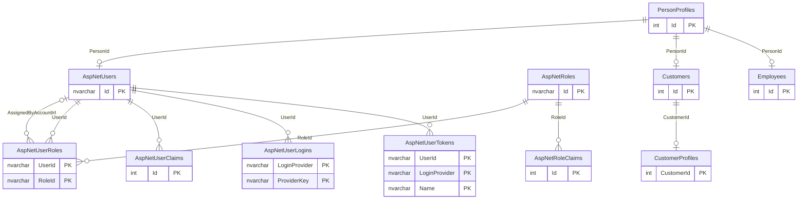
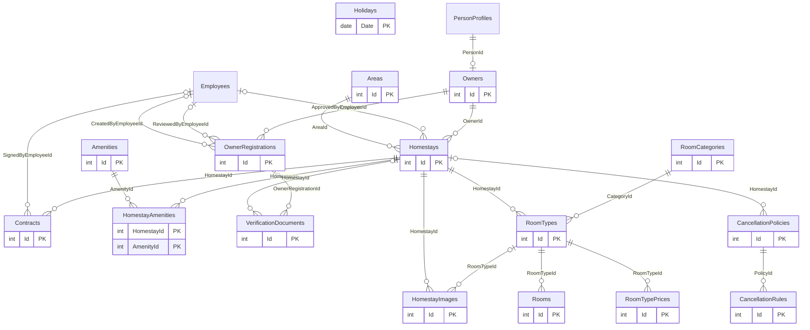
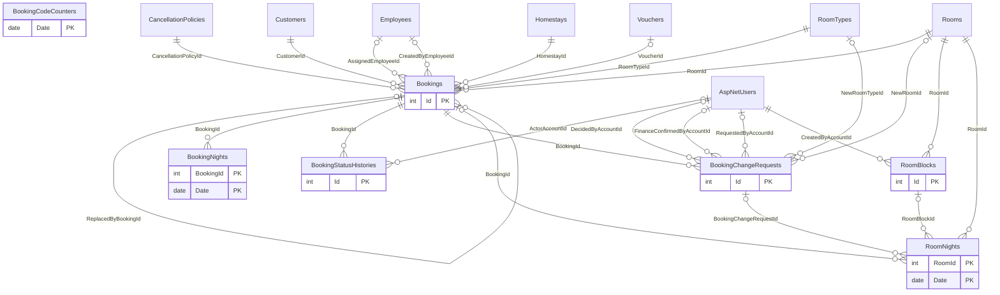
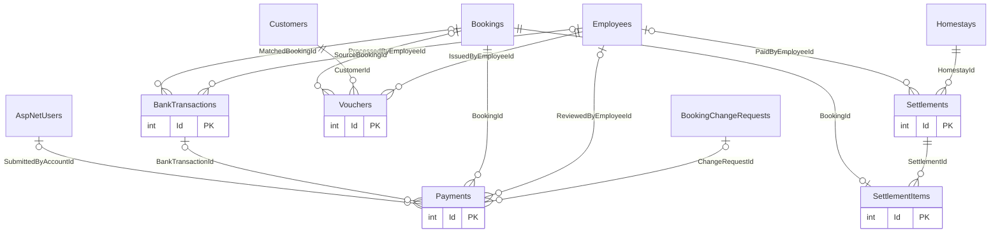
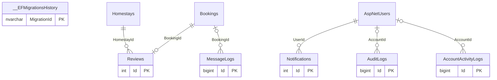
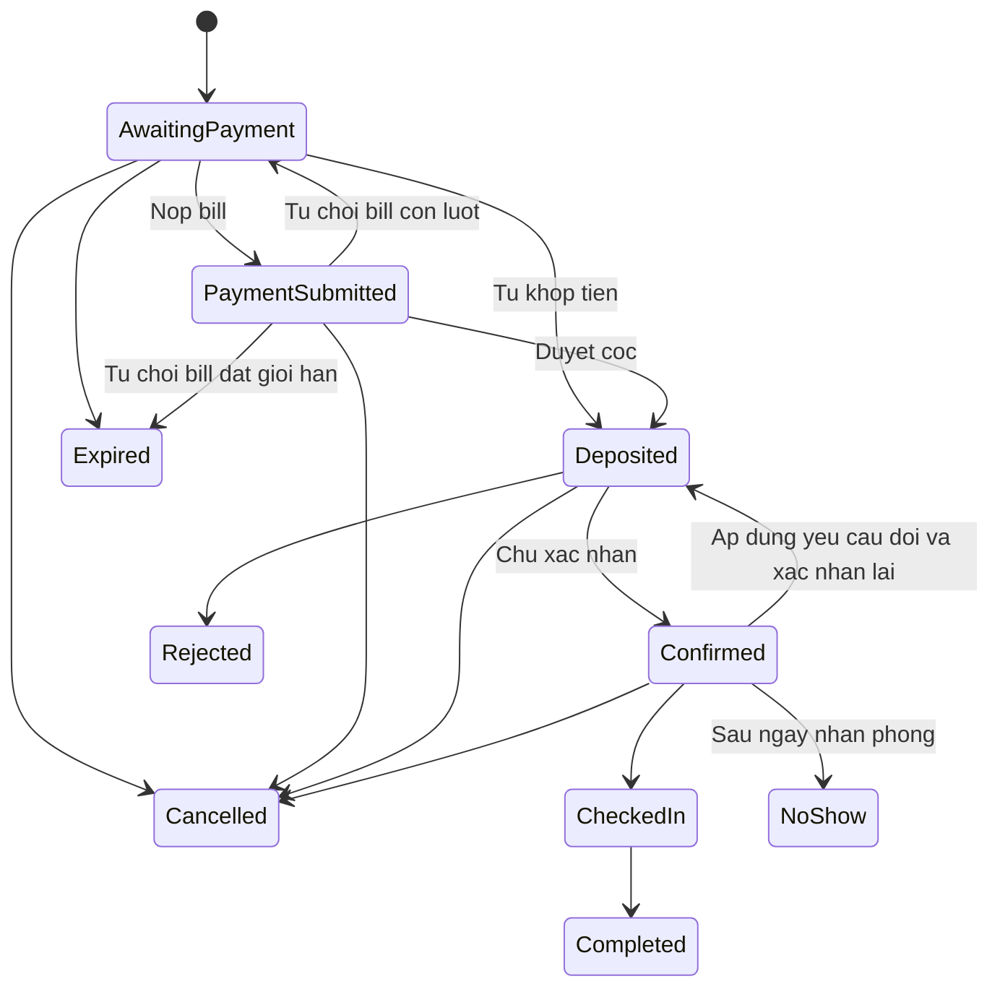

# Cơ sở dữ liệu của Fuji Homestay

Tài liệu đọc theo `Data/ApplicationDbContext.cs`, `Models/Entities/`, toàn bộ 9 migration và `database/schema.sql` trong repo; mô tả schema sau migration `20261015200521_EnumAndReviewChecks`. Đây là đối chiếu mã nguồn, không phải kết quả truy vấn một database đang chạy. Tài liệu backend và API: [api-va-backend.md](api-va-backend.md).

## 1. Tổng quan và cách tạo dữ liệu

Ứng dụng ASP.NET Core MVC .NET 10 dùng **SQL Server 2022** và **EF Core 10.0.12 theo code-first**: entity và cấu hình EF là nguồn thiết kế, migration ghi các thay đổi schema. `database/schema.sql` là script idempotent sinh từ chính các migration, không phải bộ schema database-first độc lập và không phải script scaffold ngược model.

**Số bảng: 45 = 37 DbSet nghiệp vụ + 7 bảng Identity kế thừa từ IdentityDbContext + 1 bảng kỹ thuật `__EFMigrationsHistory`.** Có 382 cột, 76 FK và 60 CHECK sau đủ migration. 45 mục bảng ở phần 3 bao phủ đúng 45 lệnh CREATE TABLE của schema; không bỏ các bảng Identity chỉ vì chúng không được khai báo DbSet trực tiếp.

Tên database mặc định trong `appsettings.json` là **HomestayBooking_v5**. `appsettings.Development.json` không ghi đè tên này; không có tên Production riêng cố định trong code. Biến môi trường/cấu hình triển khai có thể ghi đè, nên không suy ra tên database thật của Production. `database/README.md` dùng **HomestayBooking** cho ví dụ dựng mới; tên database thử có **HomestayBooking_DeployTest** và **HomestayBooking_ConstraintTest**.

Hai cách dựng cùng schema trên database đích đã kiểm tra:

1. SQL: tạo database riêng, chạy `database/deploy.sql` bằng sqlcmd hoặc SSMS SQLCMD Mode từ thư mục `database/`, với `TargetDb` bằng đúng database đang kết nối. Wrapper bật XACT_ABORT/các SET cần cho filtered index, chặn database hệ thống và database có bảng lạ nhưng chưa có lịch sử EF, rồi nạp `schema.sql`. Chạy lại chỉ áp migration còn thiếu.
2. EF: `dotnet ef database update --configuration Release --project HomestayBooking.Web` sau khi cấu hình kết nối tới đúng database riêng qua biến môi trường/user-secrets. Không cần chạy lại SQL như một bước tạo schema thứ hai.

Cấu hình chung và Development đều có `Database:AutoMigrate=false`: startup chỉ kiểm migration còn thiếu và dừng nếu thiếu. Nếu chủ động bật cờ, `SeedData.InitializeAsync` gọi MigrateAsync trước seed; nhánh không quan hệ dùng EnsureCreatedAsync phục vụ test.

SQL schema không chứa tài khoản/dữ liệu demo. Khi startup, SeedData tạo role, khu vực, danh mục loại phòng, tiện nghi, ngày lễ và chính sách hủy chung ở mọi môi trường. **Chỉ Development** chạy thêm SeedPeopleAsync, SeedHomestaysAsync, SeedSampleBookingsAsync, SeedOperationsAsync, SeedDemoImagesAsync. Mỗi phần kiểm tra dữ liệu hiện có để tránh thêm lặp; nhiều danh mục chỉ nạp khi bảng rỗng, không cập nhật đè mọi dòng cũ.

`database/data/seed_topup_2028.sql` là bổ sung riêng cho dữ liệu demo đã có (gia hạn hợp đồng mẫu, thêm lễ/ảnh giấy tờ còn thiếu), không tự chạy ở startup và không tạo tài khoản. Hướng dẫn triển khai chi tiết ở [database/README.md](../database/README.md); lệnh chạy dev an toàn trên database demo riêng ở [tài liệu backend](api-va-backend.md#7-cách-chạy-và-thử).

## 2. Sơ đồ quan hệ

Chia 5 sơ đồ theo bảng con để dễ đọc; bảng cha xuất hiện lại khi liên hệ qua nhóm. Mỗi cạnh ứng với một FK: `||` một cha bắt buộc, `|o` cha có thể thiếu do FK NULL, `o{` nhiều con, `o|` tối đa một con. Chỉ thể hiện PK trong khối bảng; danh sách cột đầy đủ ở phần 3. FK không đồng nghĩa mọi quan hệ nghiệp vụ đều đã được SQL kiểm tra.

### 2.1. Tài khoản, khách hàng và nhân sự

### 2.2. Chủ, cơ sở lưu trú, phòng và chính sách

### 2.3. Đặt phòng, lịch phòng và đổi/hủy

### 2.4. Thanh toán, đối soát và voucher

### 2.5. Đánh giá, thông báo, nhật ký và kỹ thuật

## 3. Từ điển 45 bảng

Cột **NULL**: Có = được thiếu ở SQL, Không = NOT NULL. **PK ghép** nghĩa là cả tổ hợp cột mới duy nhất. **FK** chỉ rõ bảng và cột đích; **IDENTITY** là số tự tăng. `nvarchar(n)` là chuỗi Unicode tối đa n ký tự, `nvarchar(max)` là văn bản dài; `bit` là cờ 0/1; tiền dùng `decimal(18,0)` (VND nguyên), tỷ lệ dùng `decimal(5,4)`, tọa độ `decimal(9,6)`. Ngày ở dùng `date`, giờ cơ sở dùng `time`, mốc hệ thống thường do C# ghi UTC vào `datetime2`.

Enum của entity lưu **tên chuỗi**, không lưu ordinal; xem đủ giá trị ở phần 4. Giá trị khởi tạo `= true`, `DateTime.UtcNow`... trong entity là mặc định C#, không tự thành DEFAULT SQL. Bốn DEFAULT SQL là HomestayImages.SortOrder, Bookings.DiscountAmount, Bookings.ChangeFeeAmount và SettlementItems.DiscountAmount (đều 0).

Không có bộ lọc xóa mềm toàn cục/IsDeleted. Mã dùng Status, IsActive, IsHidden tùy bảng và thường giữ lịch sử nghiệp vụ. Phần lớn FK là NO ACTION/chặn xóa; 13 FK cascade gồm 6 FK Identity (claims/logins/roles/tokens, hai FK UserId/RoleId ở bảng vai trò) và 7 FK con thuần: HomestayImages→Homestays, HomestayAmenities→Homestays/Amenities, CancellationRules→CancellationPolicies, BookingNights→Bookings, RoomNights→RoomBlocks, SettlementItems→Settlements. Đây là hành vi SQL, không khẳng định mọi bản ghi cha đều được UI cho phép xóa.

### 3.1. Tài khoản, khách hàng và nhân sự

#### `PersonProfiles`

Hồ sơ cá nhân dùng chung, định danh bằng số điện thoại chuẩn E.164. Có thể tồn tại trước tài khoản và gắn đồng thời khách/chủ/nhân viên.

| Cột | Kiểu SQL | NULL | Khóa | Ý nghĩa |
|---|---|---|---|---|
| `Id` | `int` | Không | PK; IDENTITY | Định danh bản ghi |
| `FullName` | `nvarchar(100)` | Có | — | Họ tên |
| `PhoneNumber` | `nvarchar(16)` | Không | — | Số điện thoại |
| `Email` | `nvarchar(256)` | Có | — | Địa chỉ email |
| `Address` | `nvarchar(300)` | Có | — | Địa chỉ |
| `CreatedAt` | `datetime2` | Không | — | Thời điểm tạo (UTC ở mã ứng dụng) |
| `UpdatedAt` | `datetime2` | Không | — | Thời điểm cập nhật (UTC ở mã ứng dụng) |

**Ràng buộc và tra cứu:**

PhoneNumber UNIQUE; service chuẩn hóa E.164. Bảng không có CHECK xác thực định dạng số điện thoại.

- UNIQUE `IX_PersonProfiles_PhoneNumber` trên `PhoneNumber`.

#### `AspNetUsers`

Tài khoản xác thực dùng chung cho khách, chủ và nhân viên; liên kết một hồ sơ cá nhân. Đây là ApplicationUser kế thừa IdentityUser.

| Cột | Kiểu SQL | NULL | Khóa | Ý nghĩa |
|---|---|---|---|---|
| `Id` | `nvarchar(450)` | Không | PK | Định danh bản ghi |
| `PersonId` | `int` | Không | FK → PersonProfiles.Id | Hồ sơ cá nhân dùng chung |
| `Status` | `nvarchar(30)` | Không | — | Trạng thái nghiệp vụ; enum `AccountStatus` |
| `PasswordChangedAt` | `datetime2` | Có | — | Lần đổi/đặt mật khẩu đã ghi nhận |
| `CreatedAt` | `datetime2` | Không | — | Thời điểm tạo (UTC ở mã ứng dụng) |
| `UpdatedAt` | `datetime2` | Không | — | Thời điểm cập nhật (UTC ở mã ứng dụng) |
| `UserName` | `nvarchar(256)` | Có | — | Tên nội bộ Identity; ApplicationUser mặc định dùng Id |
| `NormalizedUserName` | `nvarchar(256)` | Có | — | Tên nội bộ đã chuẩn hóa |
| `Email` | `nvarchar(256)` | Có | — | Địa chỉ email của Identity; hồ sơ/định danh đăng nhập thực dùng PersonProfiles |
| `NormalizedEmail` | `nvarchar(256)` | Có | — | Email chuẩn hóa của Identity |
| `EmailConfirmed` | `bit` | Không | — | Cờ xác nhận email Identity |
| `PasswordHash` | `nvarchar(max)` | Có | — | Giá trị băm mật khẩu do Identity quản lý |
| `SecurityStamp` | `nvarchar(max)` | Có | — | Dấu bảo mật để kiểm tra hiệu lực cookie |
| `ConcurrencyStamp` | `nvarchar(max)` | Có | — | Dấu kiểm soát cập nhật đồng thời của Identity |
| `PhoneNumber` | `nvarchar(max)` | Có | — | Số điện thoại của Identity; hồ sơ/định danh đăng nhập thực dùng PersonProfiles |
| `PhoneNumberConfirmed` | `bit` | Không | — | Cờ xác nhận số điện thoại Identity |
| `TwoFactorEnabled` | `bit` | Không | — | Cờ xác thực hai bước Identity; chưa thấy luồng bật trong controller |
| `LockoutEnd` | `datetimeoffset` | Có | — | Thời điểm kết thúc khóa tạm Identity |
| `LockoutEnabled` | `bit` | Không | — | Cho phép cơ chế khóa tạm Identity |
| `AccessFailedCount` | `int` | Không | — | Số lần xác thực thất bại Identity |

**Ràng buộc và tra cứu:**

PersonId UNIQUE: một người tối đa một tài khoản. EmailIndex chỉ là index thường, email không bắt buộc duy nhất. Status dùng AccountStatus, không có CHECK giới hạn enum tại SQL.

- Index `EmailIndex` trên `NormalizedEmail`.
- UNIQUE `IX_AspNetUsers_PersonId` trên `PersonId`.
- UNIQUE `UserNameIndex` trên `NormalizedUserName`; điều kiện `[NormalizedUserName] IS NOT NULL`.

#### `AspNetRoles`

Danh mục vai trò Identity: Customer, Owner, Employee. Chức vụ kế toán/quản lý/quản trị nằm ở Employees, không phải role riêng.

| Cột | Kiểu SQL | NULL | Khóa | Ý nghĩa |
|---|---|---|---|---|
| `Id` | `nvarchar(450)` | Không | PK | Định danh bản ghi |
| `Name` | `nvarchar(256)` | Có | — | Tên hiển thị |
| `NormalizedName` | `nvarchar(256)` | Có | — | Tên chuẩn hóa để tìm kiếm |
| `ConcurrencyStamp` | `nvarchar(max)` | Có | — | Dấu kiểm soát cập nhật đồng thời của Identity |

**Ràng buộc và tra cứu:**

- UNIQUE `RoleNameIndex` trên `NormalizedName`; điều kiện `[NormalizedName] IS NOT NULL`.

#### `AspNetUserRoles`

Bảng nối tài khoản với vai trò; bổ sung người cấp và thời điểm cấp quyền qua ApplicationUserRole.

| Cột | Kiểu SQL | NULL | Khóa | Ý nghĩa |
|---|---|---|---|---|
| `UserId` | `nvarchar(450)` | Không | PK ghép; FK → AspNetUsers.Id | Tài khoản Identity |
| `RoleId` | `nvarchar(450)` | Không | PK ghép; FK → AspNetRoles.Id | Vai trò Identity |
| `AssignedAt` | `datetime2` | Không | — | Thời điểm cấp vai trò |
| `AssignedByAccountId` | `nvarchar(450)` | Có | FK → AspNetUsers.Id | Tài khoản cấp vai trò; NULL khi hệ thống cấp |

**Ràng buộc và tra cứu:**

- Index `IX_AspNetUserRoles_AssignedByAccountId` trên `AssignedByAccountId`.
- Index `IX_AspNetUserRoles_RoleId` trên `RoleId`.

#### `AspNetUserClaims`

Các claim lưu theo tài khoản của Identity. Claim chức vụ/quyền chủ đã duyệt còn được dựng từ hồ sơ khi tạo principal; không mặc định có sẵn trong bảng này.

| Cột | Kiểu SQL | NULL | Khóa | Ý nghĩa |
|---|---|---|---|---|
| `Id` | `int` | Không | PK; IDENTITY | Định danh bản ghi |
| `UserId` | `nvarchar(450)` | Không | FK → AspNetUsers.Id | Tài khoản Identity |
| `ClaimType` | `nvarchar(max)` | Có | — | Tên loại claim |
| `ClaimValue` | `nvarchar(max)` | Có | — | Giá trị claim |

**Ràng buộc và tra cứu:**

- Index `IX_AspNetUserClaims_UserId` trên `UserId`.

#### `AspNetRoleClaims`

Các claim của vai trò do Identity hỗ trợ; bảng có trong schema, chưa thấy seed claim vai trò riêng.

| Cột | Kiểu SQL | NULL | Khóa | Ý nghĩa |
|---|---|---|---|---|
| `Id` | `int` | Không | PK; IDENTITY | Định danh bản ghi |
| `RoleId` | `nvarchar(450)` | Không | FK → AspNetRoles.Id | Vai trò Identity |
| `ClaimType` | `nvarchar(max)` | Có | — | Tên loại claim |
| `ClaimValue` | `nvarchar(max)` | Có | — | Giá trị claim |

**Ràng buộc và tra cứu:**

- Index `IX_AspNetRoleClaims_RoleId` trên `RoleId`.

#### `AspNetUserLogins`

Thông tin liên kết đăng nhập ngoài do Identity hỗ trợ. Model nhắc Google nhưng Program.cs chưa đăng ký Google authentication.

| Cột | Kiểu SQL | NULL | Khóa | Ý nghĩa |
|---|---|---|---|---|
| `LoginProvider` | `nvarchar(450)` | Không | PK ghép | Nhà cung cấp đăng nhập/token |
| `ProviderKey` | `nvarchar(450)` | Không | PK ghép | Định danh người dùng ở provider |
| `ProviderDisplayName` | `nvarchar(max)` | Có | — | Tên provider hiển thị |
| `UserId` | `nvarchar(450)` | Không | FK → AspNetUsers.Id | Tài khoản Identity |

**Ràng buộc và tra cứu:**

Có bảng liên kết ngoài chưa đồng nghĩa Google login đã hoạt động.

- Index `IX_AspNetUserLogins_UserId` trên `UserId`.

#### `AspNetUserTokens`

Kho token theo tài khoản/provider của Identity; không phải nơi phát JWT cho các Web API hiện có.

| Cột | Kiểu SQL | NULL | Khóa | Ý nghĩa |
|---|---|---|---|---|
| `UserId` | `nvarchar(450)` | Không | PK ghép; FK → AspNetUsers.Id | Tài khoản Identity |
| `LoginProvider` | `nvarchar(450)` | Không | PK ghép | Nhà cung cấp đăng nhập/token |
| `Name` | `nvarchar(450)` | Không | PK ghép | Tên hiển thị |
| `Value` | `nvarchar(max)` | Có | — | Giá trị token Identity |

**Ràng buộc và tra cứu:**

- Ngoài PK/FK và kiểu/null ở trên, không thấy CHECK/index bổ sung trong schema.

#### `Customers`

Hồ sơ nghiệp vụ người đặt phòng; khách không cần có tài khoản. Thông tin họ tên và điện thoại lấy từ PersonProfiles.

| Cột | Kiểu SQL | NULL | Khóa | Ý nghĩa |
|---|---|---|---|---|
| `Id` | `int` | Không | PK; IDENTITY | Định danh bản ghi |
| `PersonId` | `int` | Không | FK → PersonProfiles.Id | Hồ sơ cá nhân dùng chung |
| `Note` | `nvarchar(1000)` | Có | — | Ghi chú |
| `CreatedAt` | `datetime2` | Không | — | Thời điểm tạo (UTC ở mã ứng dụng) |
| `UpdatedAt` | `datetime2` | Không | — | Thời điểm cập nhật (UTC ở mã ứng dụng) |

**Ràng buộc và tra cứu:**

- UNIQUE `IX_Customers_PersonId` trên `PersonId`.

#### `CustomerProfiles`

Phần thông tin riêng của khách: căn cước, mã sinh viên và trạng thái xác minh. Dùng chung khóa chính với Customers.

| Cột | Kiểu SQL | NULL | Khóa | Ý nghĩa |
|---|---|---|---|---|
| `CustomerId` | `int` | Không | PK; FK → Customers.Id | Khách đặt phòng |
| `CitizenId` | `nvarchar(20)` | Có | — | Số căn cước; dữ liệu nhạy cảm |
| `StudentId` | `nvarchar(30)` | Có | — | Mã sinh viên; dữ liệu nhạy cảm |
| `StudentVerificationStatus` | `nvarchar(20)` | Không | — | Tình trạng xác minh sinh viên; enum `StudentVerificationStatus` |
| `CreatedAt` | `datetime2` | Không | — | Thời điểm tạo (UTC ở mã ứng dụng) |
| `UpdatedAt` | `datetime2` | Không | — | Thời điểm cập nhật (UTC ở mã ứng dụng) |

**Ràng buộc và tra cứu:**

- Ngoài PK/FK và kiểu/null ở trên, không thấy CHECK/index bổ sung trong schema.

#### `Employees`

Hồ sơ nhân viên Fuji, mã đăng nhập nội bộ, chức vụ và tình trạng làm việc.

| Cột | Kiểu SQL | NULL | Khóa | Ý nghĩa |
|---|---|---|---|---|
| `Id` | `int` | Không | PK; IDENTITY | Định danh bản ghi |
| `PersonId` | `int` | Không | FK → PersonProfiles.Id | Hồ sơ cá nhân dùng chung |
| `EmployeeCode` | `nvarchar(20)` | Không | — | Mã đăng nhập nhân viên |
| `Department` | `nvarchar(100)` | Có | — | Phòng ban |
| `Position` | `nvarchar(20)` | Không | — | Chức vụ nhân viên; enum `EmployeePosition` |
| `EmploymentStatus` | `nvarchar(20)` | Không | — | Tình trạng làm việc; enum `EmploymentStatus` |
| `CreatedAt` | `datetime2` | Không | — | Thời điểm tạo (UTC ở mã ứng dụng) |
| `UpdatedAt` | `datetime2` | Không | — | Thời điểm cập nhật (UTC ở mã ứng dụng) |

**Ràng buộc và tra cứu:**

- UNIQUE `IX_Employees_EmployeeCode` trên `EmployeeCode`.
- UNIQUE `IX_Employees_PersonId` trên `PersonId`.

### 3.2. Chủ, cơ sở lưu trú, phòng và chính sách

#### `Owners`

Hồ sơ chủ homestay, chứa thông tin nhận tiền đối soát. Việc duyệt chủ được theo dõi ở OwnerRegistrations.

| Cột | Kiểu SQL | NULL | Khóa | Ý nghĩa |
|---|---|---|---|---|
| `Id` | `int` | Không | PK; IDENTITY | Định danh bản ghi |
| `PersonId` | `int` | Không | FK → PersonProfiles.Id | Hồ sơ cá nhân dùng chung |
| `BankName` | `nvarchar(100)` | Có | — | Tên ngân hàng nhận đối soát |
| `BankAccountNo` | `nvarchar(30)` | Có | — | Số tài khoản của chủ; dữ liệu nhạy cảm |
| `BankAccountName` | `nvarchar(100)` | Có | — | Tên chủ tài khoản ngân hàng |
| `CreatedAt` | `datetime2` | Không | — | Thời điểm tạo (UTC ở mã ứng dụng) |
| `UpdatedAt` | `datetime2` | Không | — | Thời điểm cập nhật (UTC ở mã ứng dụng) |

**Ràng buộc và tra cứu:**

- UNIQUE `IX_Owners_PersonId` trên `PersonId`.

#### `OwnerRegistrations`

Hồ sơ đăng ký chủ, nguồn tạo, trạng thái thẩm định và người quyết định. Giữ lịch sử hồ sơ đã kết thúc.

| Cột | Kiểu SQL | NULL | Khóa | Ý nghĩa |
|---|---|---|---|---|
| `Id` | `int` | Không | PK; IDENTITY | Định danh bản ghi |
| `OwnerId` | `int` | Không | FK → Owners.Id | Chủ homestay |
| `Source` | `nvarchar(20)` | Không | — | Nguồn tạo hồ sơ đăng ký; enum `OwnerRegistrationSource` |
| `Status` | `nvarchar(30)` | Không | — | Trạng thái nghiệp vụ; enum `OwnerRegistrationStatus` |
| `CreatedByEmployeeId` | `int` | Có | FK → Employees.Id | Nhân viên tạo; NULL khi tự đăng ký/đặt |
| `ReviewedByEmployeeId` | `int` | Có | FK → Employees.Id | Nhân viên duyệt |
| `ReviewNote` | `nvarchar(1000)` | Có | — | Ghi chú thẩm định |
| `SubmittedAt` | `datetime2` | Có | — | Thời điểm nộp |
| `ReviewedAt` | `datetime2` | Có | — | Thời điểm duyệt |
| `CreatedAt` | `datetime2` | Không | — | Thời điểm tạo (UTC ở mã ứng dụng) |
| `UpdatedAt` | `datetime2` | Không | — | Thời điểm cập nhật (UTC ở mã ứng dụng) |

**Ràng buộc và tra cứu:**

- CHECK `CK_OwnerRegistrations_Decision`: NeedsRevision/Approved/Rejected có nhân viên và thời điểm duyệt; NeedsRevision/Rejected còn cần ghi chú khác rỗng.
- CHECK `CK_OwnerRegistrations_Status`: Chỉ nhận các giá trị: `Draft`, `WaitingOwnerActivation`, `PendingReview`, `UnderReview`, `NeedsRevision`, `Approved`, `Rejected`.
- Index `IX_OwnerRegistrations_CreatedByEmployeeId` trên `CreatedByEmployeeId`.
- UNIQUE `IX_OwnerRegistrations_OwnerId_Open` trên `OwnerId`; điều kiện `[Status] IN ('Draft', 'WaitingOwnerActivation', 'PendingReview', 'UnderReview', 'NeedsRevision')`.
- Index `IX_OwnerRegistrations_ReviewedByEmployeeId` trên `ReviewedByEmployeeId`.

#### `Areas`

Danh mục khu vực để nhóm homestay và lọc tìm kiếm.

| Cột | Kiểu SQL | NULL | Khóa | Ý nghĩa |
|---|---|---|---|---|
| `Id` | `int` | Không | PK; IDENTITY | Định danh bản ghi |
| `Name` | `nvarchar(100)` | Không | — | Tên hiển thị |
| `Province` | `nvarchar(100)` | Không | — | Tỉnh/thành |
| `AreaGroup` | `nvarchar(20)` | Không | — | Nhóm khu vực; enum `AreaGroup` |

**Ràng buộc và tra cứu:**

- UNIQUE `IX_Areas_Province_Name` trên `Province, Name`.

#### `Homestays`

Thông tin cơ sở lưu trú, vị trí, nội dung, giờ nhận/trả và tình trạng kinh doanh. Chủ được duyệt và hợp đồng hiệu lực còn được service kiểm tra.

| Cột | Kiểu SQL | NULL | Khóa | Ý nghĩa |
|---|---|---|---|---|
| `Id` | `int` | Không | PK; IDENTITY | Định danh bản ghi |
| `OwnerId` | `int` | Không | FK → Owners.Id | Chủ homestay |
| `AreaId` | `int` | Không | FK → Areas.Id | Khu vực |
| `Name` | `nvarchar(200)` | Không | — | Tên hiển thị |
| `Address` | `nvarchar(300)` | Không | — | Địa chỉ |
| `Latitude` | `decimal(9,6)` | Có | — | Vĩ độ |
| `Longitude` | `decimal(9,6)` | Có | — | Kinh độ |
| `DescriptionHtml` | `nvarchar(max)` | Có | — | Nội dung HTML đã được service lọc |
| `CheckinGuideHtml` | `nvarchar(max)` | Có | — | Hướng dẫn nhận phòng; chỉ tiết lộ sau xác nhận |
| `ContactPhone` | `nvarchar(16)` | Có | — | Điện thoại liên hệ (E.164) |
| `CheckinTime` | `time` | Không | — | Giờ nhận phòng tại cơ sở |
| `CheckoutTime` | `time` | Không | — | Giờ trả phòng tại cơ sở |
| `Status` | `nvarchar(20)` | Không | — | Trạng thái nghiệp vụ; enum `HomestayStatus` |
| `ApprovedByEmployeeId` | `int` | Có | FK → Employees.Id | Nhân viên duyệt homestay |
| `ApprovedAt` | `datetime2` | Có | — | Thời điểm duyệt homestay |
| `CreatedAt` | `datetime2` | Không | — | Thời điểm tạo (UTC ở mã ứng dụng) |
| `UpdatedAt` | `datetime2` | Không | — | Thời điểm cập nhật (UTC ở mã ứng dụng) |

**Ràng buộc và tra cứu:**

Đổi Status (Draft/PendingReview/Active/Suspended/Ended) để quản lý vòng đời; không có cột IsDeleted.

- CHECK `CK_Homestays_Status`: Chỉ nhận các giá trị: `Draft`, `PendingReview`, `Active`, `Suspended`, `Ended`.
- Index `IX_Homestays_ApprovedByEmployeeId` trên `ApprovedByEmployeeId`.
- Index `IX_Homestays_AreaId_Status` trên `AreaId, Status`.
- Index `IX_Homestays_OwnerId` trên `OwnerId`.

#### `Contracts`

Hợp đồng hợp tác với một homestay; xác định thời hạn và tỷ lệ hoa hồng Fuji.

| Cột | Kiểu SQL | NULL | Khóa | Ý nghĩa |
|---|---|---|---|---|
| `Id` | `int` | Không | PK; IDENTITY | Định danh bản ghi |
| `HomestayId` | `int` | Không | FK → Homestays.Id | Homestay liên quan |
| `ContractNo` | `nvarchar(30)` | Không | — | Số hợp đồng |
| `StartDate` | `date` | Không | — | Ngày bắt đầu |
| `EndDate` | `date` | Không | — | Ngày kết thúc |
| `CommissionRate` | `decimal(5,4)` | Không | — | Tỷ lệ hoa hồng Fuji (ví dụ 0.10 = 10%) |
| `Status` | `nvarchar(20)` | Không | — | Trạng thái nghiệp vụ; enum `ContractStatus` |
| `SignedByEmployeeId` | `int` | Có | FK → Employees.Id | Nhân viên ký hợp đồng |
| `CreatedAt` | `datetime2` | Không | — | Thời điểm tạo (UTC ở mã ứng dụng) |
| `UpdatedAt` | `datetime2` | Không | — | Thời điểm cập nhật (UTC ở mã ứng dụng) |

**Ràng buộc và tra cứu:**

- CHECK `CK_Contracts_CommissionRate`: 0 < tỷ lệ hoa hồng < 1.
- CHECK `CK_Contracts_Dates`: Ngày kết thúc sau ngày bắt đầu.
- CHECK `CK_Contracts_Status`: Chỉ nhận các giá trị: `Active`, `Expired`, `Terminated`.
- UNIQUE `IX_Contracts_ContractNo` trên `ContractNo`.
- UNIQUE `IX_Contracts_HomestayId_Active` trên `HomestayId`; điều kiện `[Status] = 'Active'`.
- Index `IX_Contracts_SignedByEmployeeId` trên `SignedByEmployeeId`.

#### `Amenities`

Danh mục tiện nghi dùng chung như Wifi hoặc bể bơi.

| Cột | Kiểu SQL | NULL | Khóa | Ý nghĩa |
|---|---|---|---|---|
| `Id` | `int` | Không | PK; IDENTITY | Định danh bản ghi |
| `Name` | `nvarchar(100)` | Không | — | Tên hiển thị |
| `Icon` | `nvarchar(50)` | Có | — | Tên biểu tượng giao diện |

**Ràng buộc và tra cứu:**

- UNIQUE `IX_Amenities_Name` trên `Name`.

#### `HomestayAmenities`

Bảng nối nhiều-nhiều giữa homestay và tiện nghi.

| Cột | Kiểu SQL | NULL | Khóa | Ý nghĩa |
|---|---|---|---|---|
| `HomestayId` | `int` | Không | PK ghép; FK → Homestays.Id | Homestay liên quan |
| `AmenityId` | `int` | Không | PK ghép; FK → Amenities.Id | Tiện nghi |

**Ràng buộc và tra cứu:**

- Index `IX_HomestayAmenities_AmenityId` trên `AmenityId`.

#### `HomestayImages`

Ảnh công khai của homestay; có thể gắn riêng một loại phòng, có thứ tự và cờ ảnh bìa.

| Cột | Kiểu SQL | NULL | Khóa | Ý nghĩa |
|---|---|---|---|---|
| `Id` | `int` | Không | PK; IDENTITY | Định danh bản ghi |
| `HomestayId` | `int` | Không | FK → Homestays.Id | Homestay liên quan |
| `RoomTypeId` | `int` | Có | FK → RoomTypes.Id | Loại phòng của homestay |
| `Url` | `nvarchar(300)` | Không | — | Liên kết ảnh/trang |
| `SortOrder` | `int` | Không | — | Thứ tự hiển thị |
| `IsCover` | `bit` | Không | — | Cờ ảnh bìa homestay |

**Ràng buộc và tra cứu:**

- UNIQUE `IX_HomestayImages_Cover` trên `HomestayId`; điều kiện `[IsCover] = 1`.
- Index `IX_HomestayImages_HomestayId_SortOrder` trên `HomestayId, SortOrder`.
- Index `IX_HomestayImages_RoomTypeId` trên `RoomTypeId`.

#### `VerificationDocuments`

Giấy tờ xác minh gắn với hồ sơ đăng ký chủ hoặc với homestay. Chỉ lưu tên/đường dẫn file, file nhạy cảm ở ngoài wwwroot.

| Cột | Kiểu SQL | NULL | Khóa | Ý nghĩa |
|---|---|---|---|---|
| `Id` | `int` | Không | PK; IDENTITY | Định danh bản ghi |
| `OwnerRegistrationId` | `int` | Có | FK → OwnerRegistrations.Id | Hồ sơ đăng ký chủ |
| `HomestayId` | `int` | Có | FK → Homestays.Id | Homestay liên quan |
| `DocumentType` | `nvarchar(30)` | Không | — | Loại giấy tờ; enum `DocumentType` |
| `FileUrl` | `nvarchar(300)` | Không | — | Tên/đường dẫn file do kho file quản lý |
| `OriginalFileName` | `nvarchar(255)` | Có | — | Tên file gốc |
| `ExpiryDate` | `date` | Có | — | Ngày hết hạn giấy tờ |
| `CreatedAt` | `datetime2` | Không | — | Thời điểm tạo (UTC ở mã ứng dụng) |

**Ràng buộc và tra cứu:**

- CHECK `CK_VerificationDocuments_Owner`: Đúng một trong OwnerRegistrationId, HomestayId có giá trị.
- CHECK `CK_VerificationDocuments_DocumentType`: Chỉ nhận các giá trị: `BusinessLicense`, `FireSafety`, `PropertyPhoto`, `Other`.
- Index `IX_VerificationDocuments_HomestayId` trên `HomestayId`.
- Index `IX_VerificationDocuments_OwnerRegistrationId` trên `OwnerRegistrationId`.

#### `RoomCategories`

Danh mục loại phòng dùng chung để lọc tìm kiếm, khác với loại phòng cụ thể của từng homestay.

| Cột | Kiểu SQL | NULL | Khóa | Ý nghĩa |
|---|---|---|---|---|
| `Id` | `int` | Không | PK; IDENTITY | Định danh bản ghi |
| `Name` | `nvarchar(100)` | Không | — | Tên hiển thị |

**Ràng buộc và tra cứu:**

- UNIQUE `IX_RoomCategories_Name` trên `Name`.

#### `RoomTypes`

Loại phòng do một homestay bán, sức chứa, mô tả và diện tích. Khách chọn loại phòng, hệ thống xếp phòng cụ thể.

| Cột | Kiểu SQL | NULL | Khóa | Ý nghĩa |
|---|---|---|---|---|
| `Id` | `int` | Không | PK; IDENTITY | Định danh bản ghi |
| `HomestayId` | `int` | Không | FK → Homestays.Id | Homestay liên quan |
| `CategoryId` | `int` | Không | FK → RoomCategories.Id | Danh mục loại phòng chung |
| `Name` | `nvarchar(100)` | Không | — | Tên hiển thị |
| `MaxGuests` | `int` | Không | — | Sức chứa tối đa |
| `AreaM2` | `int` | Có | — | Diện tích m² |
| `Description` | `nvarchar(1000)` | Có | — | Mô tả văn bản |
| `IsActive` | `bit` | Không | — | Còn hoạt động/được dùng |
| `CreatedAt` | `datetime2` | Không | — | Thời điểm tạo (UTC ở mã ứng dụng) |
| `UpdatedAt` | `datetime2` | Không | — | Thời điểm cập nhật (UTC ở mã ứng dụng) |

**Ràng buộc và tra cứu:**

IsActive dùng ngừng bán; không có cột IsDeleted.

- CHECK `CK_RoomTypes_MaxGuests`: Sức chứa > 0.
- Index `IX_RoomTypes_CategoryId` trên `CategoryId`.
- UNIQUE `IX_RoomTypes_HomestayId_Name` trên `HomestayId, Name`.

#### `Rooms`

Phòng vật lý cụ thể thuộc một loại phòng. Tình trạng bận theo ngày được suy ra từ RoomNights.

| Cột | Kiểu SQL | NULL | Khóa | Ý nghĩa |
|---|---|---|---|---|
| `Id` | `int` | Không | PK; IDENTITY | Định danh bản ghi |
| `RoomTypeId` | `int` | Không | FK → RoomTypes.Id | Loại phòng của homestay |
| `RoomCode` | `nvarchar(20)` | Không | — | Mã phòng, duy nhất trong loại phòng |
| `IsActive` | `bit` | Không | — | Còn hoạt động/được dùng |

**Ràng buộc và tra cứu:**

IsActive dùng ngừng bán; không có cột IsDeleted.

- UNIQUE `IX_Rooms_RoomTypeId_RoomCode` trên `RoomTypeId, RoomCode`.

#### `RoomTypePrices`

Giá theo loại phòng, loại ngày và ngày bắt đầu hiệu lực. Đổi giá tạo phiên bản mới thay vì sửa giá của đơn cũ.

| Cột | Kiểu SQL | NULL | Khóa | Ý nghĩa |
|---|---|---|---|---|
| `Id` | `int` | Không | PK; IDENTITY | Định danh bản ghi |
| `RoomTypeId` | `int` | Không | FK → RoomTypes.Id | Loại phòng của homestay |
| `DayType` | `nvarchar(10)` | Không | — | Loại ngày để chọn giá; enum `DayType` |
| `Price` | `decimal(18,0)` | Không | — | Giá một đêm (VND) |
| `EffectiveFrom` | `date` | Không | — | Ngày bắt đầu hiệu lực giá |
| `CreatedAt` | `datetime2` | Không | — | Thời điểm tạo (UTC ở mã ứng dụng) |

**Ràng buộc và tra cứu:**

- CHECK `CK_RoomTypePrices_Price`: Giá > 0.
- CHECK `CK_RoomTypePrices_DayType`: Chỉ nhận các giá trị: `Weekday`, `Weekend`, `Holiday`.
- UNIQUE `IX_RoomTypePrices_RoomTypeId_DayType_EffectiveFrom` trên `RoomTypeId, DayType, EffectiveFrom`.

#### `Holidays`

Danh mục ngày lễ để chọn mức giá Holiday.

| Cột | Kiểu SQL | NULL | Khóa | Ý nghĩa |
|---|---|---|---|---|
| `Date` | `date` | Không | PK | Ngày |
| `Name` | `nvarchar(100)` | Không | — | Tên hiển thị |

**Ràng buộc và tra cứu:**

- Ngoài PK/FK và kiểu/null ở trên, không thấy CHECK/index bổ sung trong schema.

#### `CancellationPolicies`

Chính sách hủy chung hoặc riêng của homestay, áp dụng mọi ngày hay dịp lễ.

| Cột | Kiểu SQL | NULL | Khóa | Ý nghĩa |
|---|---|---|---|---|
| `Id` | `int` | Không | PK; IDENTITY | Định danh bản ghi |
| `HomestayId` | `int` | Có | FK → Homestays.Id | Homestay liên quan |
| `Scope` | `nvarchar(10)` | Không | — | Phạm vi áp dụng chính sách; enum `PolicyScope` |
| `Name` | `nvarchar(100)` | Không | — | Tên hiển thị |
| `IsActive` | `bit` | Không | — | Còn hoạt động/được dùng |
| `CreatedAt` | `datetime2` | Không | — | Thời điểm tạo (UTC ở mã ứng dụng) |

**Ràng buộc và tra cứu:**

- CHECK `CK_CancellationPolicies_Scope`: Chỉ nhận các giá trị: `All`, `Holiday`.
- UNIQUE `IX_CancellationPolicies_Active` trên `HomestayId, Scope`; điều kiện `[IsActive] = 1`.

#### `CancellationRules`

Các bậc hoàn tiền của một chính sách hủy theo số ngày còn lại trước khi nhận phòng.

| Cột | Kiểu SQL | NULL | Khóa | Ý nghĩa |
|---|---|---|---|---|
| `Id` | `int` | Không | PK; IDENTITY | Định danh bản ghi |
| `PolicyId` | `int` | Không | FK → CancellationPolicies.Id | Chính sách hủy |
| `MinDaysBefore` | `int` | Không | — | Ngưỡng số ngày trước ngày nhận phòng |
| `RefundPercent` | `int` | Không | — | Phần trăm tiền hoàn (0–100) |

**Ràng buộc và tra cứu:**

- CHECK `CK_CancellationRules_Days`: Số ngày ngưỡng ≥ 0.
- CHECK `CK_CancellationRules_Percent`: Phần trăm hoàn trong [0, 100].
- UNIQUE `IX_CancellationRules_PolicyId_MinDaysBefore` trên `PolicyId, MinDaysBefore`.

### 3.3. Đặt phòng, lịch phòng và đổi/hủy

#### `Bookings`

Đơn đặt đúng một phòng, chứa người đặt, người liên hệ, ngày ở và các khoản tiền đã chốt. AmountDue là thuộc tính tính toán trong C#, không có cột SQL.

| Cột | Kiểu SQL | NULL | Khóa | Ý nghĩa |
|---|---|---|---|---|
| `Id` | `int` | Không | PK; IDENTITY | Định danh bản ghi |
| `Code` | `nvarchar(20)` | Không | — | Mã nghiệp vụ |
| `CustomerId` | `int` | Không | FK → Customers.Id | Khách đặt phòng |
| `ContactName` | `nvarchar(100)` | Không | — | Họ tên người ở/liên hệ, có thể khác người đặt |
| `ContactPhone` | `nvarchar(16)` | Không | — | Điện thoại liên hệ (E.164) |
| `SourceChannel` | `nvarchar(20)` | Không | — | Kênh liên hệ đặt phòng; enum `SourceChannel` |
| `CreatedByEmployeeId` | `int` | Có | FK → Employees.Id | Nhân viên tạo; NULL khi tự đăng ký/đặt |
| `AssignedEmployeeId` | `int` | Có | FK → Employees.Id | Nhân viên phụ trách đơn |
| `HomestayId` | `int` | Không | FK → Homestays.Id | Homestay liên quan |
| `RoomTypeId` | `int` | Không | FK → RoomTypes.Id | Loại phòng của homestay |
| `RoomId` | `int` | Không | FK → Rooms.Id | Phòng vật lý cụ thể |
| `CheckIn` | `date` | Không | — | Ngày nhận phòng |
| `CheckOut` | `date` | Không | — | Ngày trả phòng; không tính đêm này |
| `Guests` | `int` | Không | — | Số khách ở |
| `SpecialRequests` | `nvarchar(1000)` | Có | — | Yêu cầu riêng |
| `Status` | `nvarchar(20)` | Không | — | Trạng thái nghiệp vụ; enum `BookingStatus` |
| `HoldExpiresAt` | `datetime2` | Không | — | Hạn giữ phòng chờ thanh toán |
| `PaymentSubmittedAt` | `datetime2` | Có | — | Thời điểm nộp bill |
| `DepositedAt` | `datetime2` | Có | — | Thời điểm ghi nhận đủ cọc |
| `ConfirmDeadlineAt` | `datetime2` | Có | — | Hạn chủ xác nhận |
| `ConfirmAlertSentAt` | `datetime2` | Có | — | Đã cảnh báo chậm xác nhận lúc này |
| `ConfirmedAt` | `datetime2` | Có | — | Thời điểm xác nhận |
| `CheckedInAt` | `datetime2` | Có | — | Thời điểm nhận phòng |
| `CompletedAt` | `datetime2` | Có | — | Thời điểm hoàn thành |
| `CancelledAt` | `datetime2` | Có | — | Thời điểm hủy/hết hạn/từ chối |
| `CancelReason` | `nvarchar(500)` | Có | — | Lý do hủy/từ chối |
| `TotalAmount` | `decimal(18,0)` | Không | — | Tổng tiền phòng đã chốt |
| `DepositRate` | `decimal(5,4)` | Không | — | Tỷ lệ tiền cọc |
| `DepositAmount` | `decimal(18,0)` | Không | — | Tiền cọc đã chốt |
| `CommissionRate` | `decimal(5,4)` | Không | — | Tỷ lệ hoa hồng Fuji (ví dụ 0.10 = 10%) |
| `CancellationPolicyId` | `int` | Không | FK → CancellationPolicies.Id | Chính sách hủy áp dụng cho đơn |
| `RefundAmount` | `decimal(18,0)` | Có | — | Số tiền hoàn |
| `ReplacedByBookingId` | `int` | Có | FK → Bookings.Id | Đơn thay thế khi xử lý trùng phòng |
| `CreatedAt` | `datetime2` | Không | — | Thời điểm tạo (UTC ở mã ứng dụng) |
| `UpdatedAt` | `datetime2` | Không | — | Thời điểm cập nhật (UTC ở mã ứng dụng) |
| `DiscountAmount` | `decimal(18,0)` | Không | — | Phần giảm do voucher Fuji chịu |
| `VoucherId` | `int` | Có | FK → Vouchers.Id | Voucher đã dùng |
| `ChangeFeeAmount` | `decimal(18,0)` | Không | — | Phí đổi cộng dồn đã áp dụng |

**Ràng buộc và tra cứu:**

Status là concurrency token EF. Không có CHECK riêng liệt kê BookingStatus nhưng CK_Bookings_ConfirmedAt cũng giới hạn các tên trạng thái hiện có. Các quan hệ phòng–loại phòng–homestay được service kiểm tra, các FK riêng lẻ không tự chứng minh chúng cùng cơ sở.

- CHECK `CK_Bookings_Amounts`: Tổng tiền > 0; 0 ≤ cọc ≤ tổng tiền.
- CHECK `CK_Bookings_Dates`: Ngày trả sau ngày nhận.
- CHECK `CK_Bookings_Guests`: Số khách > 0.
- CHECK `CK_Bookings_Discount`: 0 ≤ tiền giảm < tiền cọc, khách luôn còn số tiền cần chuyển > 0.
- CHECK `CK_Bookings_Refund`: Tiền hoàn nếu có nằm trong [0, cọc − giảm giá].
- CHECK `CK_Bookings_Voucher`: Không gắn voucher thì giảm = 0; gắn voucher thì giảm > 0.
- CHECK `CK_Bookings_CommissionRate`: 0 < tỷ lệ hoa hồng < 1.
- CHECK `CK_Bookings_DepositRate`: 0 < tỷ lệ cọc ≤ 1.
- CHECK `CK_Bookings_ConfirmedAt`: Confirmed/CheckedIn/Completed/NoShow có ConfirmedAt; AwaitingPayment/PaymentSubmitted/Deposited/Rejected/Expired không có; Cancelled chấp nhận cả hai.
- CHECK `CK_Bookings_ChangeFeeAmount`: Phí đổi cộng dồn ≥ 0.
- Index `IX_Bookings_AssignedEmployeeId_Status` trên `AssignedEmployeeId, Status`.
- Index `IX_Bookings_CancellationPolicyId` trên `CancellationPolicyId`.
- Index `IX_Bookings_CheckOut` trên `CheckOut`.
- UNIQUE `IX_Bookings_Code` trên `Code`.
- Index `IX_Bookings_CreatedByEmployeeId` trên `CreatedByEmployeeId`.
- Index `IX_Bookings_CustomerId` trên `CustomerId`.
- Index `IX_Bookings_HomestayId_CheckIn` trên `HomestayId, CheckIn`.
- Index `IX_Bookings_ReplacedByBookingId` trên `ReplacedByBookingId`.
- Index `IX_Bookings_RoomId` trên `RoomId`.
- Index `IX_Bookings_RoomTypeId` trên `RoomTypeId`.
- Index `IX_Bookings_Status_ConfirmDeadlineAt` trên `Status, ConfirmDeadlineAt`.
- Index `IX_Bookings_Status_HoldExpiresAt` trên `Status, HoldExpiresAt`.
- Index `IX_Bookings_VoucherId` trên `VoucherId`.

#### `BookingNights`

Chi tiết giá từng đêm đã chốt của đơn, giúp giá đơn không thay theo bảng giá về sau.

| Cột | Kiểu SQL | NULL | Khóa | Ý nghĩa |
|---|---|---|---|---|
| `BookingId` | `int` | Không | PK ghép; FK → Bookings.Id | Đơn đặt phòng |
| `Date` | `date` | Không | PK ghép | Ngày |
| `DayType` | `nvarchar(10)` | Không | — | Loại ngày để chọn giá; enum `DayType` |
| `Price` | `decimal(18,0)` | Không | — | Giá một đêm (VND) |

**Ràng buộc và tra cứu:**

- CHECK `CK_BookingNights_Price`: Giá > 0.
- CHECK `CK_BookingNights_DayType`: Chỉ nhận các giá trị: `Weekday`, `Weekend`, `Holiday`.

#### `BookingCodeCounters`

Bộ đếm mã đơn theo ngày, phục vụ BookingCodeGenerator sinh mã FJyyMMdd-NNN.

| Cột | Kiểu SQL | NULL | Khóa | Ý nghĩa |
|---|---|---|---|---|
| `Date` | `date` | Không | PK | Ngày Việt Nam dùng sinh mã đơn |
| `LastSeq` | `int` | Không | — | Số thứ tự mã đơn cuối trong ngày |

**Ràng buộc và tra cứu:**

- Ngoài PK/FK và kiểu/null ở trên, không thấy CHECK/index bổ sung trong schema.

#### `BookingStatusHistories`

Lịch sử chuyển trạng thái đơn, thời điểm, người thực hiện và ghi chú.

| Cột | Kiểu SQL | NULL | Khóa | Ý nghĩa |
|---|---|---|---|---|
| `Id` | `int` | Không | PK; IDENTITY | Định danh bản ghi |
| `BookingId` | `int` | Không | FK → Bookings.Id | Đơn đặt phòng |
| `FromStatus` | `nvarchar(20)` | Có | — | Trạng thái trước; NULL ở lịch sử tạo đơn; enum `BookingStatus` |
| `ToStatus` | `nvarchar(20)` | Không | — | Trạng thái sau; enum `BookingStatus` |
| `ActorType` | `nvarchar(20)` | Không | — | Loại chủ thể thực hiện; enum `ActorType` |
| `ActorAccountId` | `nvarchar(450)` | Có | FK → AspNetUsers.Id | Tài khoản thực hiện; có thể NULL |
| `Note` | `nvarchar(500)` | Có | — | Ghi chú |
| `ChangedAt` | `datetime2` | Không | — | Thời điểm chuyển trạng thái |

**Ràng buộc và tra cứu:**

- Index `IX_BookingStatusHistories_ActorAccountId` trên `ActorAccountId`.
- Index `IX_BookingStatusHistories_BookingId` trên `BookingId`.

#### `BookingChangeRequests`

Yêu cầu đổi ngày/loại phòng hoặc hủy; giữ báo giá đã chốt, quyết định quản lý và xác nhận tài chính riêng.

| Cột | Kiểu SQL | NULL | Khóa | Ý nghĩa |
|---|---|---|---|---|
| `Id` | `int` | Không | PK; IDENTITY | Định danh bản ghi |
| `BookingId` | `int` | Không | FK → Bookings.Id | Đơn đặt phòng |
| `RequestType` | `nvarchar(32)` | Không | — | Loại yêu cầu đổi/hủy; enum `ChangeRequestType` |
| `RequestedByType` | `nvarchar(20)` | Không | — | Loại người gửi (Customer/Employee); enum `ActorType` |
| `NewCheckIn` | `date` | Có | — | Ngày nhận mới |
| `NewCheckOut` | `date` | Có | — | Ngày trả mới |
| `NewRoomTypeId` | `int` | Có | FK → RoomTypes.Id | Loại phòng mới |
| `PriceDifference` | `decimal(18,0)` | Có | — | Chênh lệch giá phòng; có thể âm |
| `RefundAmount` | `decimal(18,0)` | Có | — | Số tiền hoàn |
| `Status` | `nvarchar(20)` | Không | — | Trạng thái nghiệp vụ; enum `ChangeRequestStatus` |
| `DecidedByAccountId` | `nvarchar(450)` | Có | FK → AspNetUsers.Id | Tài khoản quyết định |
| `DecidedAt` | `datetime2` | Có | — | Thời điểm quyết định |
| `DecisionNote` | `nvarchar(500)` | Có | — | Ghi chú quyết định |
| `CreatedAt` | `datetime2` | Không | — | Thời điểm tạo (UTC ở mã ứng dụng) |
| `AdditionalDeposit` | `decimal(18,0)` | Có | — | Tiền cọc cần nộp thêm |
| `ChangeFee` | `decimal(18,0)` | Có | — | Phí đổi chốt lúc gửi |
| `DepositCarriedOver` | `decimal(18,0)` | Có | — | Phần cọc chuyển sang sau đổi |
| `FinanceConfirmedAt` | `datetime2` | Có | — | Thời điểm xác nhận tài chính |
| `FinanceConfirmedByAccountId` | `nvarchar(450)` | Có | FK → AspNetUsers.Id | Tài khoản kế toán xác nhận |
| `FinanceNote` | `nvarchar(500)` | Có | — | Ghi chú xác nhận tài chính |
| `NewRoomId` | `int` | Có | FK → Rooms.Id | Phòng mới giữ cho yêu cầu |
| `NewTotalAmount` | `decimal(18,0)` | Có | — | Tổng tiền mới đã báo giá |
| `PaymentDeadlineAt` | `datetime2` | Có | — | Hạn khách nộp cọc bổ sung |
| `RejectionReason` | `nvarchar(500)` | Có | — | Lý do từ chối |
| `RequestedByAccountId` | `nvarchar(450)` | Có | FK → AspNetUsers.Id | Tài khoản gửi yêu cầu |

**Ràng buộc và tra cứu:**

Status là concurrency token EF; UNIQUE có lọc chặn hai yêu cầu Pending/AwaitingPayment trên cùng đơn. Người duyệt phải là Manager, người xác nhận tài chính phải là Accountant do service/policy kiểm, không do FK kiểm chức vụ.

- CHECK `CK_BookingChangeRequests_RequestedBy`: Chỉ Customer hoặc Employee được là loại người gửi.
- CHECK `CK_BookingChangeRequests_Type`: Chỉ nhận các giá trị: `ChangeDates`, `ChangeRoomType`, `ChangeDatesAndRoomType`, `Cancel`.
- CHECK `CK_BookingChangeRequests_Status`: Chỉ nhận các giá trị: `Pending`, `AwaitingPayment`, `Applied`, `Rejected`, `Expired`.
- CHECK `CK_BookingChangeRequests_Fields`: Cancel không có ngày/loại phòng mới; ChangeDates đủ hai ngày hợp lệ; ChangeRoomType chỉ có loại mới; đổi cả hai phải đủ ngày và loại mới.
- CHECK `CK_BookingChangeRequests_Decision`: Pending chưa có người/thời điểm quyết định; trạng thái khác phải có cả hai.
- CHECK `CK_BookingChangeRequests_ActorSeparation`: Các tài khoản gửi, duyệt và xác nhận tài chính phải khác nhau khi cùng có giá trị.
- CHECK `CK_BookingChangeRequests_Amounts`: Các khoản phí/cọc/tổng mới/hoàn nếu có phải không âm; PriceDifference được phép âm.
- CHECK `CK_BookingChangeRequests_Finance`: Applied có AdditionalDeposit > 0 phải có người, thời điểm (không trước quyết định) và ghi chú tài chính; các trường hợp còn lại không có bộ dữ liệu xác nhận này.
- CHECK `CK_BookingChangeRequests_Notes`: Sau Pending cần ghi chú quyết định; Rejected có lý do hoặc dùng DecisionNote làm lý do lịch sử.
- CHECK `CK_BookingChangeRequests_PaymentDeadline`: Pending chưa có hạn tiền; AwaitingPayment/Expired có cọc thêm > 0 và hạn sau quyết định; Applied/Rejected tuân theo nhánh có/không có cọc thêm.
- Index `IX_BookingChangeRequests_BookingId` trên `BookingId`.
- Index `IX_BookingChangeRequests_DecidedByAccountId` trên `DecidedByAccountId`.
- Index `IX_BookingChangeRequests_NewRoomTypeId` trên `NewRoomTypeId`.
- Index `IX_BookingChangeRequests_FinanceConfirmedByAccountId` trên `FinanceConfirmedByAccountId`.
- Index `IX_BookingChangeRequests_NewRoomId` trên `NewRoomId`.
- UNIQUE `IX_BookingChangeRequests_OneActivePerBooking` trên `BookingId`; điều kiện `[Status] IN ('Pending', 'AwaitingPayment')`.
- Index `IX_BookingChangeRequests_RequestedByAccountId` trên `RequestedByAccountId`.

#### `RoomBlocks`

Lần khóa lịch một phòng vì khách kênh khác hoặc bảo trì; ngày kết thúc không tính là đêm khóa.

| Cột | Kiểu SQL | NULL | Khóa | Ý nghĩa |
|---|---|---|---|---|
| `Id` | `int` | Không | PK; IDENTITY | Định danh bản ghi |
| `RoomId` | `int` | Không | FK → Rooms.Id | Phòng vật lý cụ thể |
| `StartDate` | `date` | Không | — | Ngày bắt đầu |
| `EndDate` | `date` | Không | — | Ngày kết thúc |
| `Reason` | `nvarchar(20)` | Không | — | Lý do nghiệp vụ; enum `RoomBlockReason` |
| `Note` | `nvarchar(255)` | Có | — | Ghi chú |
| `CreatedByAccountId` | `nvarchar(450)` | Không | FK → AspNetUsers.Id | Tài khoản tạo khóa lịch |
| `CreatedAt` | `datetime2` | Không | — | Thời điểm tạo (UTC ở mã ứng dụng) |

**Ràng buộc và tra cứu:**

- CHECK `CK_RoomBlocks_Dates`: Ngày kết thúc sau ngày bắt đầu.
- CHECK `CK_RoomBlocks_Reason`: Chỉ nhận các giá trị: `OtherChannel`, `Maintenance`.
- Index `IX_RoomBlocks_CreatedByAccountId` trên `CreatedByAccountId`.
- Index `IX_RoomBlocks_RoomId` trên `RoomId`.

#### `RoomNights`

Nguồn tồn phòng: một dòng là một đêm bị chiếm bởi đơn, khóa lịch hoặc yêu cầu đổi đang giữ phòng mới.

| Cột | Kiểu SQL | NULL | Khóa | Ý nghĩa |
|---|---|---|---|---|
| `RoomId` | `int` | Không | PK ghép; FK → Rooms.Id | Phòng vật lý cụ thể |
| `Date` | `date` | Không | PK ghép | Ngày |
| `BookingId` | `int` | Có | FK → Bookings.Id | Đơn đặt phòng |
| `RoomBlockId` | `int` | Có | FK → RoomBlocks.Id | Lần khóa lịch chiếm đêm |
| `BookingChangeRequestId` | `int` | Có | FK → BookingChangeRequests.Id | Yêu cầu đổi đang giữ đêm mới |

**Ràng buộc và tra cứu:**

PK (RoomId, Date) chặn trùng phòng ngay tại database. Xóa/ghi lại các đêm trong cùng transaction với nghiệp vụ.

- CHECK `CK_RoomNights_Owner`: Đúng một trong BookingId, RoomBlockId, BookingChangeRequestId có giá trị.
- Index `IX_RoomNights_BookingId` trên `BookingId`.
- Index `IX_RoomNights_RoomBlockId` trên `RoomBlockId`.
- Index `IX_RoomNights_BookingChangeRequestId` trên `BookingChangeRequestId`.

### 3.4. Thanh toán, đối soát và voucher

#### `BankTransactions`

Giao dịch tiền vào do nhà cung cấp báo về, kể cả giao dịch chưa khớp được đơn. Có thông tin xử lý/hoàn riêng để kế toán tra soát.

| Cột | Kiểu SQL | NULL | Khóa | Ý nghĩa |
|---|---|---|---|---|
| `Id` | `int` | Không | PK; IDENTITY | Định danh bản ghi |
| `Provider` | `nvarchar(20)` | Không | — | Nhà cung cấp giao dịch; enum `BankProvider` |
| `ProviderTransactionId` | `nvarchar(100)` | Không | — | Mã giao dịch từ nhà cung cấp |
| `BankReference` | `nvarchar(100)` | Có | — | Mã tham chiếu ngân hàng |
| `AccountNumber` | `nvarchar(30)` | Không | — | Số tài khoản nhận; dữ liệu nhạy cảm |
| `Amount` | `decimal(18,0)` | Không | — | Số tiền (VND) |
| `TransferContent` | `nvarchar(500)` | Có | — | Nội dung chuyển khoản |
| `TransactionTime` | `datetime2` | Không | — | Thời điểm giao dịch (được đổi về UTC) |
| `ReceivedAt` | `datetime2` | Không | — | Thời điểm hệ thống nhận |
| `RawPayload` | `nvarchar(max)` | Có | — | JSON gốc để tra soát |
| `MatchStatus` | `nvarchar(20)` | Không | — | Kết quả khớp/xử lý giao dịch; enum `BankMatchStatus` |
| `MatchedBookingId` | `int` | Có | FK → Bookings.Id | Đơn đã nhận diện từ giao dịch |
| `ProcessedByEmployeeId` | `int` | Có | FK → Employees.Id | Nhân viên xử lý |
| `ProcessedAt` | `datetime2` | Có | — | Thời điểm xử lý |
| `Note` | `nvarchar(500)` | Có | — | Ghi chú |
| `RefundBankRef` | `nvarchar(100)` | Có | — | Mã giao dịch chuyển trả |
| `RefundedAt` | `datetime2` | Có | — | Thời điểm hoàn giao dịch |

**Ràng buộc và tra cứu:**

MatchStatus là concurrency token EF; UNIQUE (Provider, ProviderTransactionId) chống webhook lặp.

- CHECK `CK_BankTransactions_Amount`: Số tiền > 0.
- CHECK `CK_BankTransactions_Refunded`: Refunded bắt buộc có RefundedAt.
- Index `IX_BankTransactions_MatchedBookingId` trên `MatchedBookingId`.
- Index `IX_BankTransactions_MatchStatus_TransactionTime` trên `MatchStatus, TransactionTime`.
- Index `IX_BankTransactions_ProcessedByEmployeeId` trên `ProcessedByEmployeeId`.
- UNIQUE `IX_BankTransactions_Provider_ProviderTransactionId` trên `Provider, ProviderTransactionId`.

#### `Payments`

Khoản thanh toán của một đơn: cọc, cọc bổ sung, hoàn hoặc bù. Ảnh bill và giao dịch ngân hàng là hai nguồn chứng từ khác nhau.

| Cột | Kiểu SQL | NULL | Khóa | Ý nghĩa |
|---|---|---|---|---|
| `Id` | `int` | Không | PK; IDENTITY | Định danh bản ghi |
| `BookingId` | `int` | Không | FK → Bookings.Id | Đơn đặt phòng |
| `Type` | `nvarchar(20)` | Không | — | Loại khoản thanh toán; enum `PaymentType` |
| `Method` | `nvarchar(20)` | Không | — | Phương thức thanh toán; enum `PaymentMethod` |
| `BankTransactionId` | `int` | Có | FK → BankTransactions.Id | Giao dịch ngân hàng làm chứng từ |
| `Amount` | `decimal(18,0)` | Không | — | Số tiền (VND) |
| `ReceiptImageUrl` | `nvarchar(300)` | Có | — | Tên file ảnh bill ngoài wwwroot |
| `TransferContent` | `nvarchar(255)` | Có | — | Nội dung chuyển khoản |
| `BankRef` | `nvarchar(100)` | Có | — | Mã tham chiếu giao dịch |
| `Status` | `nvarchar(20)` | Không | — | Trạng thái nghiệp vụ; enum `PaymentStatus` |
| `SubmittedByAccountId` | `nvarchar(450)` | Có | FK → AspNetUsers.Id | Tài khoản nộp; NULL với khách tra cứu/hệ thống |
| `SubmittedAt` | `datetime2` | Không | — | Thời điểm nộp |
| `ReviewedByEmployeeId` | `int` | Có | FK → Employees.Id | Nhân viên duyệt |
| `ReviewedAt` | `datetime2` | Có | — | Thời điểm duyệt |
| `RejectReason` | `nvarchar(500)` | Có | — | Lý do từ chối |
| `ReviewAlertSentAt` | `datetime2` | Có | — | Thời điểm đã cảnh báo bill chậm duyệt |
| `ChangeRequestId` | `int` | Có | FK → BookingChangeRequests.Id | Yêu cầu đổi của cọc bổ sung |

**Ràng buộc và tra cứu:**

UNIQUE có lọc cho một cọc còn hiệu lực/đơn, một hoàn/đơn và một cọc thêm còn hiệu lực/yêu cầu; bill Rejected được giữ làm lịch sử.

- CHECK `CK_Payments_Amount`: Số tiền > 0.
- CHECK `CK_Payments_Receipt`: ManualReceipt bắt buộc có ReceiptImageUrl khác rỗng.
- CHECK `CK_Payments_ChangeRequest`: Chỉ AdditionalDeposit có ChangeRequestId và loại này bắt buộc có liên kết đó.
- CHECK `CK_Payments_Method`: Chỉ nhận các giá trị: `BankAutoMatch`, `ManualReceipt`, `ManualTransfer`.
- CHECK `CK_Payments_Status`: Chỉ nhận các giá trị: `Submitted`, `Approved`, `Rejected`.
- CHECK `CK_Payments_Type`: Chỉ nhận các giá trị: `Deposit`, `Refund`, `Compensation`, `AdditionalDeposit`.
- UNIQUE `IX_Payments_BankTransactionId` trên `BankTransactionId`; điều kiện `[BankTransactionId] IS NOT NULL`.
- UNIQUE `IX_Payments_OneDepositPerBooking` trên `BookingId`; điều kiện `[Type] = 'Deposit' AND [Status] <> 'Rejected'`.
- Index `IX_Payments_ReviewedByEmployeeId` trên `ReviewedByEmployeeId`.
- Index `IX_Payments_Status_SubmittedAt` trên `Status, SubmittedAt`.
- Index `IX_Payments_SubmittedByAccountId` trên `SubmittedByAccountId`.
- Index `IX_Payments_BookingId` trên `BookingId`.
- UNIQUE `IX_Payments_OneRefundPerBooking` trên `BookingId`; điều kiện `[Type] = 'Refund'`.
- UNIQUE `IX_Payments_OneAdditionalDepositPerChangeRequest` trên `ChangeRequestId`; điều kiện `[Type] = 'AdditionalDeposit' AND [Status] <> 'Rejected'`.

#### `Settlements`

Bảng đối soát một homestay trong một kỳ nửa tháng, giữ tổng tiền và trạng thái gửi/xác nhận/chi trả.

| Cột | Kiểu SQL | NULL | Khóa | Ý nghĩa |
|---|---|---|---|---|
| `Id` | `int` | Không | PK; IDENTITY | Định danh bản ghi |
| `HomestayId` | `int` | Không | FK → Homestays.Id | Homestay liên quan |
| `Year` | `int` | Không | — | Năm đối soát |
| `Month` | `int` | Không | — | Tháng đối soát |
| `PeriodNo` | `int` | Không | — | Kỳ 1 (1–15), kỳ 2 (16–cuối tháng) |
| `TotalRoomAmount` | `decimal(18,0)` | Không | — | Tổng tiền phòng các dòng |
| `TotalRetained` | `decimal(18,0)` | Không | — | Tổng tiền giữ lại để phân chia |
| `TotalCommission` | `decimal(18,0)` | Không | — | Tổng hoa hồng Fuji |
| `PayoutAmount` | `decimal(18,0)` | Không | — | Tiền trả chủ = giữ lại − hoa hồng |
| `Status` | `nvarchar(20)` | Không | — | Trạng thái nghiệp vụ; enum `SettlementStatus` |
| `PaidAt` | `datetime2` | Có | — | Thời điểm đã chuyển tiền |
| `PaidByEmployeeId` | `int` | Có | FK → Employees.Id | Nhân viên ghi nhận chi trả |
| `CreatedAt` | `datetime2` | Không | — | Thời điểm tạo (UTC ở mã ứng dụng) |
| `UpdatedAt` | `datetime2` | Không | — | Thời điểm cập nhật (UTC ở mã ứng dụng) |
| `ConfirmedAt` | `datetime2` | Có | — | Thời điểm xác nhận |
| `PaidBankRef` | `nvarchar(100)` | Có | — | Mã giao dịch chi trả cho chủ |
| `SentAt` | `datetime2` | Có | — | Thời điểm gửi |

**Ràng buộc và tra cứu:**

Chủ xác nhận là tùy chọn: service cho Paid từ Sent hoặc Confirmed. Các yêu cầu ConfirmedAt, PaidBankRef/PaidByEmployeeId được service kiểm thêm, không đầy đủ trong CHECK.

- CHECK `CK_Settlements_Period`: Kỳ là 1 hoặc 2, tháng từ 1 đến 12.
- CHECK `CK_Settlements_Amounts`: Các tổng không âm; hoa hồng ≤ giữ lại; trả chủ = giữ lại − hoa hồng.
- CHECK `CK_Settlements_Paid`: Paid phải có PaidAt.
- CHECK `CK_Settlements_Sent`: Ngoài Draft phải có SentAt.
- CHECK `CK_Settlements_Status`: Chỉ nhận các giá trị: `Draft`, `Sent`, `Confirmed`, `Paid`.
- CHECK `CK_Settlements_Year`: Năm trong [2020, 2100].
- UNIQUE `IX_Settlements_HomestayId_Year_Month_PeriodNo` trên `HomestayId, Year, Month, PeriodNo`.
- Index `IX_Settlements_PaidByEmployeeId` trên `PaidByEmployeeId`.

#### `SettlementItems`

Các đơn nằm trong bảng đối soát; chụp số tiền và hoa hồng khi lập. Một đơn chỉ nằm trong một bảng đối soát.

| Cột | Kiểu SQL | NULL | Khóa | Ý nghĩa |
|---|---|---|---|---|
| `Id` | `int` | Không | PK; IDENTITY | Định danh bản ghi |
| `SettlementId` | `int` | Không | FK → Settlements.Id | Bảng đối soát |
| `BookingId` | `int` | Không | FK → Bookings.Id | Đơn đặt phòng |
| `ItemType` | `nvarchar(20)` | Không | — | Loại dòng đối soát; enum `SettlementItemType` |
| `RoomAmount` | `decimal(18,0)` | Không | — | Tiền phòng của đơn |
| `DepositAmount` | `decimal(18,0)` | Không | — | Tiền cọc đã chốt |
| `RefundAmount` | `decimal(18,0)` | Không | — | Số tiền hoàn |
| `RetainedAmount` | `decimal(18,0)` | Không | — | Phần tiền cọc giữ lại |
| `CommissionRate` | `decimal(5,4)` | Không | — | Tỷ lệ hoa hồng Fuji (ví dụ 0.10 = 10%) |
| `CommissionAmount` | `decimal(18,0)` | Không | — | Tiền hoa hồng Fuji |
| `PayoutAmount` | `decimal(18,0)` | Không | — | Tiền trả chủ = giữ lại − hoa hồng |
| `DiscountAmount` | `decimal(18,0)` | Không | — | Phần giảm do voucher Fuji chịu |

**Ràng buộc và tra cứu:**

- CHECK `CK_SettlementItems_Amounts`: Tiền phòng/cọc/hoàn/giảm không âm; 0 < giữ lại ≤ cọc; 0 ≤ hoa hồng ≤ giữ lại; trả chủ = giữ lại − hoa hồng.
- CHECK `CK_SettlementItems_CommissionRate`: 0 < tỷ lệ hoa hồng < 1.
- CHECK `CK_SettlementItems_ItemType`: Chỉ nhận các giá trị: `Completed`, `CancelledRetained`, `NoShow`.
- UNIQUE `IX_SettlementItems_BookingId` trên `BookingId`.
- Index `IX_SettlementItems_SettlementId` trên `SettlementId`.

#### `Vouchers`

Voucher xin lỗi gắn với một khách và đơn nguồn; có số dư để dùng nhiều lần tới hết hạn. Fuji chịu phần giảm này.

| Cột | Kiểu SQL | NULL | Khóa | Ý nghĩa |
|---|---|---|---|---|
| `Id` | `int` | Không | PK; IDENTITY | Định danh bản ghi |
| `Code` | `nvarchar(20)` | Không | — | Mã nghiệp vụ |
| `CustomerId` | `int` | Không | FK → Customers.Id | Khách đặt phòng |
| `Amount` | `decimal(18,0)` | Không | — | Số tiền (VND) |
| `Balance` | `decimal(18,0)` | Không | — | Số dư voucher còn dùng được |
| `ExpiresOn` | `date` | Không | — | Ngày cuối còn hiệu lực voucher theo giờ Việt Nam |
| `Status` | `nvarchar(20)` | Không | — | Trạng thái nghiệp vụ; enum `VoucherStatus` |
| `Reason` | `nvarchar(500)` | Không | — | Lý do nghiệp vụ |
| `SourceBookingId` | `int` | Có | FK → Bookings.Id | Đơn gốc được cấp voucher xin lỗi |
| `IssuedByEmployeeId` | `int` | Không | FK → Employees.Id | Nhân viên cấp voucher |
| `IssuedAt` | `datetime2` | Không | — | Thời điểm cấp |
| `RevokedAt` | `datetime2` | Có | — | Thời điểm thu hồi |
| `RevokeReason` | `nvarchar(500)` | Có | — | Lý do thu hồi |

**Ràng buộc và tra cứu:**

Balance là concurrency token EF. Status lưu chuỗi nhưng chưa có CHECK enum riêng ở SQL.

- CHECK `CK_Vouchers_Amount`: Giá trị cấp > 0.
- CHECK `CK_Vouchers_Balance`: 0 ≤ số dư ≤ giá trị cấp.
- UNIQUE `IX_Vouchers_Code` trên `Code`.
- Index `IX_Vouchers_CustomerId_Status` trên `CustomerId, Status`.
- Index `IX_Vouchers_IssuedByEmployeeId` trên `IssuedByEmployeeId`.
- UNIQUE `IX_Vouchers_SourceBookingId` trên `SourceBookingId`; điều kiện `[SourceBookingId] IS NOT NULL`.

### 3.5. Đánh giá, thông báo, nhật ký và kỹ thuật

#### `Reviews`

Đánh giá cho một đơn hoàn thành, kèm phản hồi của chủ và cờ ẩn đánh giá vi phạm.

| Cột | Kiểu SQL | NULL | Khóa | Ý nghĩa |
|---|---|---|---|---|
| `Id` | `int` | Không | PK; IDENTITY | Định danh bản ghi |
| `BookingId` | `int` | Không | FK → Bookings.Id | Đơn đặt phòng |
| `HomestayId` | `int` | Không | FK → Homestays.Id | Homestay liên quan |
| `Rating` | `int` | Không | — | Điểm 1–5 |
| `Comment` | `nvarchar(1000)` | Có | — | Nội dung đánh giá |
| `OwnerReply` | `nvarchar(1000)` | Có | — | Phản hồi của chủ |
| `RepliedAt` | `datetime2` | Có | — | Thời điểm phản hồi |
| `IsHidden` | `bit` | Không | — | Cờ ẩn đánh giá |
| `CreatedAt` | `datetime2` | Không | — | Thời điểm tạo (UTC ở mã ứng dụng) |

**Ràng buộc và tra cứu:**

IsHidden là ẩn đánh giá, không xóa dòng. Điều kiện đơn Completed/đúng homestay được ReviewService kiểm.

- CHECK `CK_Reviews_Rating`: Điểm đánh giá từ 1 đến 5.
- CHECK `CK_Reviews_Reply`: Phản hồi và thời điểm cùng NULL hoặc cùng có giá trị, nội dung khác rỗng.
- UNIQUE `IX_Reviews_BookingId` trên `BookingId`.
- Index `IX_Reviews_HomestayId` trên `HomestayId`.

#### `Notifications`

Thông báo trong ứng dụng cho từng tài khoản, kèm liên kết và cờ đã đọc.

| Cột | Kiểu SQL | NULL | Khóa | Ý nghĩa |
|---|---|---|---|---|
| `Id` | `int` | Không | PK; IDENTITY | Định danh bản ghi |
| `UserId` | `nvarchar(450)` | Không | FK → AspNetUsers.Id | Tài khoản Identity |
| `Message` | `nvarchar(500)` | Không | — | Nội dung thông báo trong app |
| `Url` | `nvarchar(300)` | Có | — | Liên kết ảnh/trang |
| `IsRead` | `bit` | Không | — | Đã đọc hay chưa |
| `CreatedAt` | `datetime2` | Không | — | Thời điểm tạo (UTC ở mã ứng dụng) |

**Ràng buộc và tra cứu:**

- Index `IX_Notifications_UserId_IsRead` trên `UserId, IsRead`.

#### `MessageLogs`

Nhật ký gửi tin ngoài theo kênh, người nhận và mã mẫu; không chứa nội dung tin hay OTP. Sent hiện có thể chỉ là gửi giả lập thành công.

| Cột | Kiểu SQL | NULL | Khóa | Ý nghĩa |
|---|---|---|---|---|
| `Id` | `bigint` | Không | PK; IDENTITY | Định danh bản ghi |
| `Channel` | `nvarchar(10)` | Không | — | Kênh gửi tin; enum `MessageChannel` |
| `RecipientPhone` | `nvarchar(16)` | Có | — | Số điện thoại người nhận |
| `RecipientEmail` | `nvarchar(256)` | Có | — | Email người nhận |
| `TemplateCode` | `nvarchar(50)` | Không | — | Mã mẫu tin |
| `BookingId` | `int` | Có | FK → Bookings.Id | Đơn đặt phòng |
| `Status` | `nvarchar(10)` | Không | — | Trạng thái nghiệp vụ; enum `MessageStatus` |
| `ErrorMessage` | `nvarchar(500)` | Có | — | Lỗi gửi tin đã ghi nhận |
| `SentAt` | `datetime2` | Có | — | Thời điểm gửi |
| `CreatedAt` | `datetime2` | Không | — | Thời điểm tạo (UTC ở mã ứng dụng) |

**Ràng buộc và tra cứu:**

- Index `IX_MessageLogs_BookingId` trên `BookingId`.
- Index `IX_MessageLogs_Status_CreatedAt` trên `Status, CreatedAt`.

#### `AuditLogs`

Nhật ký thay đổi dữ liệu nhạy cảm do service ghi, gồm bảng/bản ghi và JSON trước/sau; không có trigger tự ghi cho mọi câu SQL.

| Cột | Kiểu SQL | NULL | Khóa | Ý nghĩa |
|---|---|---|---|---|
| `Id` | `bigint` | Không | PK; IDENTITY | Định danh bản ghi |
| `AccountId` | `nvarchar(450)` | Có | FK → AspNetUsers.Id | Tài khoản liên quan |
| `TableName` | `nvarchar(100)` | Không | — | Tên bảng bị thay đổi |
| `RecordId` | `nvarchar(100)` | Không | — | Định danh bản ghi bị thay đổi (chuỗi) |
| `Action` | `nvarchar(10)` | Không | — | Thao tác Insert/Update/Delete; enum `AuditAction` |
| `OldValues` | `nvarchar(max)` | Có | — | JSON dữ liệu trước thay đổi |
| `NewValues` | `nvarchar(max)` | Có | — | JSON dữ liệu sau thay đổi |
| `IpAddress` | `nvarchar(45)` | Có | — | IP nếu có ghi nhận |
| `CreatedAt` | `datetime2` | Không | — | Thời điểm tạo (UTC ở mã ứng dụng) |

**Ràng buộc và tra cứu:**

RecordId là chuỗi đa hình, không FK sang từng bảng nghiệp vụ.

- Index `IX_AuditLogs_AccountId` trên `AccountId`.
- Index `IX_AuditLogs_TableName_RecordId` trên `TableName, RecordId`.

#### `AccountActivityLogs`

Nhật ký sự kiện tài khoản. ActorId là định danh đa hình theo ActorType, không phải khóa ngoại.

| Cột | Kiểu SQL | NULL | Khóa | Ý nghĩa |
|---|---|---|---|---|
| `Id` | `bigint` | Không | PK; IDENTITY | Định danh bản ghi |
| `AccountId` | `nvarchar(450)` | Có | FK → AspNetUsers.Id | Tài khoản liên quan |
| `EventType` | `nvarchar(40)` | Không | — | Loại sự kiện tài khoản; enum `AccountEventType` |
| `ActorType` | `nvarchar(20)` | Không | — | Loại chủ thể thực hiện; enum `ActorType` |
| `ActorId` | `nvarchar(450)` | Có | — | Định danh đa hình người thực hiện; không FK |
| `Detail` | `nvarchar(1000)` | Có | — | Chi tiết sự kiện |
| `IpAddress` | `nvarchar(45)` | Có | — | IP nếu có ghi nhận |
| `CreatedAt` | `datetime2` | Không | — | Thời điểm tạo (UTC ở mã ứng dụng) |

**Ràng buộc và tra cứu:**

Model mô tả append-only theo cách sử dụng; SQL không có trigger cấm UPDATE/DELETE.

- Index `IX_AccountActivityLogs_AccountId_CreatedAt` trên `AccountId, CreatedAt`.

#### `__EFMigrationsHistory`

Bảng kỹ thuật EF ghi migration đã áp dụng và phiên bản EF; deploy.sql/schema.sql dùng để tránh áp lặp.

| Cột | Kiểu SQL | NULL | Khóa | Ý nghĩa |
|---|---|---|---|---|
| `MigrationId` | `nvarchar(150)` | Không | PK | Mã migration đã áp dụng |
| `ProductVersion` | `nvarchar(32)` | Không | — | Phiên bản EF Core ghi migration |

**Ràng buộc và tra cứu:**

- Ngoài PK/FK và kiểu/null ở trên, không thấy CHECK/index bổ sung trong schema.

## 4. Enum và vòng đời trạng thái

Có **30 enum lưu dữ liệu entity** trong `Models/Entities/Enums.cs`; toàn dự án Web có **34 enum C#**, gồm thêm 4 enum hỗ trợ không lưu cột. Bảng dưới liệt kê đủ tên giá trị theo thứ tự khai báo (ordinal C# bắt đầu 0, nhưng database lưu tên chuỗi). Việc enum tồn tại không chứng minh tích hợp tương ứng đã được triển khai, ví dụ Casso/GoogleLinked.

| Enum entity | Tất cả giá trị |
|---|---|
| `BookingStatus` | `AwaitingPayment`, `PaymentSubmitted`, `Deposited`, `Confirmed`, `CheckedIn`, `Completed`, `Expired`, `Rejected`, `Cancelled`, `NoShow` |
| `SourceChannel` | `Web`, `Phone`, `Zalo`, `Messenger`, `Other` |
| `PaymentType` | `Deposit`, `Refund`, `Compensation`, `AdditionalDeposit` |
| `PaymentMethod` | `BankAutoMatch`, `ManualReceipt`, `ManualTransfer` |
| `PaymentStatus` | `Submitted`, `Approved`, `Rejected` |
| `BankProvider` | `SePay`, `Casso`, `Simulator` |
| `BankMatchStatus` | `Matched`, `Underpaid`, `LatePayment`, `Unmatched`, `ManuallyMatched`, `Refunded`, `Ignored` |
| `RoomBlockReason` | `OtherChannel`, `Maintenance` |
| `DayType` | `Weekday`, `Weekend`, `Holiday` |
| `AreaGroup` | `InnerCity`, `Suburb`, `OtherProvince` |
| `HomestayStatus` | `Draft`, `PendingReview`, `Active`, `Suspended`, `Ended` |
| `ContractStatus` | `Active`, `Expired`, `Terminated` |
| `PolicyScope` | `All`, `Holiday` |
| `DocumentType` | `BusinessLicense`, `FireSafety`, `PropertyPhoto`, `Other` |
| `ChangeRequestType` | `ChangeDates`, `ChangeRoomType`, `ChangeDatesAndRoomType`, `Cancel` |
| `ChangeRequestStatus` | `Pending`, `AwaitingPayment`, `Applied`, `Rejected`, `Expired` |
| `SettlementStatus` | `Draft`, `Sent`, `Confirmed`, `Paid` |
| `SettlementItemType` | `Completed`, `CancelledRetained`, `NoShow` |
| `MessageChannel` | `Sms`, `Zalo`, `Email` |
| `MessageStatus` | `Pending`, `Sent`, `Failed` |
| `AuditAction` | `Insert`, `Update`, `Delete` |
| `AccountStatus` | `PendingActivation`, `Active`, `Locked`, `Disabled` |
| `StudentVerificationStatus` | `NotSubmitted`, `Pending`, `Verified`, `Rejected` |
| `OwnerRegistrationSource` | `SelfService`, `EmployeeAssisted` |
| `OwnerRegistrationStatus` | `Draft`, `WaitingOwnerActivation`, `PendingReview`, `UnderReview`, `NeedsRevision`, `Approved`, `Rejected` |
| `EmployeePosition` | `Consultant`, `Accountant`, `Manager`, `Administrator` |
| `EmploymentStatus` | `Active`, `Suspended`, `Resigned` |
| `AccountEventType` | `AccountCreated`, `AccountActivated`, `RoleAssigned`, `GoogleLinked`, `PasswordChanged`, `PasswordReset`, `PhoneChanged`, `StatusChanged`, `OwnerRegistrationSubmitted`, `OwnerApproved`, `OwnerRejected` |
| `ActorType` | `Customer`, `Owner`, `Employee`, `System` |
| `VoucherStatus` | `Active`, `UsedUp`, `Expired`, `Revoked` |

Enum hỗ trợ (không phải cột database):

| Enum | Giá trị | Nơi dùng |
|---|---|---|
| `CalendarNightState` | `Free`, `Booked`, `Blocked`, `ChangeRequestHeld` | Trạng thái lịch suy ra trong RoomBlockService |
| `HomestaySort` | `Default`, `PriceAscending`, `PriceDescending`, `Rating` | Sắp xếp query tìm homestay |
| `CatalogKind` | `Area`, `RoomCategory`, `Amenity`, `Holiday` | Chọn danh mục trong CatalogDeletionService |
| `CancellationHandling` | `Policy`, `FujiRefund`, `Transfer` | Enum private trong BookingService, chọn cách xử lý tiền khi hủy |

**Vòng đời đơn:** các cạnh thường lấy đúng `BookingService.Transitions`, không suy từ tên enum. Cạnh quay về Deposited lấy riêng `ApplyChangeRequestReconfirmation`; yêu cầu đổi được áp từ Deposited thì đơn vẫn Deposited, không thêm một lịch sử đổi trạng thái giả.

Diễn giải: AwaitingPayment giữ phòng mặc định 15 phút; job chỉ tự hết hạn đơn còn AwaitingPayment, không tự hủy bill đang chờ kế toán. Bill bị từ chối được về AwaitingPayment với hạn mới; tới giới hạn 2 lần từ chối thì Expired (`ReceiptReviewService`). Tiền về hợp lệ có thể đưa đơn sang Deposited không qua ảnh bill. Quá 30 phút chưa xác nhận chỉ cảnh báo, không tự đổi Deposited thành Rejected. Chỉ nhận phòng từ ngày CheckIn; chỉ đánh NoShow từ ngày sau CheckIn. Các trạng thái Completed/Expired/Rejected/Cancelled/NoShow không có cạnh đi tiếp trong Transitions.

Yêu cầu đổi/hủy có vòng riêng trong `BookingChangeRequestService`: Pending → Applied nếu không cần thu thêm; Pending → AwaitingPayment nếu có cọc thêm; Pending → Rejected khi bị từ chối/không thể áp; AwaitingPayment → Applied sau kế toán xác nhận, hoặc → Rejected/Expired. Yêu cầu đã Applied đổi ngày/loại phòng đưa đơn về Deposited; yêu cầu hủy đưa đơn về Cancelled.

Đối soát trong `SettlementService`: Draft → Sent; Sent → Confirmed là tùy chọn; Sent hoặc Confirmed → Paid. Reopen cho Sent/Confirmed về Draft có kiểm điều kiện và lý do.

## 5. View, stored procedure, trigger và function SQL

Đã rà các file `.sql` dưới `database/`: **không có CREATE VIEW, stored procedure, trigger hay function do ứng dụng định nghĩa**. `schema.sql` tạo bảng/ràng buộc/index và ghi lịch sử migration; `deploy.sql` là wrapper triển khai, không phải stored procedure. Các hàm như DB_NAME, OBJECT_ID, CHECKSUM_AGG trong script là hàm hệ thống SQL Server.

`verify.sql` kiểm schema; `tests/*.sql` kiểm ràng buộc/đối chiếu dữ liệu (một số script thử ghi trong transaction rồi rollback); `data/seed_topup_2028.sql` bổ sung dữ liệu demo. Luồng nghiệp vụ và ghi audit nằm ở C# services, không có trigger tự thực hiện khi cập nhật SQL trực tiếp.

## 6. Quy tắc nghiệp vụ và giới hạn bảo vệ ở dữ liệu

Mã BR dưới đây lấy từ comment trong entity/DbContext/service; phân biệt điều SQL bảo vệ với phần còn phải qua service.

| Quy tắc | Cơ chế theo code/SQL |
|---|---|
| BR-01 — cọc | Bookings kiểm tỷ lệ và số tiền hợp lệ; PricingService tính cọc mặc định 30%, làm tròn nghìn. CHECK không tự tính cọc bằng 30% tổng. |
| BR-02 — hoa hồng | Contracts/Bookings/SettlementItems lưu tỷ lệ decimal(5,4), CHECK 0 < rate < 1; đơn chụp tỷ lệ hợp đồng. |
| BR-03 — đối soát | UNIQUE homestay/năm/tháng/kỳ; kỳ 1 hoặc 2; UNIQUE SettlementItems.BookingId; CHECK tiền trả = giữ lại − hoa hồng. Service xét kỳ theo ngày trả, tài khoản nhận và điều kiện chi. |
| BR-04 — hoàn hủy | Chính sách và bậc hoàn lưu trong CancellationPolicies/Rules; CHECK phần trăm 0–100 và tiền hoàn không quá cọc thực chuyển. Service chọn chính sách và chốt số tiền. Seed chung: ≥7 ngày 100%, 3–6 ngày 50%, dưới 3 ngày 0%. |
| BR-05, NFR-01 — chống trùng | PK RoomNights(RoomId, Date), CHECK đúng một chủ chiếm đêm, transaction khi giữ/chuyển đêm. |
| BR-06 — hạn xác nhận | ConfirmDeadlineAt/ConfirmAlertSentAt lưu mốc; BookingTimeoutJob cảnh báo sau hạn mặc định 30 phút, không có CHECK tự chạy theo đồng hồ. |
| BR-07 — mã đơn | UNIQUE Bookings.Code và PK BookingCodeCounters.Date; BookingCodeGenerator sinh mã theo ngày Việt Nam. |
| BR-08 — giá | UNIQUE RoomTypePrices(RoomTypeId, DayType, EffectiveFrom), giá > 0; BookingNights giữ giá đã chốt. Service ưu tiên Holiday, rồi thứ Sáu/thứ Bảy Weekend, còn lại Weekday. |
| BR-09 — đánh giá | UNIQUE Reviews.BookingId, điểm 1–5 và cặp phản hồi/thời điểm; service kiểm đơn hoàn thành và chủ sở hữu. |
| BR-10 — nội dung chuyển | Payment/BankTransaction lưu nội dung; BankMatchingService đọc mã đơn. SQL không CHECK chuỗi phải chứa mã. |
| BR-11 — xử lý trùng phòng | Bookings.ReplacedByBookingId và PaymentType.Compensation lưu dấu xử lý; OverbookingService kiểm chuyển/thay đơn/bù tiền. FK không tự đảm bảo cùng khách/ngày ở. |
| BR-12 — giấy tờ | VerificationDocuments CHECK đúng một nơi gắn và đúng DocumentType; việc đủ giấy phép/PCCC/ảnh còn do service kiểm. |
| BR-13 — thông tin cơ sở | Có cột địa chỉ, hướng dẫn và liên hệ; BookingContactVisibility/controller chỉ tiết lộ theo trạng thái xác nhận. SQL không tự che cột theo người đọc. |

Các bảo vệ thêm: UNIQUE hồ sơ chủ đang xử lý; một hợp đồng Active/cơ sở; một ảnh bìa/cơ sở; chống webhook lặp; cọc/hoàn/cọc thêm không bị ghi lặp; phân tách ba người gửi–duyệt–tài chính của yêu cầu đổi. EF dùng concurrency token cho Bookings.Status, BookingChangeRequests.Status, BankTransactions.MatchStatus, Vouchers.Balance; đó là điều kiện kiểm cập nhật của EF, không phải kiểu rowversion hay trigger SQL.

Không nên coi CHECK/FK là toàn bộ nghiệp vụ: thiếu đồng nhất giữa phòng/loại phòng/cơ sở, chức vụ người xử lý, tổng khớp các dòng, trạng thái làm việc hay chứng từ chi trả vẫn được service và `database/tests/data_consistency.sql` đối chiếu.

## 7. Dữ liệu mẫu và tài khoản để thuyết trình

Có thể nạp đủ dữ liệu bằng `database/deploy.sql` rồi `database/data/sample_data.sql` trên database mới, thay cho seed tự động Development; cách chạy và kiểm tra ở [database/README.md](../database/README.md#nạp-dữ-liệu-mẫu-bằng-sql). Script từ chối database đã có dữ liệu hoặc sai phiên bản migration, giữ nguyên ID và kiểm FK trusted trước khi hoàn tất transaction. Bản xuất ngày **20/10/2026** cố định ngày đơn theo lúc seed nguồn, không tự dời theo ngày nạp; không cần thêm `seed_topup_2028.sql`. Mã băm Identity trong SQL thuộc tài khoản demo, **chỉ dùng ở môi trường thử** (Production vẫn giữ dữ liệu đã nạp). Ảnh không nằm trong SQL: dùng `wwwroot/images/demo` và chép hai file `Data/SampleFiles/sample-receipt.png`, `sample-document.png` vào `App_Data/receipts`; khóa Data Protection do ứng dụng tự tạo.

Tài khoản dưới đây đọc từ `SeedData.EmployeeData`, `OwnerData`, `CustomerData`. **Mật khẩu mẫu: xem `SeedData.DefaultPassword`**. Nhân viên dùng mã nhân viên tại `/Account/EmployeeLogin`; chủ/khách dùng số điện thoại tại `/Account/Login`.

| Định danh đăng nhập | Vai trò/chức vụ | Ghi chú |
|---|---|---|
| AD001 | Employee / Administrator | Quản trị viên Fuji |
| QL001 | Employee / Manager | Nguyễn Thị Hương |
| KT001 | Employee / Accountant | Phạm Thu Trang |
| NV001 | Employee / Consultant | Nguyễn Thị Lan |
| NV002 | Employee / Consultant | Trần Văn Minh |
| 0912000001 | Owner + Customer | Lê Văn Hùng; Approved |
| 0912000002 | Owner | Phạm Thu Hà; Approved |
| 0912000003 | Owner | Đỗ Quang Huy; Approved |
| 0912000004 | Owner | Vũ Minh Anh; Approved |
| 0912000005 | Owner | Hoàng Thị Mai; Approved |
| 0912000006 | Owner | Ngô Đức Thắng; PendingReview, quyền hạn chế |
| 0987000001 | Customer | Nguyễn Văn Minh |
| 0987000003 | Customer | Đặng Thị Thu |
| 0987000004 | Customer | Bùi Quốc Bảo |
| 0987000005 | Customer | Phan Ngọc Ánh |
| 0987000007 | Customer | Võ Thị Hồng |
| 0987000009 | Customer | Lý Thanh Tâm |
| 0987000010 | Customer | Mai Đức Anh |
| 0987000012 | Customer | Tạ Quang Vinh |
| 0987000013 | Customer | Đinh Thị Yến |

15 hồ sơ khách gồm 10 có tài khoản (tính cả chủ 0912000001) và 5 không có tài khoản: 0987000002, 0987000006, 0987000008, 0987000011, 0987000014. Tổng tài khoản mẫu phân biệt là **20**: 5 nhân viên + 6 chủ + 9 khách riêng (một chủ có thêm role Customer).

HomestayData có **35 homestay** (7 khu vực × 5), code sinh 93 loại phòng và **128 phòng** trên database mới. SampleBookingCount là **60 đơn mục tiêu**; vòng lặp có tối đa 30 lần thử mỗi kế hoạch và có thể bỏ qua nếu không tạo được, nên đây không phải lời khẳng định số đơn thực tế ở mọi database/ngày chạy. Ngày đơn bám thời điểm seed, Random cố định 2026. SampleReviewCount là tối đa 20 đánh giá, còn phụ thuộc số đơn Completed đủ điều kiện; có 6 kế hoạch khóa lịch mẫu.

Hợp đồng demo mới kết thúc 2028-05-31; ngày lễ có dữ liệu 2026–2028 (Giỗ Tổ 2027/2028 để quản trị bổ sung). Seed còn tạo giấy tờ/ảnh bill mẫu, đối soát, yêu cầu đổi, voucher và giao dịch để minh họa các trạng thái. Chạy lại seed không đảm bảo dữ liệu cũ tự được kéo tới các mốc mới.
