# Kết quả kiểm thử và quá trình sửa lỗi — Fuji Homestay

Ngày tổng hợp: **20/10/2026**. Tài liệu đối chiếu mục **5.4 Kiểm thử** của đề bài. Mỗi test case ở mục 3 có đúng năm trường: mục tiêu; dữ liệu/ràng buộc; dự kiến; thực tế; kết quả. Các lỗi liên kết sang quá trình sửa ở mục 4.

## 1. Tổng quan kiểm thử

Phạm vi gồm luồng khách, chủ homestay, tư vấn, kế toán, quản lý/quản trị; bảo mật, giao diện và diễn tập Production. Bằng chứng lịch sử ngày 17–20/10/2026 được gom từ thư mục thử tạm; lượt này chỉ dựng tài liệu, nén ảnh và chạy build/test cô lập dữ liệu. Không khởi động lại ứng dụng, không thao tác database/container, không công bố web.

| Thành phần | Môi trường / cách kiểm |
|---|---|
| Ứng dụng | ASP.NET Core MVC, Razor, .NET 10; máy Darwin x86_64; SDK 10.0.400 theo báo cáo và lượt build |
| Dữ liệu lịch sử | SQL Server 2022 trong Docker, version 16.0.4230.2; các DB QA riêng, không dùng dữ liệu khách thật |
| Đơn vị/service/ràng buộc | xUnit; EF InMemory và SQLite in-memory; SQLite kiểm CHECK/unique; không coi InMemory thay SQL Server |
| Tích hợp | WebApplicationFactory chạy pipeline thật: Identity, routing, policy, CSRF, HTML/JSON; fixture thay SQL Server bằng InMemory riêng |
| SQL Server thật | ReportServiceSqlServerTests và AvailabilityPerformanceTests trên DB thử có guard, rollback; **không chạy SQL trong lượt tổng hợp này** |
| SQL thuần | database/tests: ràng buộc, workflow và kiểm nhất quán; số mốc theo database/README.md, không chạy lại |
| Hiệu năng | Benchmark 150 cơ sở/1.500 phòng/326.700 đêm; số đo cục bộ đã lưu, không phải SLA hoặc thử tải Internet |
| QA trình duyệt | Chromium 155, WebKit 26.6, Firefox 156 theo báo cáo; thao tác form/modal/upload, responsive, sáng/tối, VI/EN, no-JS/reduced-motion; điện thoại mô phỏng |
| Triển khai | Publish Production, proxy loopback, phiên qua restart, backup/restore, cập nhật/rollback; chưa TLS public/4G/reboot thật |

Nguồn chính: [trước ra mắt](prelaunch-report.md) (đặc biệt mục 4–10,12), [QA bước 06](../ui/qa-report.md), [B9](../ui/b9-backend-report.md), [backend-gaps](../ui/backend-gaps.md), [diễn tập](../deploy/self-host-rehearsal-report.md), [database/README.md](../../database/README.md), mã test và diff commit. Báo cáo từng bước [02](../ui/02-component-report.md), [02x](../ui/02x-component-report.md), [03](../ui/03-trang-khach-report.md), [03y](../ui/03y-phong-cach-report.md), [04](../ui/04-noi-bo-report.md), [05a](../ui/05a-chu-homestay-report.md), [05b](../ui/05b-nhan-vien-report.md), [05c](../ui/05c-ke-toan-report.md), [05d](../ui/05d-quan-ly-report.md) bổ sung phạm vi và giới hạn.

Báo cáo trước ra mắt ban đầu kết luận NO-GO vì upload; mục 12 cập nhật GO có điều kiện sau vá. Tài liệu này giữ cả hai mốc. Một nhóm test xanh không tự chứng minh toàn bộ E2E, và “không có bằng chứng lưu lại” không được tính thành Pass.

## 2. Kết quả test tự động

### 2.1. Lượt chạy ngay khi tổng hợp

| Kiểm | Kết quả thực tế |
|---|---|
| Build Release | Exit 0; **0 cảnh báo, 0 lỗi**; thời gian 00:00:02.46 |
| Test đã chọn | Exit 0; tổng **1780**, **1779 pass / 0 fail / 1 skip**; thời gian runner 4 m 30 s |
| Không chọn | **1 test SQL Server báo cáo**, do chỉ dẫn không thao tác database; không tính là skip/pass |
| Nguồn | [Tóm tắt TRX theo lớp](evidence/hien-tai.md), [đoạn kết luận build/test](evidence/build-test-hien-tai.txt) |

Lượt test đầu trong sandbox bị timeout khởi tạo IHost ở nhiều ca tích hợp, đã dừng đúng tiến trình test; không có tổng kết hợp lệ, không tính là ứng dụng đạt. Lượt xác nhận dưới đây chạy ngoài sandbox, giữ cùng bộ lọc; [trích sự cố môi trường](evidence/moi-truong-luot-dau.txt) được lưu riêng. Chạy lệnh build theo yêu cầu. Lệnh test giữ nguyên solution/Release/no-build, thêm logger TRX và thư mục kết quả; biến MSBuild `VSTestTestCaseFilter` loại riêng `ReportServiceSqlServerTests`. Test đó ghi dữ liệu thử trong transaction, rollback vẫn làm thay đổi bộ đếm IDENTITY nên không chạy khi bị cấm thao tác database. Toàn bộ test đã chọn vẫn bao gồm WebApplicationFactory, SQLite, service và bảo mật.

| Nhóm thư mục / namespace | Tổng đã chọn | Pass | Fail | Skip |
|---|---:|---:|---:|---:|
| Data | 331 | 331 | 0 | 0 |
| Extensions | 7 | 7 | 0 | 0 |
| Identity | 51 | 51 | 0 | 0 |
| Integration | 183 | 183 | 0 | 0 |
| Services | 1130 | 1129 | 0 | 1 |
| TagHelpers | 55 | 55 | 0 | 0 |
| Ui | 23 | 23 | 0 | 0 |
| **Tổng** | **1780** | **1779** | **0** | **1** |

**Skip** là `AvailabilityPerformanceTests.StaffAvailabilityAndDatedSearchStayWithinTargets`: thuộc tính PerformanceFact chỉ chạy khi RUN_PERF_TESTS=1. Lượt này không bật để không chạm SQL Server. **Không chọn** là `ReportServiceSqlServerTests.ReportsTranslateOnSqlServerWithExpectedMoneyConfirmationTimesAndVietnamMonths`; thiếu chạy ca này không được báo toàn suite đầy đủ.

### 2.2. Mốc tự động lịch sử đã bảo toàn

| Mốc | Tổng | Pass | Fail | Skip | Bằng chứng |
|---|---:|---:|---:|---:|---|
| Trước tối ưu hiệu năng | 1739 | 1738 | 1 | 0 | [TRX tóm tắt trước](evidence/prelaunch-truoc.md); lỗi FR-08 |
| Cuối QA trước ra mắt | 1741 | 1741 | 0 | 0 | [TRX tóm tắt cuối](evidence/prelaunch-cuoi.md), có benchmark |
| Tự host lượt đầu | 1772 | 1772 | 0 | 0 | [TRX tóm tắt](evidence/selfhost-cuoi.md), có SQL/benchmark |
| Funnel lượt cuối | 1781 | 1781 | 0 | 0 | [TRX tóm tắt](evidence/funnel-cuoi.md), runner theo báo cáo 3 phút 20 giây |

TRX nguồn được đọc để xuất số lượng, kết quả theo lớp và thời gian; bản tóm tắt ghi SHA-256 nguồn. Không chép raw TRX có stdout, đường dẫn máy hoặc dữ liệu phiên. [Trích đoạn hồi quy](evidence/hoi-quy-trich-doan.md) giữ cả đỏ/xanh, mỗi đoạn tối đa 14 dòng. Các mốc khác số test vì mã/test được bổ sung theo thời gian, không cộng các mốc thành tổng số ca duy nhất.

### 2.3. Bộ SQL thuần

| File trong database/tests | Số ca / mốc đạt được tài liệu mô tả | Phạm vi và giới hạn chứng cứ |
|---|---|---|
| constraints.sql | 87 đạt, 0 trượt | 54 đầu vào sai phải bị chặn +33 hợp lệ; README mục 4 mô tả kết quả đúng; không có bằng chứng lưu lại log kết luận đã tuyển cho lượt này |
| hardening_seeded.sql | 28 đạt, 0 trượt | 7 CHECK DatabaseHardening; README mô tả kết quả đúng; không có bằng chứng lưu lại log kết luận đã tuyển cho lượt này |
| status_consistency_seeded.sql | 42 đạt, 0 trượt | 4 CHECK trạng thái; README mô tả kết quả đúng; không có bằng chứng lưu lại log kết luận đã tuyển cho lượt này |
| change_request_seeded.sql | 65 đạt, 0 trượt | CHECK/unique/RoomNights workflow; README mô tả mốc mong đợi; không có bằng chứng lưu lại log kết luận đã tuyển cho lượt này |
| data_consistency.sql | 35/35 OK ở các DB QA trước ra mắt và DB diễn tập/restore | Báo cáo trước ra mắt mục 11, diễn tập mục 3/8 và README ghi đã chạy đạt; chỉ đọc, không sửa dữ liệu cho xanh |

Bốn bộ ràng buộc có **222 ca** theo README; đây là kích thước và mốc đạt được tài liệu quy định, **không phải 222 test vừa chạy lại**. Không nâng câu “kết quả đúng/mong đợi” trong README thành log thực thi mới. File đầu README còn mô tả 33 quy tắc consistency, nhưng phần hướng dẫn hiện hành và script đã tăng lên 35; dùng mốc 35 có báo cáo kiểm thật.

## 3. Danh mục test case

Giữ nguyên mã TC01–TC12 từ báo cáo trước ra mắt; đánh tiếp TC13–TC50. “Lần đầu” là mốc đầu có chứng cứ của **chính tình huống mô tả**, không phải lần chạy đầu trong đời dự án. Pass của ca âm tính nghĩa là đầu vào sai đã bị chặn đúng. Pass có giới hạn chỉ áp dụng phần đã nêu ở trường thực tế.

Tổng **50 ca**: **28 Pass lần đầu**, **18 Fail lần đầu**, **4 ca không có bằng chứng lần đầu**; **18 Pass sau sửa**. Cuối cùng có 30 Pass, 18 Pass sau sửa và 2 chưa đủ bằng chứng kiểm lại (TC41/TC42). TC43/TC49 có kiểm tự động cuối đạt nhưng không biết kết quả chạy lần đầu. Số liệu danh mục không đồng nhất với số test xUnit và không cộng ca con vào 50. Các phát hiện UI nhỏ được gom thành nhóm hồi quy TC50, mô tả rõ ca con/giới hạn.

| Mã TC | Chức năng/module | Mục tiêu | Kết quả lần đầu | Kết quả cuối | Mã lỗi liên quan |
|---|---|---|---|---|---|
| TC01 | Khách / đặt phòng | Tạo đơn, giữ đêm và tính cọc đúng. | Pass | Pass | — |
| TC02 | Khách / validation | Chặn khoảng ngày không hợp lệ. | Pass | Pass | — |
| TC03 | Khách / validation | Kiểm định dạng và chuẩn hóa SĐT. | Pass | Pass | — |
| TC04 | Khách / đồng thời | Chỉ một yêu cầu giữ được phòng cuối. | Pass | Pass | — |
| TC05 | Bảo mật / chủ homestay | Chặn đọc và sửa dữ liệu của chủ khác. | Pass | Pass | — |
| TC06 | Khách / tra cứu | Không tiết lộ sự tồn tại đơn. | Pass | Pass | — |
| TC07 | Bảo mật / file | Chặn file giả, hỏng, sai tên hoặc MIME. | Fail | Pass sau sửa | [BUG-01](#bug-01), [BUG-02](#bug-02) |
| TC08 | Bảo mật / nội dung | Không thực thi script hoặc event handler. | Pass | Pass | — |
| TC09 | Khách / tìm kiếm | Giữ bộ lọc khi chuyển trang. | Pass | Pass | — |
| TC10 | Khách / ngôn ngữ | Giữ ngôn ngữ qua luồng đặt và tra cứu. | Pass | Pass | — |
| TC11 | Phi chức năng / thiết bị | Dùng được đặt phòng và lịch trên màn hẹp. | Pass | Pass | — |
| TC12 | Khách / hủy đơn | Tính hoàn 50% theo BR-04 và nhả đêm. | Pass | Pass | — |
| TC13 | Khách / homestay | Chỉ lộ địa chỉ/liên hệ ở trạng thái được phép. | Pass | Pass | — |
| TC14 | Nghiệp vụ / giá | Tính ngày thường, cuối tuần, lễ và hiệu lực giá. | Pass | Pass | — |
| TC15 | Khách / voucher | Giới hạn giảm theo phần hoa hồng. | Pass | Pass | — |
| TC16 | Kế toán / giao dịch | Khớp đúng và không ghi nhận tiền lặp. | Pass | Pass | — |
| TC17 | Khách + kế toán / bill | Duyệt hoặc từ chối bill qua đúng vai trò. | Pass | Pass | — |
| TC18 | Kế toán / đổi đơn | Chỉ áp dụng đổi sau khi kế toán xác nhận. | Pass | Pass | — |
| TC19 | Khách + nhân viên / thay đổi | Giữ đúng phê duyệt, giá và cọc. | Pass | Pass | — |
| TC20 | Khách + chủ / đánh giá | Chỉ lưu trú hoàn thành được đánh giá; trả lời công khai, encode. | Pass | Pass | — |
| TC21 | Chủ / đơn phòng | Kiểm trạng thái và lý do của chủ. | Pass | Pass | — |
| TC22 | Chủ + thẩm định / đối tác | Đi hết tự đăng ký, bổ sung, hợp đồng và mở bán. | Pass | Pass | — |
| TC23 | Chủ / lịch phòng | Đồng bộ lịch khóa với tồn phòng. | Pass | Pass | — |
| TC24 | Chủ + kế toán / đối soát | Chi đúng số tiền, trạng thái và quyền. | Pass | Pass | — |
| TC25 | Nhân viên / đơn | Tạo khách mới và giữ đúng người phụ trách. | Pass | Pass | — |
| TC26 | Phi chức năng / tồn phòng | Đạt ngưỡng FR-08/NFR-02/NFR-05 với dữ liệu lớn. | Fail | Pass sau sửa | [BUG-07](#bug-07), [BUG-08](#bug-08) |
| TC27 | Nhân viên + quản lý / sự cố | Giữ tiền khi đổi phòng và mở đúng đơn từ thông báo. | Fail | Pass sau sửa | [BUG-21](#bug-21) |
| TC28 | Quản trị / tài khoản | Phân quyền quản lý/ghi và vòng đời tài khoản. | Pass | Pass | — |
| TC29 | Chủ / nội dung | Hiện đủ tiện nghi/loại phòng và bảo toàn dữ liệu. | Fail | Pass sau sửa | [BUG-34](#bug-34) |
| TC30 | Quản lý / báo cáo | Năm tab giữ kỳ và hiển thị số tiền thật. | Fail | Pass sau sửa | [BUG-24](#bug-24) |
| TC31 | Quản trị / danh mục | CRUD và chặn xóa mục đang dùng. | Pass | Pass | — |
| TC32 | Quản lý / đối tác | Đủ điều kiện mới mở bán và gửi chủ đúng đích. | Fail | Pass sau sửa | [BUG-33](#bug-33) |
| TC33 | Bảo mật / toàn hệ thống | Chặn truy cập vai trò sai và POST không chống giả mạo. | Pass | Pass | — |
| TC34 | Bảo mật / đăng nhập | Giới hạn đăng nhập sai và redirect bên ngoài. | Pass | Pass | — |
| TC35 | Bảo mật / HTTP | Có header nền trên trang và API. | Fail | Pass sau sửa | [BUG-03](#bug-03) |
| TC36 | Giao diện / bước 06 | Nhìn thấy focus khi dùng bàn phím. | Fail | Pass sau sửa | [BUG-10](#bug-10) |
| TC37 | Giao diện / bước 06 | Dịch nút chi tiết khi chọn English. | Fail | Pass sau sửa | [BUG-11](#bug-11) |
| TC38 | Giao diện / bước 06 | Không tràn trang tài khoản. | Fail | Pass sau sửa | [BUG-12](#bug-12) |
| TC39 | Giao diện / bước 06 + trước ra mắt | Đảm bảo nút nhỏ/đóng đủ 44px. | Fail | Pass sau sửa | [BUG-13](#bug-13), [BUG-26](#bug-26) |
| TC40 | Giao diện + tài chính / bước 06 | Hiển thị tiền và thời gian VN đọc được. | Fail | Pass sau sửa | [BUG-14](#bug-14) |
| TC41 | Chủ / editor | Giữ chữ â nguyên dạng khi lưu editor. | Không có bằng chứng lưu lại | Chưa đủ bằng chứng kiểm lại | [BUG-15](#bug-15) |
| TC42 | API / tài liệu | Chỉ công bố route Web API. | Không có bằng chứng lưu lại | Chưa đủ bằng chứng kiểm lại | [BUG-16](#bug-16) |
| TC43 | API / hợp đồng trả về | Trả trạng thái và loại ngày bằng tên. | Không có bằng chứng lưu lại | Pass | [BUG-17](#bug-17) |
| TC44 | Bảo mật / xử lý lỗi | Trả 500 thân thiện khi pipeline POST có exception. | Fail | Pass sau sửa | [BUG-09](#bug-09) |
| TC45 | Triển khai / đóng gói | Giữ ảnh giấy tờ/bill mẫu trong output. | Fail | Pass sau sửa | [BUG-05](#bug-05) |
| TC46 | Bảo mật + kế toán / webhook | Chặn ngày sai, không xử lý tích hợp chưa cấu hình. | Fail | Pass sau sửa | [BUG-06](#bug-06), [BUG-20](#bug-20) |
| TC47 | Khách + nhân viên / đặt phòng | Một form không giữ thêm phòng khi gửi lại. | Fail | Pass sau sửa | [BUG-04](#bug-04) |
| TC48 | Triển khai / tự host | Tránh redirect loop, giữ phiên và ẩn Dev. | Fail | Pass sau sửa | [BUG-18](#bug-18), [BUG-22](#bug-22), [BUG-23](#bug-23) |
| TC49 | Triển khai / thanh toán | Không dùng QR tài khoản mẫu khi ảnh lỗi. | Không có bằng chứng lưu lại | Pass | [BUG-19](#bug-19) |
| TC50 | Giao diện / 02x–05d | Khắc phục các phát hiện trước QA tổng thể. | Fail | Pass sau sửa | [BUG-25](#bug-25), [BUG-27](#bug-27), [BUG-28](#bug-28), [BUG-29](#bug-29), [BUG-30](#bug-30), [BUG-31](#bug-31), [BUG-32](#bug-32), [BUG-35](#bug-35) |

#### TC01 — Đặt hợp lệ

| Trường | Nội dung |
|---|---|
| Mục tiêu test | Tạo đơn, giữ đêm và tính cọc đúng. |
| Dữ liệu đầu vào, các ràng buộc | Khách chưa đăng nhập, Phố Cổ Corner House, 20–21/10/2026, 2 khách, SĐT thử 0977015014; phòng còn bán, hợp đồng hiệu lực; BR-01 cọc 30%. |
| Đầu ra dự kiến | Đơn AwaitingPayment có mã FJ; tổng 400.000đ, cọc 120.000đ; giữ đúng đêm, có QR. |
| Đầu ra thực tế | [báo cáo trước ra mắt](prelaunch-report.md) mục 4/9: FJ261020-001 đúng số tiền và QR; ca hai đêm 002 giữ hai đêm trước khi hết hạn. 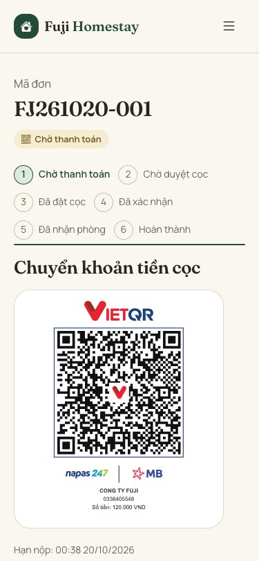 |
| Kết quả | **Pass** |

#### TC02 — Trả trước nhận

| Trường | Nội dung |
|---|---|
| Mục tiêu test | Chặn khoảng ngày không hợp lệ. |
| Dữ liệu đầu vào, các ràng buộc | Form đặt phòng có ngày trả trước ngày nhận; bổ sung dữ liệu test ngày nhận = ngày trả 20/11/2026; không được tạo đơn. |
| Đầu ra dự kiến | Báo validation phía server, không 500, không giữ đêm. |
| Đầu ra thực tế | [báo cáo trước ra mắt](prelaunch-report.md) TC02 ghi ngày đảo bị chặn; `PricingServiceTests.Quote_CheckOutNotAfterCheckIn_Throws` kiểm ngày bằng nhau, có trong [kết quả chạy lại](evidence/hien-tai.md). Không có bằng chứng lưu lại ngày cụ thể của lượt ngày đảo HTTP. |
| Kết quả | **Pass** |

#### TC03 — SĐT sai

| Trường | Nội dung |
|---|---|
| Mục tiêu test | Kiểm định dạng và chuẩn hóa SĐT. |
| Dữ liệu đầu vào, các ràng buộc | SĐT 12345; biến thể hợp lệ có khoảng trắng và +84; tên/SĐT trống, tên 101 ký tự, ghi chú 501 ký tự là dữ liệu biên. |
| Đầu ra dự kiến | Giá trị sai không tạo đơn; số hợp lệ được chuẩn hóa; không 500. |
| Đầu ra thực tế | [báo cáo trước ra mắt](prelaunch-report.md) mục 5/9 ghi các biên bị chặn và +84/khoảng trắng tạo được đơn. Không có bằng chứng lưu lại mã đơn riêng cho từng biến thể. |
| Kết quả | **Pass** |

#### TC04 — Phòng cuối đồng thời

| Trường | Nội dung |
|---|---|
| Mục tiêu test | Chỉ một yêu cầu giữ được phòng cuối. |
| Dữ liệu đầu vào, các ràng buộc | 8 HTTP POST đồng thời, 8 phiên và giá trị chống giả mạo riêng; một phòng cuối, 01–03/02/2027, hai đêm. |
| Đầu ra dự kiến | 1 thành công, 7 hết phòng; không trùng RoomNight. |
| Đầu ra thực tế | [báo cáo trước ra mắt](prelaunch-report.md) mục 5/9 và concurrency.json được báo cáo dẫn: đúng 1/8 thành công, 7 báo hết phòng, không trùng đêm; [dữ liệu HTTP đã tuyển](evidence/tc04-dong-thoi.json). Không chạy lại HTTP/SQL trong lượt tổng hợp. |
| Kết quả | **Pass** |

#### TC05 — Quyền chủ

| Trường | Nội dung |
|---|---|
| Mục tiêu test | Chặn đọc và sửa dữ liệu của chủ khác. |
| Dữ liệu đầu vào, các ràng buộc | Chủ A 0912000001 truy cập đơn, homestay, lịch, đối soát của B; API ghi có giá trị chống giả mạo hợp lệ. |
| Đầu ra dự kiến | 404 cho tài nguyên không thuộc chủ; dữ liệu B giữ nguyên. |
| Đầu ra thực tế | [báo cáo trước ra mắt](prelaunch-report.md) ma trận quyền: cả GET và API ghi trả 404. `HomestayEditorTests.EditorBlocksOtherOwnerAndAccountant` và nhóm `OwnerApiTests` trong [kết quả chạy lại](evidence/hien-tai.md). |
| Kết quả | **Pass** |

#### TC06 — Tra cứu sai SĐT

| Trường | Nội dung |
|---|---|
| Mục tiêu test | Không tiết lộ sự tồn tại đơn. |
| Dữ liệu đầu vào, các ràng buộc | Mã đơn tồn tại + SĐT sai 0900000000; thiếu SĐT; mã FJ000000-000; đối chứng mã chữ thường + SĐT đúng. |
| Đầu ra dự kiến | Các trường hợp sai cùng trả 404; đúng trả đơn tương ứng. |
| Đầu ra thực tế | [báo cáo trước ra mắt](prelaunch-report.md) TC06 đạt; `PublicApiTests.BookingLookupNeedsMatchingPhoneAndHidesExistence` assert đủ các nhánh trong [kết quả chạy lại](evidence/hien-tai.md). |
| Kết quả | **Pass** |

#### TC07 — Upload

| Trường | Nội dung |
|---|---|
| Mục tiêu test | Chặn file giả, hỏng, sai tên hoặc MIME. |
| Dữ liệu đầu vào, các ràng buộc | Multipart của chủ 0912000001 tới /Owner/Homestays/Document/1; PNG chỉ 12 byte, ../qa-path.png, PNG tên .exe/.jpg, MIME image/jpeg sai; file 6/10 MB; ảnh thật PNG/JPEG/WEBP và PDF giấy tờ. |
| Đầu ra dự kiến | Từ chối dữ liệu sai và file quá 5 MB; nhận ảnh thật; PDF chỉ được nhận ở giấy tờ, không nhận làm bill/ảnh công khai. |
| Đầu ra thực tế | Lần đầu [báo cáo trước ra mắt](prelaunch-report.md) mục 5/9: nhận ảnh header PNG hỏng và sai tên/MIME. [Kết quả HTTP trước sửa](evidence/bug-01-upload-truoc.json) đã lưu. Mục 12 sau sửa: 8/8 tình huống multipart đạt, PDF tải 200/application/pdf/attachment. `UploadValidationTests.TruncatedOrCorruptedImagesAreRejected`, `MismatchedNameTypeOrPathIsRejected`, `PdfOnlyAllowedWhereEnabled` đạt trong [kết quả chạy lại](evidence/hien-tai.md). Ảnh sau chỉ minh họa giao diện quảng cáo định dạng trước sửa, không chứng minh HTTP âm tính: 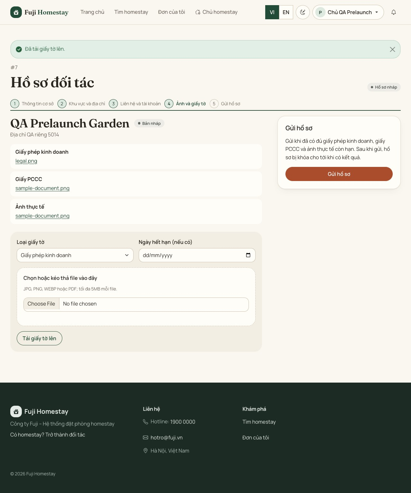 Ảnh HTTP trước/sau sửa: không có bằng chứng lưu lại. |
| Kết quả | **Pass sau sửa**; Fail → **BUG-01, BUG-02**; đề xuất và quá trình sửa xem mục 4. |

#### TC08 — XSS editor

| Trường | Nội dung |
|---|---|
| Mục tiêu test | Không thực thi script hoặc event handler. |
| Dữ liệu đầu vào, các ràng buộc | Mô tả editor chứa script, img/onerror, javascript:; đánh giá và ghi chú có chuỗi tương tự; nội dung tiếng Việt/emoji. |
| Đầu ra dự kiến | Editor loại phần nguy hiểm; đánh giá/ghi chú hiển thị văn bản đã encode. |
| Đầu ra thực tế | [báo cáo trước ra mắt](prelaunch-report.md) mục 5 và TC08: không chạy payload; mô tả mẫu đã khôi phục. Ảnh trả lời của TC20 còn hiển thị nguyên chuỗi thử ở dạng chữ; không khẳng định bao phủ mọi payload XSS. |
| Kết quả | **Pass** |

#### TC09 — Lọc và phân trang

| Trường | Nội dung |
|---|---|
| Mục tiêu test | Giữ bộ lọc khi chuyển trang. |
| Dữ liệu đầu vào, các ràng buộc | Hoàn Kiếm, 20–21/10/2026, 2 khách; MaxPrice=1000000; chuyển trang 2; URL AreaId=3; page=99999. |
| Đầu ra dự kiến | Giữ MaxPrice; URL lọc trả 200; trang vượt phạm vi được xử lý, không 500. |
| Đầu ra thực tế | [báo cáo trước ra mắt](prelaunch-report.md) TC09 đạt phần đã thử; chưa xác minh lại tập mẫu Tây Hồ bằng click phân trang. `PublicApiTests.SearchReturnsPagedHomestaysAndRejectsReversedPriceRange` còn chặn minPrice=900000 > maxPrice=100000, [kết quả chạy lại](evidence/hien-tai.md). 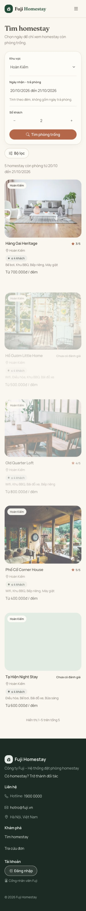 |
| Kết quả | **Pass** |

#### TC10 — English

| Trường | Nội dung |
|---|---|
| Mục tiêu test | Giữ ngôn ngữ qua luồng đặt và tra cứu. |
| Dữ liệu đầu vào, các ràng buộc | Chọn EN; tìm → đặt → QR → tra cứu FJ261020-025; mỗi vai trò một màn English. |
| Đầu ra dự kiến | Điều hướng tiếp vẫn EN; tiền VND và dữ liệu đã lưu giữ cách hiển thị đã chốt. |
| Đầu ra thực tế | [báo cáo trước ra mắt](prelaunch-report.md) TC10 và english-flow.json được dẫn: đi hết luồng, mỗi vai trò một màn. Không có bằng chứng lưu lại toàn bộ route nội bộ × mọi kích thước ở EN. |
| Kết quả | **Pass** |

#### TC11 — Responsive 375

| Trường | Nội dung |
|---|---|
| Mục tiêu test | Dùng được đặt phòng và lịch trên màn hẹp. |
| Dữ liệu đầu vào, các ràng buộc | 375/768/1280, sáng/tối; thêm 390/412/1024 và tablet mô phỏng theo báo cáo; Chromium, WebKit, Firefox. |
| Đầu ra dự kiến | Không tràn ngang; menu thu gọn; thao tác đặt/hủy/lịch đọc và dùng được. |
| Đầu ra thực tế | [báo cáo trước ra mắt](prelaunch-report.md) mục 6/TC11: 90 cấu hình không tràn ngang; có đặt/hủy thực sự qua WebKit/Firefox. Chưa kiểm bàn phím ảo, AT hoặc điện thoại vật lý. Các lỗi bước 06 tách ở TC36–TC39. |
| Kết quả | **Pass** |

#### TC12 — Hủy trước 5 ngày

| Trường | Nội dung |
|---|---|
| Mục tiêu test | Tính hoàn 50% theo BR-04 và nhả đêm. |
| Dữ liệu đầu vào, các ràng buộc | Ngày QA 20/10/2026, đơn FJ261020-008 nhận 25/10/2026, cọc 120.000đ; đã cọc; kế toán ghi hoàn QA-REFUND-008. |
| Đầu ra dự kiến | Hoàn 60.000đ, Cancelled, nhả đêm; ghi hoàn riêng. |
| Đầu ra thực tế | [báo cáo trước ra mắt](prelaunch-report.md) TC12 ghi đúng 60.000/120.000đ. `RefundAndCodeTests.QuoteCancellation_DepositedBooking_FollowsBR04` kiểm thêm các mốc 7/3 ngày với cọc 600.000đ trong [kết quả chạy lại](evidence/hien-tai.md). 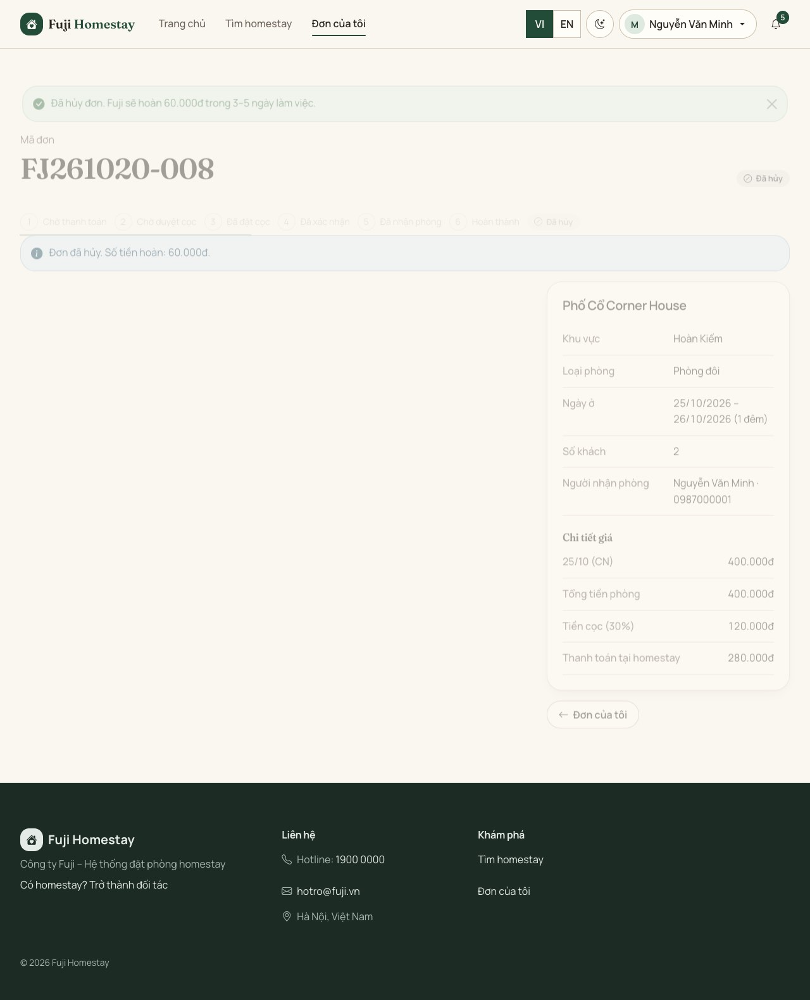 |
| Kết quả | **Pass** |

#### TC13 — Chi tiết và địa chỉ riêng

| Trường | Nội dung |
|---|---|
| Mục tiêu test | Chỉ lộ địa chỉ/liên hệ ở trạng thái được phép. |
| Dữ liệu đầu vào, các ràng buộc | Phố Cổ Corner House; FJ261020-001 trước và sau chủ xác nhận; BR-13 về địa chỉ/liên hệ. |
| Đầu ra dự kiến | Có mô tả/phòng/giá công khai; trước xác nhận không có địa chỉ riêng, sau xác nhận có hướng dẫn nhận phòng. |
| Đầu ra thực tế | [báo cáo trước ra mắt](prelaunch-report.md) mục 4: trước xác nhận không thấy địa chỉ; sau xác nhận thấy 12 Hàng Bạc và hướng dẫn. Nhóm `BookingContactVisibilityTests` trong [kết quả chạy lại](evidence/hien-tai.md); ảnh TC21 chứng minh trạng thái chủ xác nhận, không thay bằng chứng riêng phía khách. |
| Kết quả | **Pass** |

#### TC14 — Giá từng đêm

| Trường | Nội dung |
|---|---|
| Mục tiêu test | Tính ngày thường, cuối tuần, lễ và hiệu lực giá. |
| Dữ liệu đầu vào, các ràng buộc | Fixture: 19–22/11/2026; giá 500.000/600.000/600.000đ; 30/11–02/12 áp 500.000 rồi 550.000đ; 01/01/2027 là lễ. BR-01, BR-08. |
| Đầu ra dự kiến | Ba đêm tổng 1.700.000đ, cọc 510.000đ; chọn đúng phiên bản giá mỗi đêm; lễ ưu tiên cuối tuần. |
| Đầu ra thực tế | `PricingServiceTests.Quote_ThursdayToSunday_PricesEachNight`, `Quote_UsesPriceEffectiveOnEachNight`, `DayTypeOf_FollowsBR08` assert đúng các số/loại đêm trong [kết quả chạy lại](evidence/hien-tai.md). |
| Kết quả | **Pass** |

#### TC15 — Voucher

| Trường | Nội dung |
|---|---|
| Mục tiêu test | Giới hạn giảm theo phần hoa hồng. |
| Dữ liệu đầu vào, các ràng buộc | Khách đăng nhập 0987000001; voucher 50.000đ; FJ261020-003, 27–29/10/2026; tổng 800.000đ, hoa hồng 80.000đ; mức giảm tối đa 20% hoa hồng. |
| Đầu ra dự kiến | Giảm 16.000đ, cọc cần trả 224.000đ, voucher còn 34.000đ. |
| Đầu ra thực tế | [báo cáo trước ra mắt](prelaunch-report.md) mục 4 ghi đúng các số. Nhóm `VoucherServiceTests` trong [kết quả chạy lại](evidence/hien-tai.md). 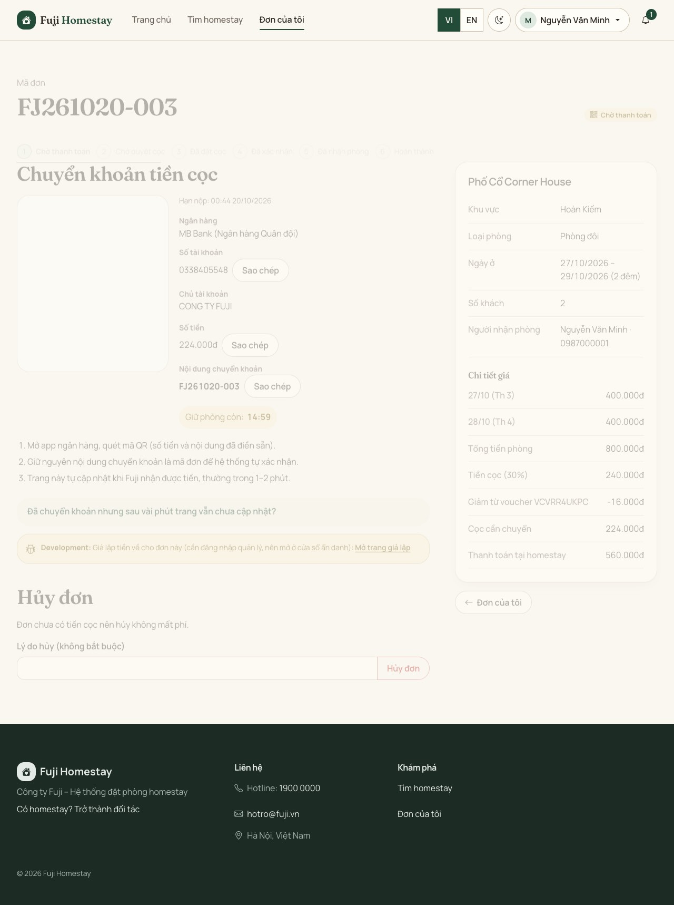 |
| Kết quả | **Pass** |

#### TC16 — Khớp ngân hàng

| Trường | Nội dung |
|---|---|
| Mục tiêu test | Khớp đúng và không ghi nhận tiền lặp. |
| Dữ liệu đầu vào, các ràng buộc | Simulator đúng mã FJ261020-001/cọc 120.000đ; fixture SP-1 gửi hai lần; khoản thiếu 10.000đ, muộn sau giữ phòng, không rõ mã. |
| Đầu ra dự kiến | Đúng → Matched/Deposited; giao dịch lặp chỉ một Payment và BankTransaction; thiếu/muộn/không mã vào hàng xử lý. |
| Đầu ra thực tế | [báo cáo trước ra mắt](prelaunch-report.md) mục 4/5 có Matched, Underpaid, LatePayment, Unmatched và kế toán xử lý. `BankMatchingServiceTests.Process_EnoughMoney_DepositsBookingAutomatically`, `Process_SameWebhookTwice_RecordsOnce`, `Process_Underpaid_KeepsWaitingForPayment` đạt trong [kết quả chạy lại](evidence/hien-tai.md). 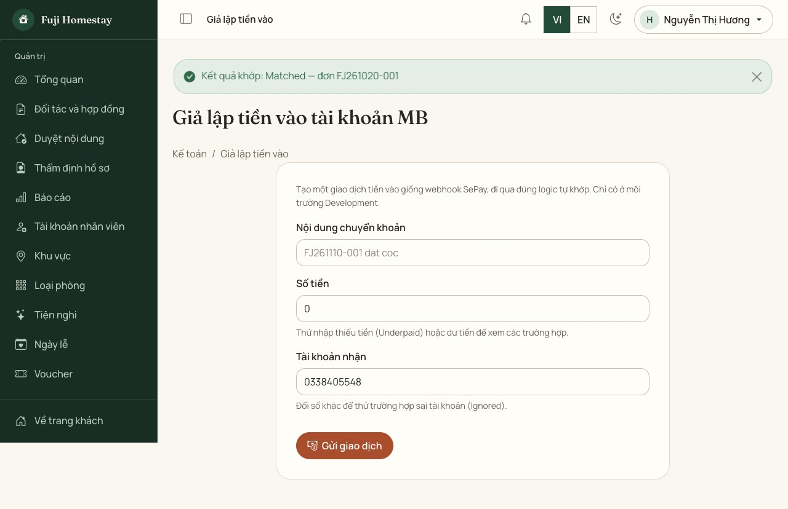 |
| Kết quả | **Pass** |

#### TC17 — Tải và duyệt bill

| Trường | Nội dung |
|---|---|
| Mục tiêu test | Duyệt hoặc từ chối bill qua đúng vai trò. |
| Dữ liệu đầu vào, các ràng buộc | PNG hợp lệ cho FJ261020-015/016; kế toán KT001; từ chối với lý do QA ảnh chưa khớp sao kê; bill chỉ nhận ảnh, tối đa 5 MB. |
| Đầu ra dự kiến | Khách gửi → chờ duyệt; KT duyệt → Deposited, từ chối → khách thấy lý do và được gửi lại. |
| Đầu ra thực tế | [báo cáo trước ra mắt](prelaunch-report.md) bill-flows ghi 015 Deposited, 016 thấy lý do; [diễn tập triển khai](../deploy/self-host-rehearsal-report.md) mục 8 còn ghi luồng không webhook: FJ261020-003 → PaymentSubmitted → Deposited → Confirmed. Nhóm `ReceiptReviewServiceTests` đạt trong [kết quả chạy lại](evidence/hien-tai.md). 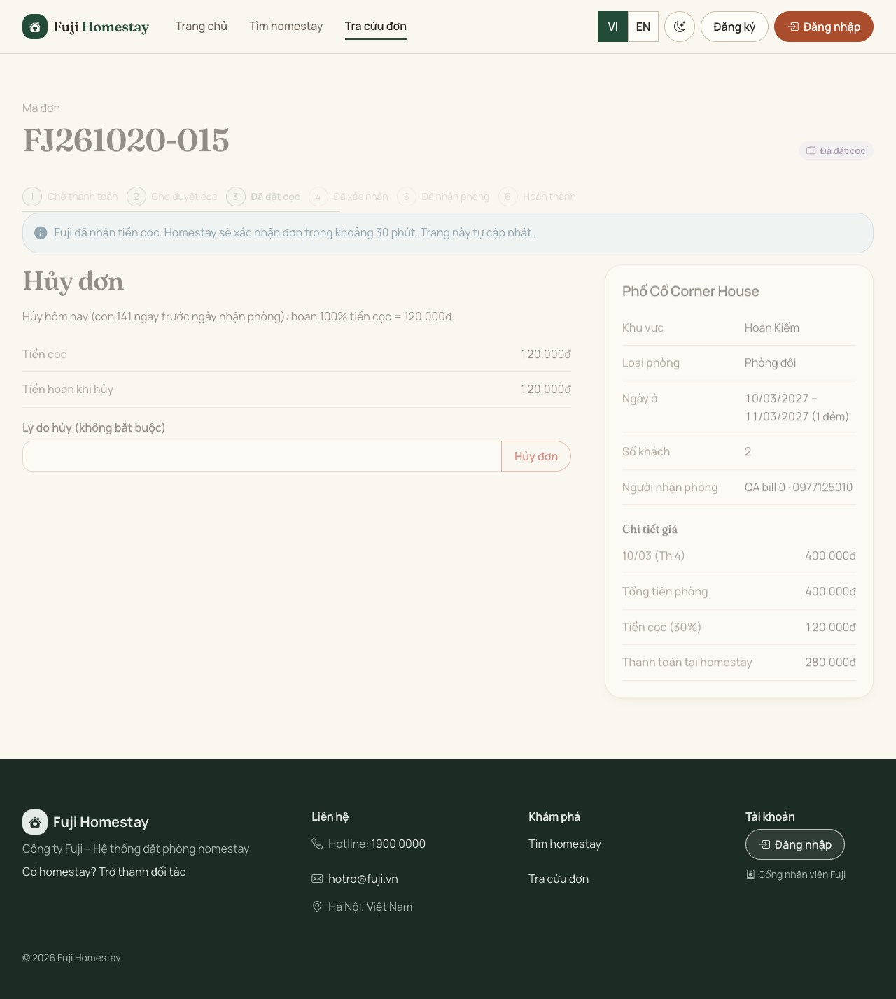 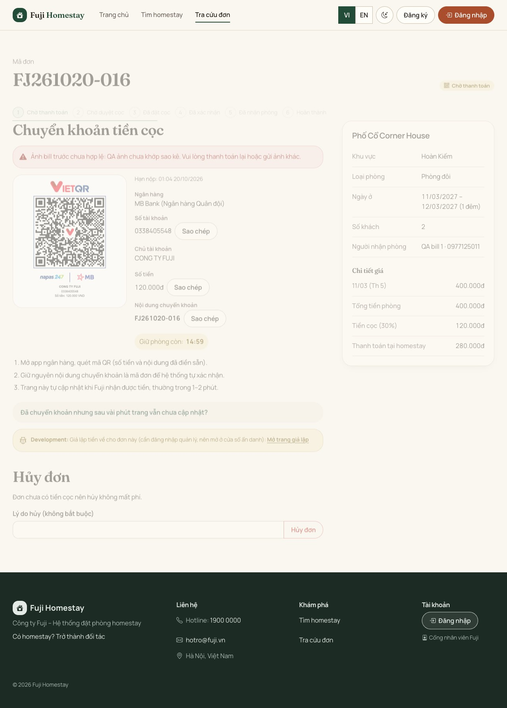 |
| Kết quả | **Pass** |

#### TC18 — Cọc bổ sung

| Trường | Nội dung |
|---|---|
| Mục tiêu test | Chỉ áp dụng đổi sau khi kế toán xác nhận. |
| Dữ liệu đầu vào, các ràng buộc | CR4, FJ261019-012; nội dung QR CR4 FJ261019-012, thêm 360.000đ; QL đã duyệt yêu cầu, kế toán đối chiếu. |
| Đầu ra dự kiến | Nhận tiền chưa tự áp yêu cầu; kế toán xác nhận → Applied, Deposited, tổng cọc 600.000đ. |
| Đầu ra thực tế | [báo cáo trước ra mắt](prelaunch-report.md) mục 4 ghi CR4 Applied, cọc 600.000đ; nhóm `BookingChangeRequestFinanceTests` trong [kết quả chạy lại](evidence/hien-tai.md). Ảnh chỉ chứng minh hàng chờ đã xử lý hết: 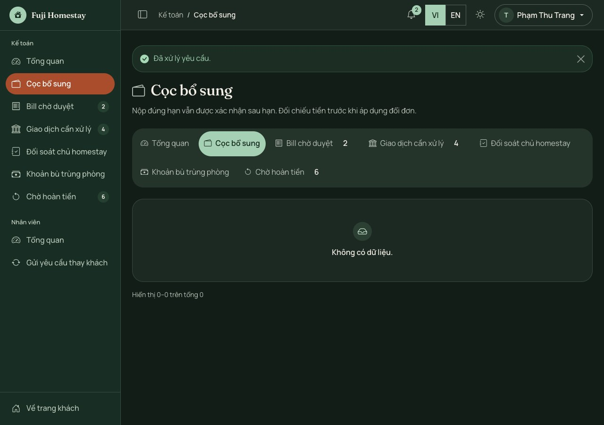 |
| Kết quả | **Pass** |

#### TC19 — Đổi ngày và duyệt đổi/hủy

| Trường | Nội dung |
|---|---|
| Mục tiêu test | Giữ đúng phê duyệt, giá và cọc. |
| Dữ liệu đầu vào, các ràng buộc | FJ261020-007 đổi 28–29/10 sang 27–28/10/2026; không thêm tiền; NV001 gửi hủy đơn #67, quản lý duyệt; đơn voucher phải liên hệ nhân viên. |
| Đầu ra dự kiến | Đổi 007 Applied với tổng 400.000đ, phí 0, cọc 120.000đ; hủy #67 Applied/Cancelled; chặn tự đổi đơn voucher. |
| Đầu ra thực tế | [báo cáo trước ra mắt](prelaunch-report.md) mục 4 dẫn cancellation-flows, staff-cancel-request, manager-approve-final: đạt đúng các trạng thái/số tiền. Nhóm `BookingChangeRequestServiceTests`/`ChangeRequestPoliciesTests` trong [kết quả chạy lại](evidence/hien-tai.md). |
| Kết quả | **Pass** |

#### TC20 — Đánh giá và phản hồi

| Trường | Nội dung |
|---|---|
| Mục tiêu test | Chỉ lưu trú hoàn thành được đánh giá; trả lời công khai, encode. |
| Dữ liệu đầu vào, các ràng buộc | FJ261020-001 Completed; khách cho 5/5 và văn bản thử có img/onerror; chủ trả lời Cảm ơn khách QA 🌸; mỗi đơn chỉ một đánh giá. |
| Đầu ra dự kiến | Điểm/nhận xét/trả lời hiện công khai; mã nguy hiểm hiện chữ; không cho đánh giá lặp. |
| Đầu ra thực tế | [báo cáo trước ra mắt](prelaunch-report.md) mục 4: gửi 5/5, chủ trả lời thành công. Nhóm `ReviewServiceTests` và `GuestReviewPageTests` trong [kết quả chạy lại](evidence/hien-tai.md). 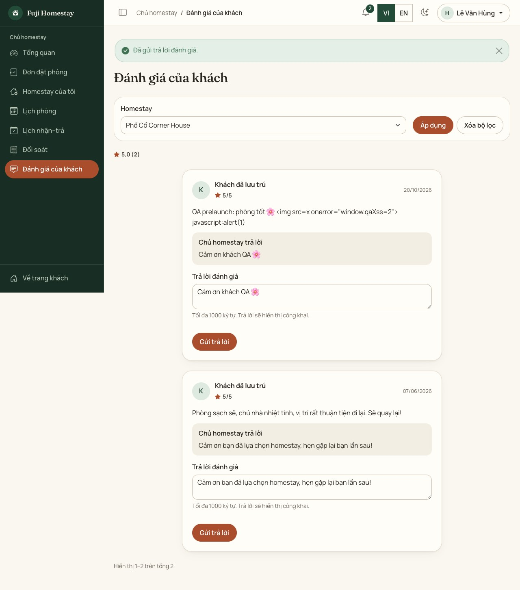 |
| Kết quả | **Pass** |

#### TC21 — Xác nhận, từ chối và lưu trú

| Trường | Nội dung |
|---|---|
| Mục tiêu test | Kiểm trạng thái và lý do của chủ. |
| Dữ liệu đầu vào, các ràng buộc | Chủ 0912000001; đơn của mình Deposited → Confirmed → CheckedIn → Completed; ca từ chối lý do trống rồi Phòng đang sửa chữa. |
| Đầu ra dự kiến | Chỉ chuyển trạng thái hợp lệ; từ chối phải có lý do, hoàn đủ cọc; không xác nhận lại tab cũ. |
| Đầu ra thực tế | [báo cáo trước ra mắt](prelaunch-report.md): 001 qua đủ trạng thái, tab cũ không Confirmed lần hai. `OwnerApiTests.RejectNeedsReasonAndRefundsDeposit` assert trống → 400, đúng → Rejected; `OwnerBookingTests.Controller_RejectWithReason_RefundsFullDeposit` kiểm hoàn đủ trong [kết quả chạy lại](evidence/hien-tai.md). 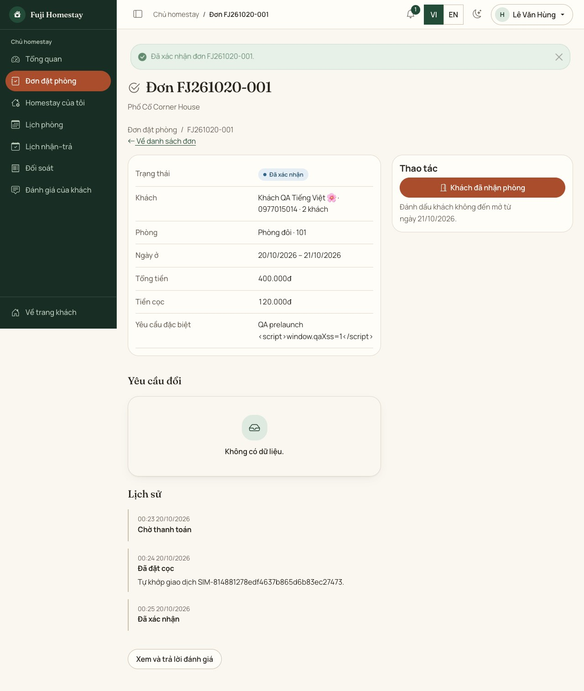 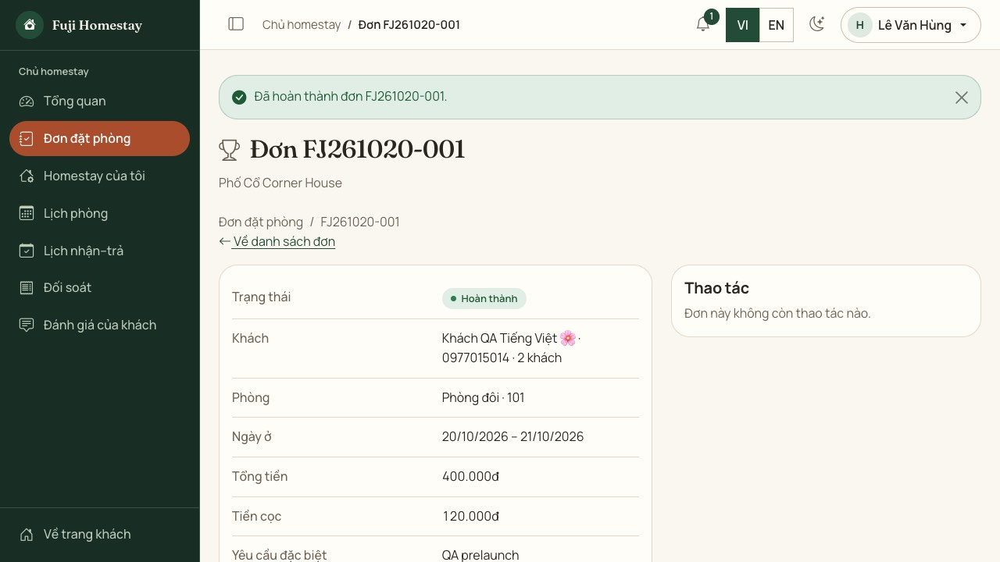 |
| Kết quả | **Pass** |

#### TC22 — Đăng ký đối tác

| Trường | Nội dung |
|---|---|
| Mục tiêu test | Đi hết tự đăng ký, bổ sung, hợp đồng và mở bán. |
| Dữ liệu đầu vào, các ràng buộc | SĐT thử 0977065014; hồ sơ #7, cơ sở #36; 3 giấy tờ mẫu; hợp đồng QA-PRELAUNCH-36, hoa hồng 12%, hạn 31/12/2027; phòng QA101, giá 500k/600k/800k. |
| Đầu ra dự kiến | Gửi → yêu cầu bổ sung → gửi lại → Approved; đủ hợp đồng/phòng/giá/ảnh và duyệt nội dung mới lên tìm kiếm. |
| Đầu ra thực tế | [báo cáo trước ra mắt](prelaunch-report.md) mục 4: đi hết luồng, tìm thấy QA Prelaunch Garden. Màn nhân viên tạo hồ sơ hộ chưa có; không xem luồng này là kiểm mời/kích hoạt assisted. 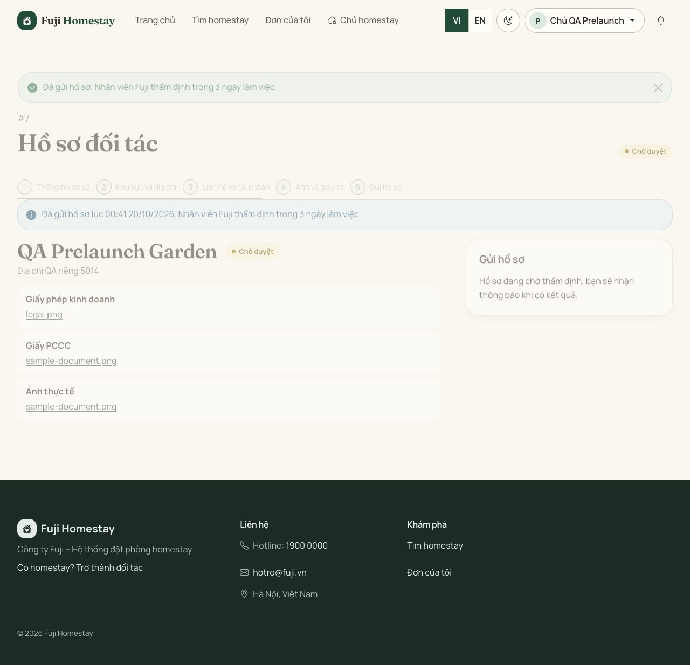 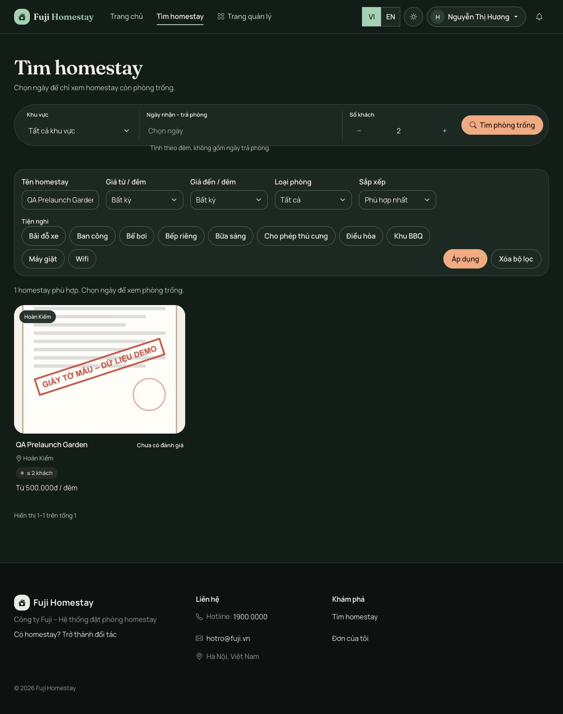 |
| Kết quả | **Pass** |

#### TC23 — Khóa/mở lịch

| Trường | Nội dung |
|---|---|
| Mục tiêu test | Đồng bộ lịch khóa với tồn phòng. |
| Dữ liệu đầu vào, các ràng buộc | Chủ đúng cơ sở; fixture start=Today+300, end=start+2, Maintenance; khóa lại cùng khoảng, khóa quá khứ, thử phòng khác chủ; API POST/DELETE có chống giả mạo. |
| Đầu ra dự kiến | 201 và 2 đêm khóa; trùng 409; ngày sai 400; khác chủ 404; mở 204; khách không đặt được đêm khóa. |
| Đầu ra thực tế | `OwnerApiTests.OwnerBlocksAndUnblocksOwnRoomWithConflictAndOwnershipChecks` đạt trong [kết quả chạy lại](evidence/hien-tai.md); [báo cáo trước ra mắt](prelaunch-report.md) calendar-ajax/final-smoke ghi đúng mã HTTP và khách bị báo hết phòng. 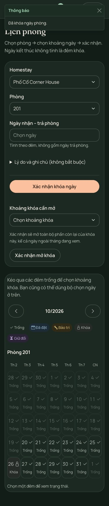 |
| Kết quả | **Pass** |

#### TC24 — Đối soát

| Trường | Nội dung |
|---|---|
| Mục tiêu test | Chi đúng số tiền, trạng thái và quyền. |
| Dữ liệu đầu vào, các ràng buộc | Bảng #29 kỳ 1/10/2026; gửi → xác nhận thay có lý do → mở lại → gửi lại; thử tiền âm rồi 306.000đ; Paid bất biến. |
| Đầu ra dự kiến | Chỉ Accountant ghi chi; sai tiền bị chặn; đủ 306.000đ → Paid; không mở lại Paid. |
| Đầu ra thực tế | [báo cáo trước ra mắt](prelaunch-report.md) mục 4: đạt. `B9FinanceTests.AccountantConfirmsOnBehalfWithReasonAuditAndOwnerLinkThenPaysActualAmountAndTime`, `PaymentRejectsBadAmountDateStateAndActors` trong [kết quả chạy lại](evidence/hien-tai.md). Định dạng audit cũ được kiểm riêng TC40. 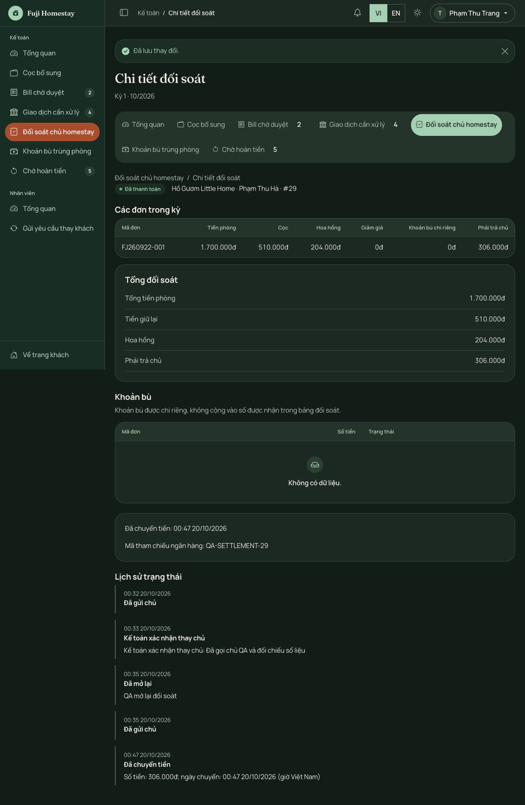 |
| Kết quả | **Pass** |

#### TC25 — Đặt hộ, nhận/giao đơn

| Trường | Nội dung |
|---|---|
| Mục tiêu test | Tạo khách mới và giữ đúng người phụ trách. |
| Dữ liệu đầu vào, các ràng buộc | NV001, SĐT 0977035014, kênh Phone; 28–29/10/2026; giao NV002; nhận đơn chưa giao #67. |
| Đầu ra dự kiến | FJ261020-004 tổng 500.000đ, cọc 150.000đ; NV002 xem được đơn được giao; NV001 nhận được #67. |
| Đầu ra thực tế | [báo cáo trước ra mắt](prelaunch-report.md) mục 4 và claim-keyboard/staff-assign ghi đúng luồng; nhóm `StaffBookingServiceTests`/`StaffWorkspaceUiTests` trong [kết quả chạy lại](evidence/hien-tai.md). 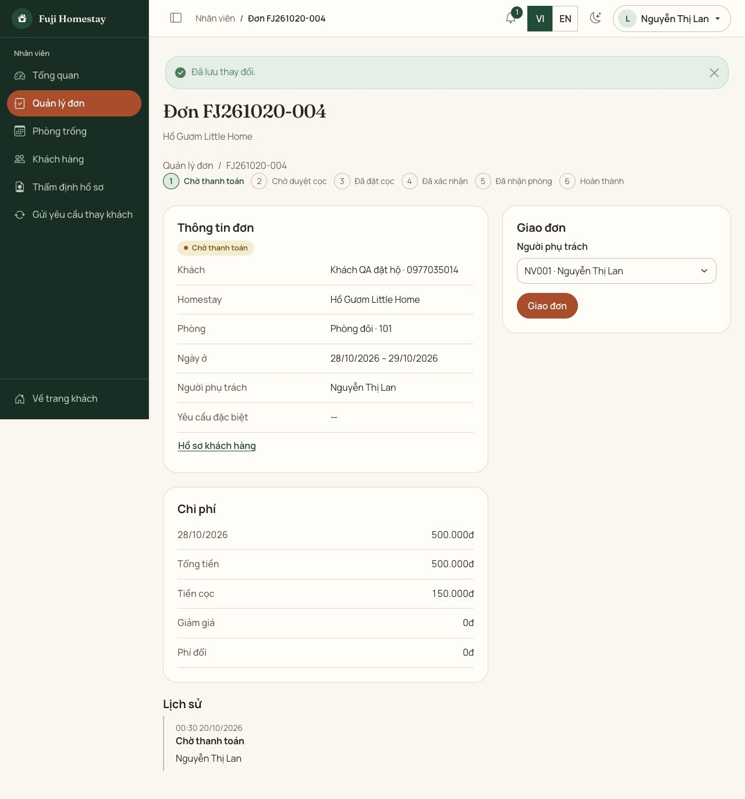 |
| Kết quả | **Pass** |

#### TC26 — Phòng trống và hiệu năng

| Trường | Nội dung |
|---|---|
| Mục tiêu test | Đạt ngưỡng FR-08/NFR-02/NFR-05 với dữ liệu lớn. |
| Dữ liệu đầu vào, các ràng buộc | 150 cơ sở, 1.500 phòng, 108.900 khóa, 326.700 đêm bận; đọc 31 đêm; ngưỡng FR-08 5.000ms, search 3.000ms; benchmark SQL cô lập. |
| Đầu ra dự kiến | Đọc phòng trống ≤5 giây, search ≤3 giây; không lặp truy vấn theo từng đêm; không thay ngưỡng để đạt. |
| Đầu ra thực tế | [báo cáo trước ra mắt](prelaunch-report.md) mục 7: trước 13.167ms Fail; sau tối ưu/cô lập lượt 1.741 test: matrix 309ms, FR-08 1.334ms, search 673ms. TRX [trước](evidence/prelaunch-truoc.md)/[sau](evidence/prelaunch-cuoi.md). Lượt này benchmark skip, không đo lại SQL. `AvailabilityServiceTests.ThirtyOneNightStaffQuoteKeepsTypesAndEffectivePriceVersionsSeparate` đạt trong [kết quả chạy lại](evidence/hien-tai.md). 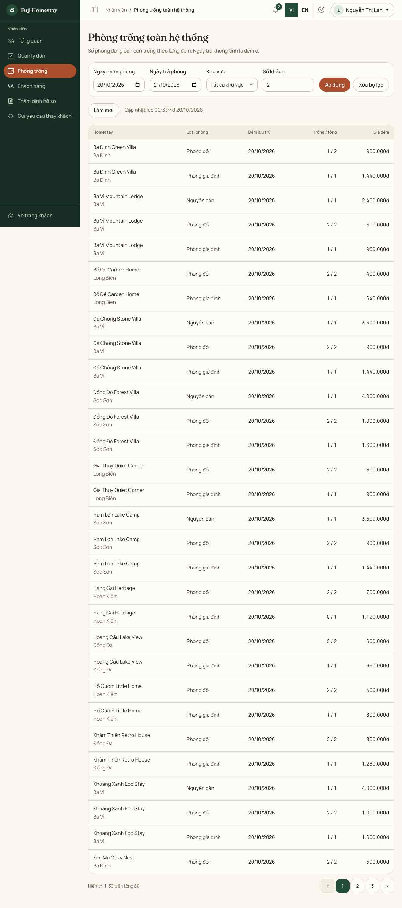 |
| Kết quả | **Pass sau sửa**; Fail → **BUG-07, BUG-08**; đề xuất và quá trình sửa xem mục 4. |

#### TC27 — Trùng phòng và liên kết thông báo

| Trường | Nội dung |
|---|---|
| Mục tiêu test | Giữ tiền khi đổi phòng và mở đúng đơn từ thông báo. |
| Dữ liệu đầu vào, các ràng buộc | FJ261020-006: 101 →102 cùng loại; thay cơ sở 017-002 →020-019; hoàn 019-005; khách nhận thông báo chi tiết theo Code, chủ theo area Owner. |
| Đầu ra dự kiến | Giữ mã/tổng/cọc khi cùng loại; đơn thay thế và khoản bù đúng; thông báo mở được đơn, không 404. |
| Đầu ra thực tế | [backend-gaps](../ui/backend-gaps.md) G-08: trước link Id số gây 404. `OverbookingServiceTests.IncidentNotificationsLinkCustomerByCodeAndOwnerToOwnerArea` kiểm move/replace/refund trong [kết quả chạy lại](evidence/hien-tai.md); [báo cáo trước ra mắt](prelaunch-report.md) ghi cọc cũ 720.000đ, tổng mới 2.880.000đ, bù 480.000đ; ca hoàn 2.400.000đ và voucher; bù 240.000đ đã chi. Không có bằng chứng lưu lại ảnh riêng trước/sau lỗi link. |
| Kết quả | **Pass sau sửa**; Fail → **BUG-21**; đề xuất và quá trình sửa xem mục 4. |

#### TC28 — Tài khoản nhân viên

| Trường | Nội dung |
|---|---|
| Mục tiêu test | Phân quyền quản lý/ghi và vòng đời tài khoản. |
| Dữ liệu đầu vào, các ràng buộc | AD001 tạo QA001; đăng nhập, đổi mật khẩu; khóa/mở, reset; 5 lần sai; QL001 chỉ được đọc; thông tin bí mật không đưa vào tài liệu. |
| Đầu ra dự kiến | Quản trị tạo/khóa/reset được; Manager bị chặn ghi; mật khẩu tạm chỉ hiện một lần; đăng xuất vô hiệu phiên. |
| Đầu ra thực tế | [báo cáo trước ra mắt](prelaunch-report.md) admin-lifecycle ghi đủ luồng. `AdminWorkspaceUiTests.AccountsManagerReadsButCannotWrite_AdministratorCreatesLocksResetsAndChangesEmployment` đạt trong [kết quả chạy lại](evidence/hien-tai.md). Không có bằng chứng lưu lại việc bắt buộc đổi mật khẩu lần đầu; hiện chỉ nhắc đổi. |
| Kết quả | **Pass** |

#### TC29 — Sửa homestay và danh mục editor

| Trường | Nội dung |
|---|---|
| Mục tiêu test | Hiện đủ tiện nghi/loại phòng và bảo toàn dữ liệu. |
| Dữ liệu đầu vào, các ràng buộc | Chủ 0912000001, homestay #6; chọn tiện nghi #3 rồi bỏ; thử cơ sở không Active và danh mục chưa gắn; sửa giá 905.000đ hiệu lực 20/10/2026. |
| Đầu ra dự kiến | Catalog đầy đủ, Selected đúng; lưu chỉ thay trường được phép; không ghi đè giá đã có hiệu lực; đổi địa chỉ Active yêu cầu duyệt lại. |
| Đầu ra thực tế | [05a](../ui/05a-chu-homestay-report.md) từng thiếu catalog G-16; [B9](../ui/b9-backend-report.md) đã nối đủ, phục hồi tập chọn ban đầu. `B9OwnerTests.EditorCatalogIsCompleteForInactiveHomeAndMarksSelection`, `HomestayEditorTests.EditorSplitsCurrentAndUpcomingPricesAndHidesDocumentFiles` đạt trong [kết quả chạy lại](evidence/hien-tai.md). 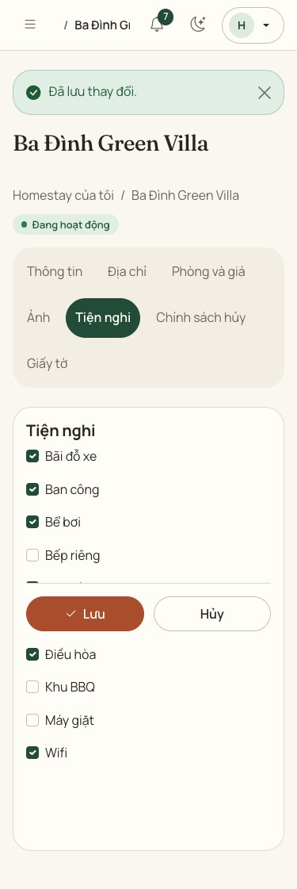 |
| Kết quả | **Pass sau sửa**; Fail → **BUG-34**; đề xuất và quá trình sửa xem mục 4. |

#### TC30 — Báo cáo và tiền trong bảng

| Trường | Nội dung |
|---|---|
| Mục tiêu test | Năm tab giữ kỳ và hiển thị số tiền thật. |
| Dữ liệu đầu vào, các ràng buộc | QL001, năm 2026/2028; năm 2028 không có đơn; khoảng QA 01/06–30/11/2026; đối chiếu ô fx-money với FinancialAsync. |
| Đầu ra dự kiến | Bảng, thẻ và biểu đồ khớp service; kỳ rỗng có trạng thái rỗng; EN giữ VND; không JS đọc bảng được. |
| Đầu ra thực tế | [05d](../ui/05d-quan-ly-report.md) có money-red trước sửa amount thành value. `AdminWorkspaceUiTests.FiveReportTabsPreserveRangeAndDisplayServiceConversionAndFinancialTotals` đạt trong [kết quả chạy lại](evidence/hien-tai.md); [báo cáo trước ra mắt](prelaunch-report.md) đủ năm tab, hình là dữ liệu QA của kỳ đã nêu. 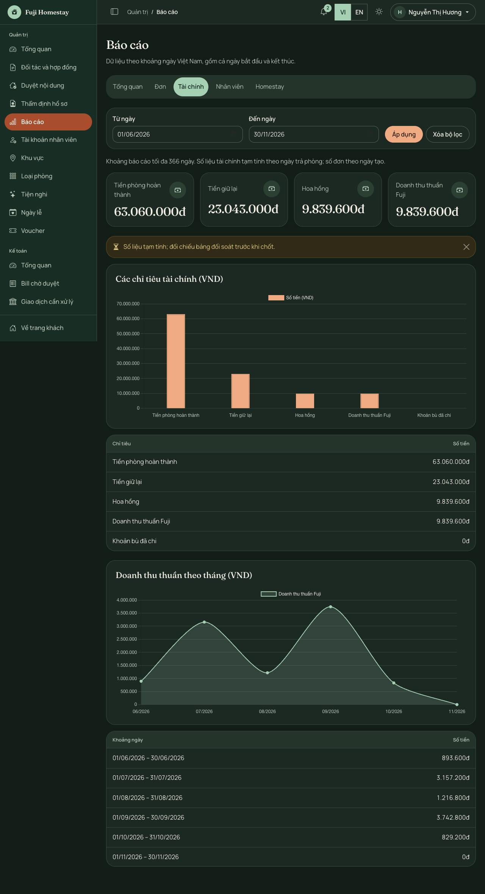 |
| Kết quả | **Pass sau sửa**; Fail → **BUG-24**; đề xuất và quá trình sửa xem mục 4. |

#### TC31 — Danh mục

| Trường | Nội dung |
|---|---|
| Mục tiêu test | CRUD và chặn xóa mục đang dùng. |
| Dữ liệu đầu vào, các ràng buộc | AD001 thêm/sửa/xóa mục QA ở Areas/RoomCategories/Amenities; xóa Hoàn Kiếm đang dùng; ở 05d thử tiện nghi #5 gắn 22 cơ sở. |
| Đầu ra dự kiến | CRUD mục riêng thành công; mục đang dùng bị chặn, không mất liên kết. |
| Đầu ra thực tế | [báo cáo trước ra mắt](prelaunch-report.md) catalogs xác nhận ba mục QA đã xóa, Hoàn Kiếm bị chặn; [05d](../ui/05d-quan-ly-report.md) ghi tiện nghi #5 còn. `AdminWorkspaceUiTests.CatalogInUseCannotBeDeletedAndShowsClearError` đạt trong [kết quả chạy lại](evidence/hien-tai.md). |
| Kết quả | **Pass** |

#### TC32 — Hợp đồng, duyệt nội dung và thông báo chủ

| Trường | Nội dung |
|---|---|
| Mục tiêu test | Đủ điều kiện mới mở bán và gửi chủ đúng đích. |
| Dữ liệu đầu vào, các ràng buộc | Hồ sơ #1003 thử B9, hợp đồng B9-DEV-20261019-1003: 19/10/2026–19/10/2027, 10%, gia hạn 20/10/2027; thử homestay chủ chưa Approved; chủ mở thông báo kết quả. |
| Đầu ra dự kiến | Chặn hợp đồng/duyệt thiếu điều kiện; hợp đồng đủ điều kiện tạo/gia hạn được; URL thông báo của chủ là /Partner/Status. |
| Đầu ra thực tế | [backend-gaps](../ui/backend-gaps.md) G-22: trước chủ bị chặn bởi URL Staff. [B9](../ui/b9-backend-report.md): hồ sơ thử Approved, hợp đồng tạo/gia hạn, thông báo chủ mở đúng; [báo cáo trước ra mắt](prelaunch-report.md) mục 4 có cơ sở #36 lên tìm kiếm. `AdminWorkspaceUiTests.ContractsCreateExtendAndTerminationUseServiceAndNotificationAlias`, `PendingContentCanBeRejectedApprovedAndResumed_ConsultantCannotAct` đạt trong [kết quả chạy lại](evidence/hien-tai.md). |
| Kết quả | **Pass sau sửa**; Fail → **BUG-33**; đề xuất và quá trình sửa xem mục 4. |

#### TC33 — Phân quyền và CSRF

| Trường | Nội dung |
|---|---|
| Mục tiêu test | Chặn truy cập vai trò sai và POST không chống giả mạo. |
| Dữ liệu đầu vào, các ràng buộc | Anonymous, Customer, Owner, NV001, KT001, QL001, AD001; 49 form POST thật bỏ giá trị chống giả mạo; API Owner POST/DELETE thiếu giá trị. |
| Đầu ra dự kiến | Đúng Login/403/404 theo quyền; form/API thiếu chống giả mạo trả 400; ngoại lệ webhook xác thực riêng. |
| Đầu ra thực tế | [báo cáo trước ra mắt](prelaunch-report.md) ma trận mục 5: 49/49 form 400, API chủ thiếu cũng 400; Manager/Admin có quyền đọc chéo đã nêu. `AdminWorkspaceUiTests.EveryMutationRequiresAntiforgery`, `OwnerApiTests.NonOwnersGet401Or403WithoutRedirect` đạt trong [kết quả chạy lại](evidence/hien-tai.md). |
| Kết quả | **Pass** |

#### TC34 — Khóa đăng nhập và redirect

| Trường | Nội dung |
|---|---|
| Mục tiêu test | Giới hạn đăng nhập sai và redirect bên ngoài. |
| Dữ liệu đầu vào, các ràng buộc | Tài khoản thử nhập sai 5 lần; thử lại thông tin đúng; returnUrl=https://evil.invalid/; đăng xuất. |
| Đầu ra dự kiến | Tài khoản bị chặn sau 5 lần sai; returnUrl ngoài hệ thống trở về /; đăng xuất xóa phiên đăng nhập. |
| Đầu ra thực tế | [báo cáo trước ra mắt](prelaunch-report.md) mục 5: quan sát đúng cả ba hành vi; nhóm `AppSignInManagerTests` trong [kết quả chạy lại](evidence/hien-tai.md). Không đưa ảnh có giá trị đăng nhập vào bộ bằng chứng. |
| Kết quả | **Pass** |

#### TC35 — Header bảo mật

| Trường | Nội dung |
|---|---|
| Mục tiêu test | Có header nền trên trang và API. |
| Dữ liệu đầu vào, các ràng buộc | GET /, /Account/Login, /api/homestays; trang tự đặt Referrer-Policy chặt hơn phải được giữ. |
| Đầu ra dự kiến | nosniff, DENY, strict-origin-when-cross-origin, Permissions-Policy hạn chế và CSP nền. |
| Đầu ra thực tế | [báo cáo trước ra mắt](prelaunch-report.md) mục 3/10 thiếu header; mục 12 sau sửa đã đo có header. `SecurityHeadersTests.ResponsesCarryBaselineSecurityHeaders` (3 đầu vào) đạt trong [kết quả chạy lại](evidence/hien-tai.md). CSP đầy đủ script-src chưa được kiểm là đạt. |
| Kết quả | **Pass sau sửa**; Fail → **BUG-03**; đề xuất và quá trình sửa xem mục 4. |

#### TC36 — Vòng focus

| Trường | Nội dung |
|---|---|
| Mục tiêu test | Nhìn thấy focus khi dùng bàn phím. |
| Dữ liệu đầu vào, các ràng buộc | 1280px; Tab qua VI, Đăng nhập, link bỏ qua và các nút btn-brand. |
| Đầu ra dự kiến | Vòng focus rõ theo token thiết kế trên mọi nút. |
| Đầu ra thực tế | [QA bước 06](../ui/qa-report.md) lỗi #1: trước không có vòng focus; sau dùng outline 3px, Tab đúng thứ tự. Lượt kiểm lại 375px toàn bộ 256/256 đạt trong báo cáo; không có bằng chứng lưu lại ảnh riêng trước/sau ở bộ nguồn đã chọn. |
| Kết quả | **Pass sau sửa**; Fail → **BUG-10**; đề xuất và quá trình sửa xem mục 4. |

#### TC37 — Dịch thông báo

| Trường | Nội dung |
|---|---|
| Mục tiêu test | Dịch nút chi tiết khi chọn English. |
| Dữ liệu đầu vào, các ràng buộc | /Notifications, EN, thông báo có URL; nút Xem chi tiết. |
| Đầu ra dự kiến | Hiện View details, điều hướng đúng. |
| Đầu ra thực tế | [QA bước 06](../ui/qa-report.md) lỗi #2: trước vẫn tiếng Việt; sau thêm resource, quét không còn khóa thiếu. Không có bằng chứng lưu lại ảnh riêng trước/sau. |
| Kết quả | **Pass sau sửa**; Fail → **BUG-11**; đề xuất và quá trình sửa xem mục 4. |

#### TC38 — Header đăng nhập ở 375px

| Trường | Nội dung |
|---|---|
| Mục tiêu test | Không tràn trang tài khoản. |
| Dữ liệu đầu vào, các ràng buộc | Khách đã đăng nhập; /Account/ChangePassword và AccessDenied ở 375px; logo, VI/EN, theme và menu tài khoản. |
| Đầu ra dự kiến | Chiều rộng trang không vượt viewport, nút không méo. |
| Đầu ra thực tế | [QA bước 06](../ui/qa-report.md) lỗi #3: trước tràn 33px; sau flex-shrink và ẩn chữ thương hiệu về mặt hiển thị dưới 420px, kiểm lại 375px đạt. Không có bằng chứng lưu lại ảnh riêng trước/sau. |
| Kết quả | **Pass sau sửa**; Fail → **BUG-12**; đề xuất và quá trình sửa xem mục 4. |

#### TC39 — Vùng bấm điện thoại

| Trường | Nội dung |
|---|---|
| Mục tiêu test | Đảm bảo nút nhỏ/đóng đủ 44px. |
| Dữ liệu đầu vào, các ràng buộc | 375px: bộ lọc Bill, Duyệt/Từ chối, Quay lại; nút đóng alert/UI Kit; đối chứng desktop 1280px. |
| Đầu ra dự kiến | Điện thoại cao tối thiểu 44px; desktop giữ kích thước quy định. |
| Đầu ra thực tế | [QA bước 06](../ui/qa-report.md) lỗi #4: btn-sm 36px →44px. [báo cáo trước ra mắt](prelaunch-report.md) mục 10/12: btn-close 32px →44×44px ở 375, 1280 giữ nguyên. Không có bằng chứng lưu lại ảnh đo trước/sau trong bộ nguồn đã chọn. |
| Kết quả | **Pass sau sửa**; Fail → **BUG-13, BUG-26**; đề xuất và quá trình sửa xem mục 4. |

#### TC40 — Định dạng audit đối soát

| Trường | Nội dung |
|---|---|
| Mục tiêu test | Hiển thị tiền và thời gian VN đọc được. |
| Dữ liệu đầu vào, các ràng buộc | Bảng #52, số tiền 120.000đ, paidAt 19/10/2026 14:10:49 UTC; tạo audit mới sau sửa, không viết lại audit lịch sử. |
| Đầu ra dự kiến | Ghi 120.000đ và 21:10 19/10/2026 (giờ Việt Nam). |
| Đầu ra thực tế | [QA bước 06](../ui/qa-report.md) lỗi #5: trước Số tiền: 120000; ngày chuyển UTC dạng ISO; sau định dạng VND/giờ VN. `B9FinanceTests.AccountantConfirmsOnBehalfWithReasonAuditAndOwnerLinkThenPaysActualAmountAndTime` đạt trong [kết quả chạy lại](evidence/hien-tai.md); ảnh TC24 có audit mới đúng định dạng. |
| Kết quả | **Pass sau sửa**; Fail → **BUG-14**; đề xuất và quá trình sửa xem mục 4. |

#### TC41 — Tiếng Việt trong TinyMCE

| Trường | Nội dung |
|---|---|
| Mục tiêu test | Giữ chữ â nguyên dạng khi lưu editor. |
| Dữ liệu đầu vào, các ràng buộc | Textarea rich-text mô tả homestay có ký tự â; bật editor và đổi theme. |
| Đầu ra dự kiến | HTML lưu chữ có dấu nguyên dạng, không biến â thành &acirc; do editor. |
| Đầu ra thực tế | Commit `f3bed4f` thêm `entity_encoding: raw` trong rich-text.js, có chú thích đúng lỗi. Không có bằng chứng lưu lại lượt Fail trước sửa hay kiểm browser riêng ký tự â sau sửa; các test editor server không thay thế kiểm TinyMCE. |
| Kết quả | **Chưa đủ bằng chứng kiểm lại**; Đối chiếu **BUG-15**; đề xuất và quá trình sửa xem mục 4. |

#### TC42 — Danh sách Swagger

| Trường | Nội dung |
|---|---|
| Mục tiêu test | Chỉ công bố route Web API. |
| Dữ liệu đầu vào, các ràng buộc | Development, /swagger, action MVC có attribute route alias /{id}; Production phải không có Swagger. |
| Đầu ra dự kiến | Danh sách Swagger chỉ có api/…; Production GET 404. |
| Đầu ra thực tế | Commit `f3bed4f` đặt DocInclusionPredicate lọc api/…; `SelfHostTests.ProductionHasNoDevelopmentEndpointsEvenForAnonymousRequests` xác nhận Production 404 trong [kết quả chạy lại](evidence/hien-tai.md). Không có bằng chứng lưu lại ảnh/lượt kiểm riêng danh sách Swagger trước và sau sửa. |
| Kết quả | **Chưa đủ bằng chứng kiểm lại**; Đối chiếu **BUG-16**; đề xuất và quá trình sửa xem mục 4. |

#### TC43 — Enum JSON

| Trường | Nội dung |
|---|---|
| Mục tiêu test | Trả trạng thái và loại ngày bằng tên. |
| Dữ liệu đầu vào, các ràng buộc | GET quote loại phòng có bán, Today+20 đến +22; tra đơn bằng Code/SĐT đúng; Owner confirm đơn Deposited. |
| Đầu ra dự kiến | dayType là Weekday/Weekend/Holiday; status là tên hợp lệ như Confirmed, không là số. |
| Đầu ra thực tế | Commit `f3bed4f` trả .ToString() trong DTO; `PublicApiTests.QuoteReturnsNightlyPricesAndDepositOrProblem`, `BookingLookupNeedsMatchingPhoneAndHidesExistence` và `OwnerApiTests.OwnerConfirmsOwnDepositedBookingButNotOthersAndNotWithoutToken` assert JSON chuỗi trong [kết quả chạy lại](evidence/hien-tai.md). Không có bằng chứng lưu lại phản hồi enum số trước sửa. |
| Kết quả | **Pass**; Đối chiếu **BUG-17**; đề xuất và quá trình sửa xem mục 4. |

#### TC44 — Lỗi POST Production

| Trường | Nội dung |
|---|---|
| Mục tiêu test | Trả 500 thân thiện khi pipeline POST có exception. |
| Dữ liệu đầu vào, các ràng buộc | Host Testing cấu hình Production; action webhook ném exception thử; request server không mang chống giả mạo của trình duyệt. |
| Đầu ra dự kiến | HTTP 500 HTML thân thiện, không lộ sentinel/stack/SQL. |
| Đầu ra thực tế | [trích hồi quy](evidence/hoi-quy-trich-doan.md): trước 400 thay vì 500, sau 1/1 pass. `ProductionErrorHandlingTests.FailedWebhookPostRendersFriendly500WithoutRequiringBrowserAntiforgery` đạt trong [kết quả chạy lại](evidence/hien-tai.md). Mở URL trang lỗi trực tiếp không được tính là thử exception. |
| Kết quả | **Pass sau sửa**; Fail → **BUG-09**; đề xuất và quá trình sửa xem mục 4. |

#### TC45 — File mẫu khi publish

| Trường | Nội dung |
|---|---|
| Mục tiêu test | Giữ ảnh giấy tờ/bill mẫu trong output. |
| Dữ liệu đầu vào, các ràng buộc | Data/SampleFiles/sample-document.png và sample-receipt.png; kiểm file tương đối AppContext.BaseDirectory, chữ ký PNG 8 byte. |
| Đầu ra dự kiến | Cả hai file tồn tại và đọc được sau build/publish. |
| Đầu ra thực tế | [trích hồi quy](evidence/hoi-quy-trich-doan.md): 2 fail →2 pass; `SeedAssetPackagingTests.DeploymentOutputContainsReadableSampleImage` đạt trong [kết quả chạy lại](evidence/hien-tai.md). [báo cáo trước ra mắt](prelaunch-report.md) mục 8 có đối chiếu byte file publish. |
| Kết quả | **Pass sau sửa**; Fail → **BUG-05**; đề xuất và quá trình sửa xem mục 4. |

#### TC46 — Ngày webhook và chế độ tắt

| Trường | Nội dung |
|---|---|
| Mục tiêu test | Chặn ngày sai, không xử lý tích hợp chưa cấu hình. |
| Dữ liệu đầu vào, các ràng buộc | Ngày not-a-date, 2026-02-30 10:00:00, rỗng; xác thực hợp lệ trong fixture. Nhánh riêng: cấu hình khóa null/rỗng/toàn khoảng trắng, JSON hợp lệ. |
| Đầu ra dự kiến | Ngày sai →400 ProblemDetails trước xử lý tiền; tích hợp tắt →503 và không ghi BankTransaction. |
| Đầu ra thực tế | `BankWebhookValidationTests.InvalidTransactionDateReturnsProblemBeforeProcessingMoney`: 3 fail trước →pass. Kiểm đối chứng Funnel có 6 fail/2 pass; sau `SelfHostTests.DisabledSePayReturns503WithoutRecordingTransactions` đạt trong [kết quả chạy lại](evidence/hien-tai.md). Không đưa giá trị khóa xác thực của fixture vào tài liệu. |
| Kết quả | **Pass sau sửa**; Fail → **BUG-06, BUG-20**; đề xuất và quá trình sửa xem mục 4. |

#### TC47 — Gửi form lặp

| Trường | Nội dung |
|---|---|
| Mục tiêu test | Một form không giữ thêm phòng khi gửi lại. |
| Dữ liệu đầu vào, các ràng buộc | Fixture 20–22/11/2026, cùng SubmissionId qua hai DbContext; gửi lại sau hủy; đối chứng hai form có Id khác. HTTP thật 2 lượt nối tiếp +6 đồng thời. |
| Đầu ra dự kiến | Cùng form trả cùng đơn; sau hủy vẫn đơn cũ, không giữ đêm; hai form độc lập được đặt hai phòng. |
| Đầu ra thực tế | [trích hồi quy](evidence/hoi-quy-trich-doan.md): trước 2 fail/1 pass, số đơn 2 thay vì 1. Sau `BookingSubmissionTests.ReplayAcrossContextsReturnsOriginalBookingWithoutHoldingAnotherRoom`, `ReplayAfterCancellationDoesNotCreateAnotherBooking`, `SeparateFormsCanStillBookTwoRoomsForSameStay` đạt trong [kết quả chạy lại](evidence/hien-tai.md). [báo cáo trước ra mắt](prelaunch-report.md): trước tạo 010/011, sau mọi lượt trả 023, SQL 1 đơn/1 đêm; đặt hộ trả cùng đơn. |
| Kết quả | **Pass sau sửa**; Fail → **BUG-04**; đề xuất và quá trình sửa xem mục 4. |

#### TC48 — Production sau proxy và khởi động lại

| Trường | Nội dung |
|---|---|
| Mục tiêu test | Tránh redirect loop, giữ phiên và ẩn Dev. |
| Dữ liệu đầu vào, các ràng buộc | ReverseProxy bật; peer 127.0.0.1, ::1, ::ffff:127.0.0.1 thiếu X-Forwarded-Proto; đối chứng ngoài loopback/proxy tắt. Restart dùng lại kho khóa; GET Dev/Swagger anonymous. |
| Đầu ra dự kiến | Loopback hợp lệ dùng HTTPS, không redirect vòng; không tin peer ngoài; dữ liệu phiên/chống giả mạo còn; Dev/Swagger 404. |
| Đầu ra thực tế | [diễn tập triển khai](../deploy/self-host-rehearsal-report.md) mục 1/8: TempData trước thiếu Secure, Dev anonymous từng redirect Login; kiểm đối chứng thiếu Proto fail. Sau `SelfHostTests.FunnelWithoutForwardedProtoTrustsOnlyEnabledLoopback`, `KeysCookieAndOldAntiforgerySurviveNewHost`, `ProductionHasNoDevelopmentEndpointsEvenForAnonymousRequests` đạt trong [kết quả chạy lại](evidence/hien-tai.md). [Kết quả HTTP proxy/bill đã tuyển](evidence/tc48-proxy-va-bill.json). Diễn tập backup/restore CHECKDB và consistency 35/35, update lỗi tự rollback binary; không có bằng chứng lưu lại public TLS/4G/reboot thật. |
| Kết quả | **Pass sau sửa**; Fail → **BUG-18, BUG-22, BUG-23**; đề xuất và quá trình sửa xem mục 4. |

#### TC49 — QR Production

| Trường | Nội dung |
|---|---|
| Mục tiêu test | Không dùng QR tài khoản mẫu khi ảnh lỗi. |
| Dữ liệu đầu vào, các ràng buộc | Host Production với ngân hàng cấu hình riêng; fallback trống hoặc /uploads/verified-bank-qr.png; làm ảnh QR chính lỗi; vẫn có form tải bill khi webhook tắt. |
| Đầu ra dự kiến | Không rơi về /images/qr-mb.png; dùng fallback đã cấu hình hoặc hướng dẫn chuyển khoản đúng tài khoản. |
| Đầu ra thực tế | [diễn tập triển khai](../deploy/self-host-rehearsal-report.md) và commit `0b76266`: bỏ fallback hằng tài khoản demo, kiểm JavaScript hai nhánh. `SelfHostTests.BookingQrNeverFallsBackToDemoAccountInProduction` (2 ca) đạt trong [kết quả chạy lại](evidence/hien-tai.md). Không có bằng chứng lưu lại lượt Fail trước sửa, ảnh trước/sau hoặc giao dịch ngân hàng thật. |
| Kết quả | **Pass**; Đối chiếu **BUG-19**; đề xuất và quá trình sửa xem mục 4. |

#### TC50 — Hồi quy component và bố cục các bước trước

| Trường | Nội dung |
|---|---|
| Mục tiêu test | Khắc phục các phát hiện trước QA tổng thể. |
| Dữ liệu đầu vào, các ràng buộc | UI Kit: modal theo submitter, rating có điểm, sort dưới PathBase; thanh tìm 768px. Home/Details: lightbox, no-JS 375px; hero/carousel/deck/partner 375/768/1280 sáng/tối. Dashboard/bảng nội bộ 768px; Staff tên/file dài 200/240 ký tự. |
| Đầu ra dự kiến | Modal đúng hành động; tên truy cập đầy đủ; sort giữ prefix; không che chữ/tràn/nút co; đủ nội dung khi reduced-motion/no-JS; bốn khối được sửa đúng hình học. |
| Đầu ra thực tế | [02x](../ui/02x-component-report.md), [03](../ui/03-trang-khach-report.md), [03y](../ui/03y-phong-cach-report.md), [04](../ui/04-noi-bo-report.md), [05a](../ui/05a-chu-homestay-report.md), [05b](../ui/05b-nhan-vien-report.md), [B9](../ui/b9-backend-report.md) ghi phát hiện và kiểm lại. Bốn khối 03y2 sau sửa: không overflow/pageerror, reduce/no-JS đủ nội dung; 04 có 204 cấu hình đạt; Staff tên dài sau sửa overflow 0. Đây là nhóm ca con cùng mục hồi quy UI, không phải một E2E xuyên mọi màn. 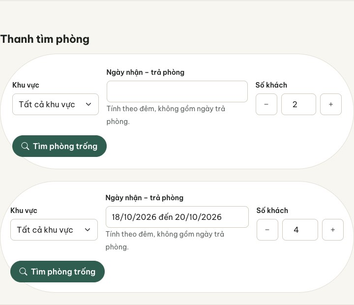 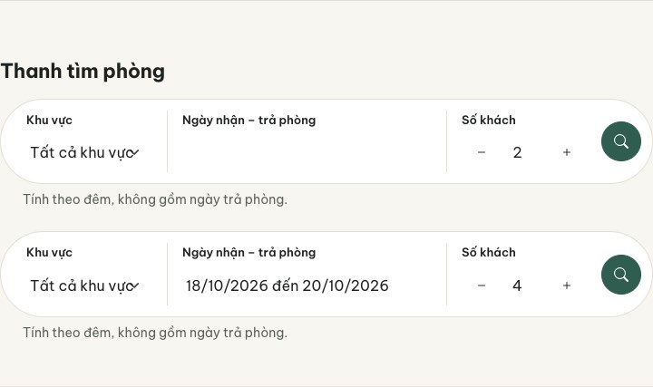 |
| Kết quả | **Pass sau sửa**; Fail → **BUG-25, BUG-27, BUG-28, BUG-29, BUG-30, BUG-31, BUG-32, BUG-35**; đề xuất và quá trình sửa xem mục 4. |

## 4. Đề xuất và quá trình fix lỗi

Có **35 mục lỗi/nhóm phát hiện**. Mức độ không có trong nguồn được ghi là đánh giá theo ảnh hưởng, không giả nhận đó là phân loại lịch sử. BUG-15/16/17/19 có chứng cứ thay đổi cấu hình/DTO nhưng thiếu đầu ra lỗi trước sửa; không cộng bốn mục này thành Fail lần đầu. BUG-25/35 tập hợp phát hiện review component/bố cục và liệt kê từng ca con trong hiện tượng.

Đường dẫn mã trong bảng được rút gọn: đường dẫn ứng dụng tính từ `HomestayBooking.Web/`; `Tests/` nghĩa là `HomestayBooking.Tests/`. Đường dẫn file là đường dẫn hiện hành; tên thư mục ứng dụng được rút gọn để dễ đọc. Hash dùng commit **có trong lịch sử repo hiện tại** sau khi đọc diff. Một số báo cáo giữ hash mốc cũ khác: `379411a→8e106aa`, `6c76271→a41fcb4`, `83422f2→30d9a0e`, `f22de19→d424ee0`, `e167871→95c2260`, `76ebd00→f0af23d`, `77e0526→3431f0a`, `3505966→53106a1`. Đối chiếu theo nội dung file/thay đổi; không coi hash cũ là một lần sửa khác.

<a id="bug-01"></a>
### BUG-01 — Upload chỉ kiểm chữ ký đầu file

| Nội dung | Ghi nhận |
|---|---|
| Test case phát hiện và hiện tượng | **TC07**. Gửi PNG 12 byte hoặc PNG tên .exe/MIME JPEG/filename ../ qua form giấy tờ vẫn được nhận; báo cáo trước ra mắt mục 5/10. |
| Mức độ | Chặn nghiệm thu |
| Nguyên nhân gốc | ReceiptFileStore cũ chỉ đọc header để đoán định dạng, không đối chiếu tên/MIME và cấu trúc đầy đủ. |
| Đề xuất cách sửa | Kiểm cả tên, dung lượng, đuôi, MIME, chữ ký và cấu trúc; ghi đúng byte đã kiểm. Bộ giải mã ảnh đầy đủ là phương án sâu hơn nhưng chưa có trong bản vá. |
| Quá trình sửa | Commit **86d574f**; file: `Services/ReceiptFileStore.cs; Tests/Services/ReceiptFileStoreTests.cs`. Giới hạn tên trần; PNG kiểm IHDR/IEND/CRC; JPEG kiểm SOF/SOS/EOI; WEBP kiểm RIFF và VP8/VP8L/VP8X; từ chối file hỏng. |
| Kiểm lại | UploadValidationTests 16 ca trong lượt hiện tại; multipart 8 tình huống đạt theo mục 12 báo cáo. Ảnh TC07 chỉ minh họa UI trước sửa; ảnh HTTP trước/sau: không có bằng chứng lưu lại. Xem test case tương ứng, [kết quả chạy lại](evidence/hien-tai.md) và các nguồn mục 1. |

<a id="bug-02"></a>
### BUG-02 — Giao diện nhận PDF nhưng backend chưa hỗ trợ

| Nội dung | Ghi nhận |
|---|---|
| Test case phát hiện và hiện tượng | **TC07**. Form Partner/Owner quảng cáo PDF nhưng pipeline chỉ nhận ảnh; báo cáo trước ra mắt mục 10. |
| Mức độ | Trung bình |
| Nguyên nhân gốc | Hợp đồng định dạng giữa giao diện và ReceiptFileStore không thống nhất. |
| Đề xuất cách sửa | Cho PDF ở giấy tờ đối tác theo quyết định đã lưu; bill/ảnh công khai vẫn chỉ ảnh. |
| Quá trình sửa | Commit **86d574f**; file: `Services/ReceiptFileStore.cs; Services/OwnerRegistrationService.DocumentsAndSla.cs`. Thêm allowPdf=true ở lưu giấy tờ; kiểm %PDF-, đối tượng, %%EOF; ánh xạ application/pdf và tải attachment. |
| Kiểm lại | UploadValidationTests.PdfOnlyAllowedWhereEnabled; mục 12: PDF hợp lệ được nhận/tải 200, PDF hỏng bị chặn. Không có bằng chứng lưu lại ảnh trước/sau. Xem test case tương ứng, [kết quả chạy lại](evidence/hien-tai.md) và các nguồn mục 1. |

<a id="bug-03"></a>
### BUG-03 — Thiếu header bảo mật mặc định

| Nội dung | Ghi nhận |
|---|---|
| Test case phát hiện và hiện tượng | **TC35**. Phản hồi Production đã đo thiếu CSP/nosniff/referrer/permissions, chỉ có một số header theo trang; báo cáo mục 3/10. |
| Mức độ | Thấp |
| Nguyên nhân gốc | Chưa có middleware đặt header chung; antiforgery tự đặt SAMEORIGIN theo mặc định. |
| Đề xuất cách sửa | Đặt nền bảo mật thống nhất và không ghi đè chính sách chặt hơn của từng trang; tiếp tục nonce riêng cho CSP script-src. |
| Quá trình sửa | Commit **86d574f**; file: `Program.cs; Tests/Integration/SecurityHeadersTests.cs`. OnStarting TryAdd các header nền, DENY và suppress X-Frame-Options từ antiforgery. |
| Kiểm lại | SecurityHeadersTests.ResponsesCarryBaselineSecurityHeaders: ba URL đạt; mục 12 ghi curl trang chủ đạt. Không có bằng chứng lưu lại ảnh trước/sau; không tuyên bố CSP đầy đủ. Xem test case tương ứng, [kết quả chạy lại](evidence/hien-tai.md) và các nguồn mục 1. |

<a id="bug-04"></a>
### BUG-04 — Gửi lại form tạo thêm đơn

| Nội dung | Ghi nhận |
|---|---|
| Test case phát hiện và hiện tượng | **TC47**. Cùng form tạo FJ261020-010 và 011, chiếm phòng khác; test đỏ thấy 2 đơn thay vì 1. |
| Mức độ | Cao |
| Nguyên nhân gốc | Form tạo đơn thiếu định danh gửi và service không nhận diện yêu cầu đã hoàn thành. |
| Đề xuất cách sửa | Thêm SubmissionId bền trong audit cùng transaction giữ đêm; giữ hai form riêng được đặt hai phòng. Chặn nút bằng JS riêng không đủ cho gửi đồng thời/nhiều instance. |
| Quá trình sửa | Commit **30d9a0e**; file: `Services/BookingService.cs; Services/StaffBookingService.cs; Controllers/BookingsController.cs; Areas/Staff/Views/Bookings/Create.cshtml; Views/Bookings/Create.cshtml`. Truyền Id từ form đến service; SQL khóa hàng khách UPDLOCK/HOLDLOCK; tìm đơn cũ qua audit trước khi tạo; ghi marker cùng transaction. |
| Kiểm lại | BookingSubmissionTests: 2 fail/1 pass →3 pass; HTTP 2+6 lượt cùng trả 023, chỉ 1 đơn/1 đêm. Trích log đỏ/xanh đã lưu; ảnh trước/sau: không có bằng chứng lưu lại. Cần giữ audit để nhận diện form cũ. Xem test case tương ứng, [kết quả chạy lại](evidence/hien-tai.md) và các nguồn mục 1. |

<a id="bug-05"></a>
### BUG-05 — Publish thiếu file mẫu

| Nội dung | Ghi nhận |
|---|---|
| Test case phát hiện và hiện tượng | **TC45**. Ảnh giấy tờ/bill mẫu không có trong bản publish; hai test packaging fail. |
| Mức độ | Trung bình |
| Nguyên nhân gốc | File Data/SampleFiles chưa được khai báo Content để mang vào output/publish. |
| Đề xuất cách sửa | Khai báo hai chế độ CopyToOutputDirectory/CopyToPublishDirectory thay vì dựa thư mục checkout. |
| Quá trình sửa | Commit **8e106aa**; file: `HomestayBooking.Web.csproj; Tests/Data/SeedAssetPackagingTests.cs`. Content Include Data/SampleFiles/*.png, PreserveNewest ở cả output và publish. |
| Kiểm lại | 2 fail →2 pass; kiểm chữ ký và so byte publish theo báo cáo. Không có bằng chứng lưu lại ảnh trước/sau; xem trích log. Xem test case tương ứng, [kết quả chạy lại](evidence/hien-tai.md) và các nguồn mục 1. |

<a id="bug-06"></a>
### BUG-06 — Ngày webhook sai gây exception

| Nội dung | Ghi nhận |
|---|---|
| Test case phát hiện và hiện tượng | **TC46**. JSON ngày not-a-date, 30/02 hoặc rỗng đi vào ParseExact và gây lỗi server. |
| Mức độ | Trung bình |
| Nguyên nhân gốc | DateTime.ParseExact ném exception thay vì validation đầu vào. |
| Đề xuất cách sửa | Dùng TryParseExact, trả 400 ProblemDetails trước khi matching tiền; vẫn xác thực trước validation ngày. |
| Quá trình sửa | Commit **a41fcb4**; file: `Controllers/Api/BankWebhookController.cs; Tests/Services/BankWebhookValidationTests.cs`. Kiểm định dạng yyyy-MM-dd HH:mm:ss, trả thông báo validation khi thất bại. |
| Kiểm lại | 3 fail +1 pass →4 pass ở lượt hồi quy cũ; test ngày sai vẫn đạt lượt hiện tại. Không có bằng chứng lưu lại ảnh; trích log đỏ/xanh có trong evidence. Xem test case tương ứng, [kết quả chạy lại](evidence/hien-tai.md) và các nguồn mục 1. |

<a id="bug-07"></a>
### BUG-07 — Đọc phòng trống vượt 5 giây

| Nội dung | Ghi nhận |
|---|---|
| Test case phát hiện và hiện tượng | **TC26**. Benchmark FR-08 ban đầu 13.167ms, vượt 5.000ms; TRX trước có một fail. |
| Mức độ | Trung bình |
| Nguyên nhân gốc | Load dated nạp ảnh/tiện nghi không cần cho DTO nhân viên; lọc tập Id lớn và duyệt giá lặp. |
| Đề xuất cách sửa | Giảm dữ liệu nạp, dùng lại scope phòng bán được và gom giá theo loại; giữ nguyên ngưỡng và kết quả giá. |
| Quá trình sửa | Commit **d424ee0**; file: `Services/AvailabilityService.cs; Tests/Services/AvailabilityServiceTests.cs`. Tùy chọn includeHomeContent=false cho staff/alternatives; join theo SellableRooms; nhóm giá theo RoomType. |
| Kiểm lại | 75 test liên quan đạt theo báo cáo; 31 đêm và EffectiveFrom được kiểm riêng. Sau cả tối ưu và cô lập: FR-08 1.334ms; không quy toàn bộ mức giảm cho một thay đổi. Không đo lại SQL lượt này. Xem test case tương ứng, [kết quả chạy lại](evidence/hien-tai.md) và các nguồn mục 1. |

<a id="bug-08"></a>
### BUG-08 — Benchmark tranh tài nguyên với fixture khác

| Nội dung | Ghi nhận |
|---|---|
| Test case phát hiện và hiện tượng | **TC26**. Lượt full có benchmark thất bại, khi nhiều fixture SQLite/InMemory đang chạy song song. |
| Mức độ | Thấp / hạ tầng test |
| Nguyên nhân gốc | Collection SQL tuần tự nội bộ nhưng còn chạy cùng collection khác, làm số đo không cô lập. |
| Đề xuất cách sửa | Không chạy benchmark cùng collection khác; số đo cô lập không thay thế thử tải Production. |
| Quá trình sửa | Commit **95c2260**; file: `Tests/Services/AvailabilityPerformanceTests.cs`. Thêm DisableParallelization=true vào ConstraintTestDatabaseCollection, không nới ngưỡng. |
| Kiểm lại | Lượt full sau sửa 1.740 pass; xác nhận cuối trước ra mắt 1.741 pass, 0 fail/skip. TRX trước/sau trong evidence; lượt hiện tại benchmark skip. Xem test case tương ứng, [kết quả chạy lại](evidence/hien-tai.md) và các nguồn mục 1. |

<a id="bug-09"></a>
### BUG-09 — Exception POST bị trang lỗi trả 400

| Nội dung | Ghi nhận |
|---|---|
| Test case phát hiện và hiện tượng | **TC44**. POST gây exception được middleware re-execute sang Home/Error nhưng trả BadRequest thay vì 500. |
| Mức độ | Trung bình |
| Nguyên nhân gốc | Re-execute giữ method POST; filter CSRF áp lên action lỗi chỉ đọc. |
| Đề xuất cách sửa | Chỉ miễn chống giả mạo cho action lỗi chỉ đọc, giữ nguyên bảo vệ action ghi. |
| Quá trình sửa | Commit **f0af23d**; file: `Controllers/HomeController.cs; Tests/Integration/ProductionErrorHandlingTests.cs`. Thêm IgnoreAntiforgeryToken ở Error, không thay filter toàn cục. |
| Kiểm lại | Test pipeline thực: trước 400, sau 500 HTML không sentinel; trích log và test hiện tại đạt. Không dùng URL Error trực tiếp làm bằng chứng exception. Xem test case tương ứng, [kết quả chạy lại](evidence/hien-tai.md) và các nguồn mục 1. |

<a id="bug-10"></a>
### BUG-10 — Nút không có vòng focus

| Nội dung | Ghi nhận |
|---|---|
| Test case phát hiện và hiện tượng | **TC36**. Tab qua VI/Đăng nhập/bỏ qua trên desktop chỉ đổi màu nhẹ, không biết focus ở đâu; QA bước 06 #1. |
| Mức độ | Cao |
| Nguyên nhân gốc | Bootstrap outline:0, màu nút tùy biến không có biến focus-shadow tương ứng. |
| Đề xuất cách sửa | Dùng outline token chung cho focus-visible để nhìn rõ ở cả theme. |
| Quá trình sửa | Commit **3431f0a**; file: `wwwroot/css/components.css`. .btn:focus-visible và btn-check + btn dùng outline 3px, offset 2px. |
| Kiểm lại | QA bước 06 ghi Tab đúng, nút có vòng; kiểm lại 375px 256/256 đạt. Không có bằng chứng lưu lại ảnh riêng trước/sau. Xem test case tương ứng, [kết quả chạy lại](evidence/hien-tai.md) và các nguồn mục 1. |

<a id="bug-11"></a>
### BUG-11 — Thiếu bản dịch nút thông báo

| Nội dung | Ghi nhận |
|---|---|
| Test case phát hiện và hiện tượng | **TC37**. EN tại Notifications vẫn hiện Xem chi tiết; QA bước 06 #2. |
| Mức độ | Cao |
| Nguyên nhân gốc | Quét resource trước bỏ sót biểu thức L[điều kiện ? a : b]. |
| Đề xuất cách sửa | Thêm khóa dịch và quét cả biểu thức điều kiện. |
| Quá trình sửa | Commit **3431f0a**; file: `Resources/SharedResource.en.resx`. Thêm Xem chi tiết →View details. |
| Kiểm lại | QA bước 06 ghi số khóa thiếu từ 1 về 0. Không có bằng chứng lưu lại ảnh riêng trước/sau. Xem test case tương ứng, [kết quả chạy lại](evidence/hien-tai.md) và các nguồn mục 1. |

<a id="bug-12"></a>
### BUG-12 — Header tài khoản tràn 33px

| Nội dung | Ghi nhận |
|---|---|
| Test case phát hiện và hiện tượng | **TC38**. 375px đã đăng nhập mở ChangePassword/AccessDenied thì header tràn, nút méo; QA bước 06 #3. |
| Mức độ | Trung bình |
| Nguyên nhân gốc | Tổng logo/chữ thương hiệu/ngôn ngữ/theme/menu vượt chiều rộng; flex co nút. |
| Đề xuất cách sửa | Bảo toàn nút, rút phần thương hiệu hiển thị dưới 420px và giữ tên truy cập. |
| Quá trình sửa | Commit **3431f0a**; file: `wwwroot/css/layout-public.css`. flex-shrink:0 cho điều khiển; ẩn trực quan brand-name khi header có dropdown trên màn hẹp. |
| Kiểm lại | QA kiểm lại mobile đạt. Không có bằng chứng lưu lại ảnh riêng trước/sau trong bộ nguồn được chọn. Xem test case tương ứng, [kết quả chạy lại](evidence/hien-tai.md) và các nguồn mục 1. |

<a id="bug-13"></a>
### BUG-13 — Nút nhỏ chỉ cao 36px

| Nội dung | Ghi nhận |
|---|---|
| Test case phát hiện và hiện tượng | **TC39**. Bill/Transactions ở 375px có btn-sm thấp hơn mục tiêu 44px; QA bước 06 #4. |
| Mức độ | Trung bình |
| Nguyên nhân gốc | Biến thể nhỏ Bootstrap giữ kích thước desktop trên điện thoại. |
| Đề xuất cách sửa | Đặt min-height dưới breakpoint 576px, dùng quy tắc chung. |
| Quá trình sửa | Commit **3431f0a**; file: `wwwroot/css/components.css`. btn-sm min-height 2.75rem trên mobile. |
| Kiểm lại | QA bước 06 chạy lại 375px đạt; nút chính/lịch đạt theo báo cáo. Ảnh đo riêng: không có bằng chứng lưu lại. Xem test case tương ứng, [kết quả chạy lại](evidence/hien-tai.md) và các nguồn mục 1. |

<a id="bug-14"></a>
### BUG-14 — Audit ghi tiền thô và giờ UTC

| Nội dung | Ghi nhận |
|---|---|
| Test case phát hiện và hiện tượng | **TC40**. Lịch sử đối soát #52 hiện Số tiền:120000; ngày chuyển UTC ISO; QA bước 06 #5. |
| Mức độ | Trung bình |
| Nguyên nhân gốc | RecordPaidAsync nội suy decimal và DateTime định dạng O trực tiếp vào ghi chú người dùng đọc. |
| Đề xuất cách sửa | Định dạng VND/giờ VN tại lúc ghi audit mới; giữ nguyên dòng lịch sử cũ. |
| Quá trình sửa | Commit **3431f0a**; file: `Services/SettlementService.cs; Tests/Services/B9FinanceTests.cs`. Dùng vi-VN N0 và VietnamTime.ToLocal, chuỗi HH:mm dd/MM/yyyy. |
| Kiểm lại | Assertion mở rộng trong B9FinanceTests đạt; TC24 có ảnh audit mới đúng định dạng. Ảnh riêng audit cũ: không có bằng chứng lưu lại. Xem test case tương ứng, [kết quả chạy lại](evidence/hien-tai.md) và các nguồn mục 1. |

<a id="bug-15"></a>
### BUG-15 — TinyMCE mã hóa â thành entity

| Nội dung | Ghi nhận |
|---|---|
| Test case phát hiện và hiện tượng | **TC41**. Code mới có chú thích tránh â → &acirc;; không có bằng chứng lưu lại màn lỗi hoặc lượt Fail trước sửa. |
| Mức độ | Trung bình (đánh giá từ ảnh hưởng nội dung) |
| Nguyên nhân gốc | Cấu hình encoding mặc định của editor có thể xuất named entity; đây là suy luận từ cấu hình/chú thích commit, không phải log tái hiện đã lưu. |
| Đề xuất cách sửa | Giữ Unicode nguyên dạng trong HTML đầu vào, tiếp tục sanitizer server. |
| Quá trình sửa | Commit **f3bed4f**; file: `wwwroot/js/components/rich-text.js`. entity_encoding: raw; đồng bộ editor về textarea khi change/input/undo/redo và đổi theme. |
| Kiểm lại | Xác nhận cấu hình bằng diff; không có bằng chứng lưu lại kiểm browser riêng â sau sửa. TC41 chưa đủ bằng chứng kiểm lại, không đánh dấu Pass sau sửa. Xem test case tương ứng, [kết quả chạy lại](evidence/hien-tai.md) và các nguồn mục 1. |

<a id="bug-16"></a>
### BUG-16 — Swagger đưa cả alias MVC vào danh sách

| Nội dung | Ghi nhận |
|---|---|
| Test case phát hiện và hiện tượng | **TC42**. Code cũ AddSwaggerGen không lọc route, có MVC alias attribute route; không có bằng chứng lưu lại ảnh Swagger sai. |
| Mức độ | Thấp (đánh giá phạm vi tài liệu API) |
| Nguyên nhân gốc | Chưa phân biệt api/… với action MVC trong bước sinh tài liệu; nhận định từ diff. |
| Đề xuất cách sửa | Lọc DocInclusionPredicate theo tiền tố api/ để giữ alias MVC dùng cho giao diện. |
| Quá trình sửa | Commit **f3bed4f**; file: `Program.cs`. Thêm tài liệu XML và predicate StartsWith api/. |
| Kiểm lại | Có cấu hình sửa trong diff và test Production Swagger 404; không có bằng chứng lưu lại kiểm danh sách Development sau sửa. TC42 chưa đủ bằng chứng kiểm lại. Xem test case tương ứng, [kết quả chạy lại](evidence/hien-tai.md) và các nguồn mục 1. |

<a id="bug-17"></a>
### BUG-17 — Hợp đồng API enum dạng số

| Nội dung | Ghi nhận |
|---|---|
| Test case phát hiện và hiện tượng | **TC43**. Yêu cầu trả tên enum được thể hiện trong commit API; không có bằng chứng lưu lại phản hồi số trước sửa. |
| Mức độ | Thấp (đánh giá tính rõ nghĩa API) |
| Nguyên nhân gốc | Không đủ bằng chứng xác lập lỗi chạy cũ; với serialization enum mặc định cần DTO chuỗi hoặc converter. |
| Đề xuất cách sửa | Chọn DTO chuỗi .ToString() tại biên API, tránh thay kiểu nội bộ nghiệp vụ. |
| Quá trình sửa | Commit **f3bed4f**; file: `Controllers/Api/RoomsApiController.cs; Controllers/Api/BookingsApiController.cs; Tests/Integration/PublicApiTests.cs`. Trả tên DayType/BookingStatus; các test gọi GetString và Enum.TryParse. |
| Kiểm lại | PublicApiTests và OwnerApiTests hiện tại assert tên enum đạt; không gán số Fail trước sửa khi không có bằng chứng lưu lại. Xem test case tương ứng, [kết quả chạy lại](evidence/hien-tai.md) và các nguồn mục 1. |

<a id="bug-18"></a>
### BUG-18 — HTTPS sau proxy thiếu Proto

| Nội dung | Ghi nhận |
|---|---|
| Test case phát hiện và hiện tượng | **TC48**. Funnel có thể kết thúc TLS nhưng không gửi X-Forwarded-Proto; kiểm đối chứng peer loopback trả scheme http thay vì https, nguy cơ vòng redirect và lỗi Secure form. |
| Mức độ | Cao |
| Nguyên nhân gốc | App vừa redirect HTTP backend vừa phụ thuộc Proto; chưa xét socket peer trước Forwarded Headers. |
| Đề xuất cách sửa | Để proxy sở hữu TLS/HSTS/redirect; chỉ assume HTTPS khi bật proxy và socket peer loopback. |
| Quá trình sửa | Commit **3f620aa**; file: `Program.cs; Tests/Integration/SelfHostTests.cs`. Kiểm peer IPv4/IPv6/mapped trước middleware forwarded; AssumeHttps mặc định true khi proxy bật; tắt redirect/HSTS ở proxy mode. |
| Kiểm lại | Đối chứng tổng 8 ca:6 fail/2 pass; sau test loopback/ngoài loopback/proxy tắt đạt; diễn tập /, health, login 200 không Location. Không có bằng chứng lưu lại vòng redirect trên Funnel công khai; chỉ diễn tập nội bộ. Xem test case tương ứng, [kết quả chạy lại](evidence/hien-tai.md) và các nguồn mục 1. |

<a id="bug-19"></a>
### BUG-19 — QR dự phòng dùng tài khoản mẫu

| Nội dung | Ghi nhận |
|---|---|
| Test case phát hiện và hiện tượng | **TC49**. Ảnh QR lỗi có fallback hằng /images/qr-mb.png dù ngân hàng Production được cấu hình khác; rủi ro trả sai người nhận. |
| Mức độ | Cao |
| Nguyên nhân gốc | VietQrService.StaticImagePath và tên MB được viết cố định trong partial. |
| Đề xuất cách sửa | Chỉ dùng ảnh fallback được người triển khai cấu hình cho đúng ngân hàng; khi trống, hướng dẫn chuyển khoản thủ công. |
| Quá trình sửa | Commit **0b76266**; file: `Services/VietQrService.cs; Views/Shared/_PaymentQr.cshtml; wwwroot/js/components/payment-qr.js`. Bỏ hằng QR mẫu; data-qr-fallback lấy Model.Bank.FallbackQrImageUrl; nhãn ngân hàng lấy BankCode. |
| Kiểm lại | 2 ca SelfHostTests.BookingQrNeverFallsBackToDemoAccountInProduction đạt; diễn tập/JS có và không fallback đạt theo báo cáo. Ảnh trước/sau: không có bằng chứng lưu lại. Xem test case tương ứng, [kết quả chạy lại](evidence/hien-tai.md) và các nguồn mục 1. |

<a id="bug-20"></a>
### BUG-20 — Webhook chưa cấu hình vẫn đi xác thực

| Nội dung | Ghi nhận |
|---|---|
| Test case phát hiện và hiện tượng | **TC46**. Kiểm đối chứng khóa rỗng/null/whitespace không trả đúng trạng thái tắt; bản cũ trả UnauthorizedResult. |
| Mức độ | Trung bình |
| Nguyên nhân gốc | Endpoint không có guard tắt tích hợp trước IsAuthorized/matching. |
| Đề xuất cách sửa | Trả 503 rõ ràng khi chưa cấu hình; tách QR và duyệt bill khỏi webhook tùy chọn. |
| Quá trình sửa | Commit **3f620aa**; file: `Controllers/Api/BankWebhookController.cs; Tests/Services/BankWebhookValidationTests.cs`. IsNullOrWhiteSpace kiểm đầu action, trả ProblemDetails Bank webhook is disabled. |
| Kiểm lại | UnconfiguredWebhookIs503BeforeProcessingMoney và SelfHostTests.DisabledSePayReturns503WithoutRecordingTransactions đạt; diễn tập không tăng dòng giao dịch. Không có bằng chứng lưu lại ảnh trước/sau. Xem test case tương ứng, [kết quả chạy lại](evidence/hien-tai.md) và các nguồn mục 1. |

<a id="bug-21"></a>
### BUG-21 — Thông báo sự cố dùng Id thay Code

| Nội dung | Ghi nhận |
|---|---|
| Test case phát hiện và hiện tượng | **TC27**. Khách bấm link sau chuyển phòng/thay cơ sở/hoàn tiền nhận 404; G-08 backend-gaps. |
| Mức độ | Trung bình |
| Nguyên nhân gốc | OverbookingService gửi /Bookings/Details/{id} nhưng controller khách tra theo Code; chủ còn cần route Owner. |
| Đề xuất cách sửa | Tạo URL tại nguồn theo người nhận và định danh đúng của từng route, không nới quyền. |
| Quá trình sửa | Commit **53106a1**; file: `Services/OverbookingService.cs; Tests/Services/OverbookingServiceTests.cs`. Khách dùng booking.Code/replacement.Code; chủ dùng /Owner/Bookings/Details/{id}. |
| Kiểm lại | IncidentNotificationsLinkCustomerByCodeAndOwnerToOwnerArea: move/replace/refund đạt hiện tại. Không có bằng chứng lưu lại ảnh 404 và ảnh sau sửa. Xem test case tương ứng, [kết quả chạy lại](evidence/hien-tai.md) và các nguồn mục 1. |

<a id="bug-22"></a>
### BUG-22 — TempData Production chưa Secure

| Nội dung | Ghi nhận |
|---|---|
| Test case phát hiện và hiện tượng | **TC48**. Lượt đỏ selfhost cho thấy assertion Secure của TempData không đạt; có thể mang thông tin nhạy cảm đã mã hóa. |
| Mức độ | Cao (đánh giá theo dữ liệu phiên) |
| Nguyên nhân gốc | Chính sách Secure đã có ở Identity/antiforgery/session nhưng chưa áp CookieTempDataProvider. |
| Đề xuất cách sửa | Áp cùng cookieSecurePolicy cho TempData, giữ chính sách Development. |
| Quá trình sửa | Commit **ccc3d8e**; file: `Program.cs; Tests/Integration/SelfHostTests.cs`. Configure CookieTempDataProviderOptions, Cookie.SecurePolicy = cookieSecurePolicy. |
| Kiểm lại | Trích tempdata-red; AbsoluteInvitationAndQrUseConfigurationInsteadOfRequestHost hiện tại đạt assertion phiên an toàn. Không chép giá trị phiên/liên kết vào evidence, không có ảnh trước/sau. Xem test case tương ứng, [kết quả chạy lại](evidence/hien-tai.md) và các nguồn mục 1. |

<a id="bug-23"></a>
### BUG-23 — Dev Production chuyển Login thay vì 404

| Nội dung | Ghi nhận |
|---|---|
| Test case phát hiện và hiện tượng | **TC48**. Khách anonymous GET Dev ở Production nhận redirect Login trước sửa; yêu cầu endpoint không tồn tại là 404. |
| Mức độ | Thấp |
| Nguyên nhân gốc | Controller vẫn được đăng ký, authorization chạy trước logic chặn môi trường. |
| Đề xuất cách sửa | Loại DevController khỏi MVC ngoài Development; giữ Swagger chỉ Development. |
| Quá trình sửa | Commit **ccc3d8e**; file: `Program.cs; Services/ProductionControllerConvention.cs`. Thêm convention theo môi trường khi AddControllersWithViews. |
| Kiểm lại | SelfHostTests.ProductionHasNoDevelopmentEndpointsEvenForAnonymousRequests ba URL đạt; báo cáo có GET/POST smoke riêng, không nhầm 405 của test giả định với 404 GET. Không có bằng chứng lưu lại ảnh. Xem test case tương ứng, [kết quả chạy lại](evidence/hien-tai.md) và các nguồn mục 1. |

<a id="bug-24"></a>
### BUG-24 — Ô tiền trong báo cáo không nhận giá trị

| Nội dung | Ghi nhận |
|---|---|
| Test case phát hiện và hiện tượng | **TC30**. 05d có test money-red đối chiếu fx-money với FinancialAsync trước sửa thuộc tính amount thành value. |
| Mức độ | Cao (đánh giá ảnh hưởng số tiền hiển thị) |
| Nguyên nhân gốc | View dùng sai tên thuộc tính MoneyTagHelper, nên ô tiền không nhận số từ service. |
| Đề xuất cách sửa | Sửa binding của tag helper và assert trực tiếp ô tiền; không chỉ kiểm StatCard. |
| Quá trình sửa | Commit **22f6757**; file: `Areas/Admin/Views/Reports/_Finance.cshtml; Tests/Integration/AdminWorkspaceUiTests.cs`. Gọi money value cho từng chỉ tiêu; test đối chiếu bảng với service ở 2026/2028. |
| Kiểm lại | Test FiveReportTabsPreserveRangeAndDisplayServiceConversionAndFinancialTotals hiện tại đạt; ảnh TC30 có bảng/thẻ đúng số. Báo cáo lưu lượt đỏ, ảnh riêng trước sửa không có bằng chứng lưu lại. Xem test case tương ứng, [kết quả chạy lại](evidence/hien-tai.md) và các nguồn mục 1. |

<a id="bug-25"></a>
### BUG-25 — Sai chi tiết hợp đồng component bước 02

| Nội dung | Ghi nhận |
|---|---|
| Test case phát hiện và hiện tượng | **TC50**. 02x ghi: modal bỏ qua data-confirm trên nút; rating thiếu role; Timeline sai vị trí directive/badge cứng; QR nhãn thiếu; Gallery rỗng thiếu hướng dẫn; sort mất PathBase; wrapper trống. Thanh tìm tablet còn lệch/co. |
| Mức độ | Trung bình |
| Nguyên nhân gốc | Listener chỉ chọn form có attribute; markup/URL/nhãn và flex chưa bao phủ biến thể component. Đây là nhóm phát hiện review component, không phải một lỗi server chung. |
| Đề xuất cách sửa | Chỉnh từng hợp đồng ở component nguồn, giữ submitter name/value, role/nhãn và PathBase; nút tìm tablet icon có tên truy cập. |
| Quá trình sửa | Commit **7610d38; eab6e7d**; file: `wwwroot/js/site.js; TagHelpers/RatingTagHelper.cs; Views/Shared/_Timeline.cshtml, _PaymentQr.cshtml, _Gallery.cshtml, _DataTable.cshtml; CSS component`. Bắt mọi form, ưu tiên submitter; role=img; status-badge; đầy đủ mô tả/nhãn; Request.PathBase+Path; dọn wrapper; căn lại thanh tìm. |
| Kiểm lại | 02x: modal Esc/Hủy không gửi, accept giữ confirmed=button; rating assert role; sáu cấu hình không overflow/pageerror. Hai ảnh thanh tìm trước/sau ở TC50; chúng minh họa bố cục, không chứng minh toàn bộ ca con. Xem test case tương ứng, [kết quả chạy lại](evidence/hien-tai.md) và các nguồn mục 1. |

<a id="bug-26"></a>
### BUG-26 — Nút đóng alert chỉ 32px

| Nội dung | Ghi nhận |
|---|---|
| Test case phát hiện và hiện tượng | **TC39**. Báo cáo trước ra mắt mục 10 còn btn-close 32px, dù nút chính đã đạt 44px. |
| Mức độ | Thấp |
| Nguyên nhân gốc | Quy tắc mobile cho btn-sm chưa bao phủ btn-close. |
| Đề xuất cách sửa | Bổ sung vùng bấm dưới 576px, giữ icon và desktop. |
| Quá trình sửa | Commit **86d574f**; file: `wwwroot/css/components.css`. btn-close mobile 44×44px. |
| Kiểm lại | Mục 12: UI Kit 375px đo44×44,1280 giữ nguyên. Không có bằng chứng lưu lại ảnh đo trước/sau. Xem test case tương ứng, [kết quả chạy lại](evidence/hien-tai.md) và các nguồn mục 1. |

<a id="bug-27"></a>
### BUG-27 — Hero quá tối và hint chạm thanh tìm

| Nội dung | Ghi nhận |
|---|---|
| Test case phát hiện và hiện tượng | **TC50**. 03y2 review: scrim dọc phủ cả ảnh; gợi ý ngày chạm mép pill. |
| Mức độ | Thấp |
| Nguyên nhân gốc | Lớp phủ64–92% toàn ảnh, hint neo theo input thay vì vùng đủ chỗ. |
| Đề xuất cách sửa | Đặt scrim tập trung vùng chữ và dành chỗ hint, kiểm tương phản trên nền ảnh thực. |
| Quá trình sửa | Commit **a87e852**; file: `Views/Shared/_HomeHero.cshtml; Views/Home/Index.cshtml; wwwroot/css/layout-public.css; wwwroot/css/components.css`. Tách partial hero dùng chung; scrim ngang/dưới, hạ hint khỏi mép pill. |
| Kiểm lại | 03y2: ba width/hai theme/năm mốc animation, cụm chữ cam nhỏ nhất4,66:1; 0 overflow. Không đưa ảnh có dòng credit ngoài phạm vi tài liệu vào evidence; ảnh trước/sau đã chọn cho lỗi này: không có bằng chứng lưu lại. Xem test case tương ứng, [kết quả chạy lại](evidence/hien-tai.md) và các nguồn mục 1. |

<a id="bug-28"></a>
### BUG-28 — Băng chuyền khu vực nhỏ và nhiều khoảng trống

| Nội dung | Ghi nhận |
|---|---|
| Test case phát hiện và hiện tượng | **TC50**. 03y2: thẻ13×18rem, góc quá lớn làm thẻ bên gần nhìn cạnh; stage/lề rộng. |
| Mức độ | Thấp |
| Nguyên nhân gốc | Hình học carousel và chiều cao section không phù hợp ảnh/nội dung. |
| Đề xuất cách sửa | Dùng cung3D nông, thẻ lớn theo viewport và giữ link/Tab truy cập được. |
| Quá trình sửa | Commit **a87e852**; file: `wwwroot/js/motion/carousel-3d.js; wwwroot/css/motion.css; wwwroot/css/components.css; wwwroot/css/layout-public.css`. Desktop336×448px; tablet288×384px; mobile270px; caption ở thẻ trước, Tab đưa thẻ ra trước. |
| Kiểm lại | Báo cáo03y2:6 cấu hình không overflow/pageerror; Tab đủ 7 link; reduce/no-JS đủ 7 khu vực. Không có bằng chứng lưu lại cặp ảnh đã tuyển cho lỗi này. Xem test case tương ứng, [kết quả chạy lại](evidence/hien-tai.md) và các nguồn mục 1. |

<a id="bug-29"></a>
### BUG-29 — Bộ bài phẳng và sai thứ tự lúc xào

| Nội dung | Ghi nhận |
|---|---|
| Test case phát hiện và hiện tượng | **TC50**. 03y2: các lớp chỉ lệch16px/opacity thấp; thẻ bay bị hạ z-index sớm. |
| Mức độ | Thấp |
| Nguyên nhân gốc | Transform lớp quá sát và cập nhật thứ tự trước khi thẻ nhấc lên. |
| Đề xuất cách sửa | Tách nhấc/lật và hạ/đổi lớp trong cùng nhịp; dọn trạng thái tạm khi reduced-motion. |
| Quá trình sửa | Commit **a87e852**; file: `wwwroot/js/motion/card-deck.js; wwwroot/css/motion.css; wwwroot/css/layout-public.css`. Lệch52px/lớp, Z giảm70px, xoay nhẹ; nhịp1,2s hai chặng; thu khoảng trống. |
| Kiểm lại | Báo cáo03y2:đứng yên đủ nhịp đổi bước, cả6 cấu hình; reduce giữa xào không còn transform/trạng thái tạm. Ảnh tuyển trước/sau:không có bằng chứng lưu lại. Xem test case tương ứng, [kết quả chạy lại](evidence/hien-tai.md) và các nguồn mục 1. |

<a id="bug-30"></a>
### BUG-30 — Chồng ảnh đối tác và CTA rời nội dung

| Nội dung | Ghi nhận |
|---|---|
| Test case phát hiện và hiện tượng | **TC50**. 03y2:ba ảnh gần trùng, cuối keyframe về cùng transform; CTA cách xa đoạn chữ. |
| Mức độ | Thấp |
| Nguyên nhân gốc | Ảnh cùng cỡ/đích transform và CTA là flex item riêng. |
| Đề xuất cách sửa | Cho ảnh vị trí/xoay/Z riêng, cả hai đầu giữ độ xòe; đặt CTA trong nhóm chữ. |
| Quá trình sửa | Commit **a87e852**; file: `wwwroot/css/motion.css; wwwroot/css/components.css; wwwroot/css/layout-public.css; Views/Home/Index.cshtml`. Ảnh72% vùng, góc−6°/6°/0°; CTA cách1,5rem; grid hai cột, mobile một cột. |
| Kiểm lại | Báo cáo03y2:6 cấu hình đạt, reduce/no-JS đủ 3 ảnh; không overflow. Ảnh tuyển trước/sau:không có bằng chứng lưu lại. Xem test case tương ứng, [kết quả chạy lại](evidence/hien-tai.md) và các nguồn mục 1. |

<a id="bug-31"></a>
### BUG-31 — Backdrop che thao tác lightbox

| Nội dung | Ghi nhận |
|---|---|
| Test case phát hiện và hiện tượng | **TC50**. Báo cáo03y2 vòng kiểm thấy lightbox bị backdrop/stacking context che nút. |
| Mức độ | Trung bình |
| Nguyên nhân gốc | Modal nằm trong main có transform tạo stacking context. |
| Đề xuất cách sửa | Đưa modal về body, giữ focus/keyboard và vòng đời ảnh. |
| Quá trình sửa | Commit **596640b**; file: `wwwroot/js/site.js; Views/Shared/_Gallery.cshtml`. Modal lightbox được chuyển ra body khi khởi tạo. |
| Kiểm lại | 03y2 kiểm mở/đóng, trước/sau, Esc đủ 5 ảnh; không pageerror. Không có bằng chứng lưu lại ảnh riêng trước/sau. Xem test case tương ứng, [kết quả chạy lại](evidence/hien-tai.md) và các nguồn mục 1. |

<a id="bug-32"></a>
### BUG-32 — Ô ngày native tràn ở no-JS375px

| Nội dung | Ghi nhận |
|---|---|
| Test case phát hiện và hiện tượng | **TC50**. 03y2 lượt đầu Details375px không JS bị input ngày ép chiều rộng. |
| Mức độ | Trung bình |
| Nguyên nhân gốc | Grid/input native có min-width nội tại, không co theo viewport. |
| Đề xuất cách sửa | Cho cột minmax và input min-width phù hợp, vẫn giữ form native dùng được. |
| Quá trình sửa | Commit **496b79f**; file: `wwwroot/css/components.css`. Sửa giới hạn chiều rộng input ngày và bố cục ngày native. |
| Kiểm lại | Báo cáo03y2:chạy lại12 cấu hình Home/Details no-JS/reduce,0 tràn, nội dung đầy đủ. Không có bằng chứng lưu lại ảnh riêng trước/sau. Xem test case tương ứng, [kết quả chạy lại](evidence/hien-tai.md) và các nguồn mục 1. |

<a id="bug-33"></a>
### BUG-33 — Thông báo hồ sơ chủ trỏ vào Staff

| Nội dung | Ghi nhận |
|---|---|
| Test case phát hiện và hiện tượng | **TC32**. G-22:chủ nhận kết quả thẩm định nhưng bấm vào route Staff bị chặn quyền. |
| Mức độ | Trung bình |
| Nguyên nhân gốc | DecideAsync dùng cùng RegistrationUrl của nhân viên cho người nhận Owner. |
| Đề xuất cách sửa | Sửa URL theo vai trò tại nguồn, không mở quyền Staff cho chủ. |
| Quá trình sửa | Commit **3b0ec74**; file: `Services/OwnerRegistrationService.cs; Tests/Services/PartnerReviewTests.cs`. Thông báo chủ dùng /Partner/Status, thông báo nội bộ giữ Staff; không backfill. |
| Kiểm lại | B9 ghi chủ thử0977091919 mở đúng Status sau Approved; PartnerReviewTests hiện tại đạt. Không có bằng chứng lưu lại ảnh lỗi/sau sửa riêng. Xem test case tương ứng, [kết quả chạy lại](evidence/hien-tai.md) và các nguồn mục 1. |

<a id="bug-34"></a>
### BUG-34 — Editor thiếu catalog quản lý

| Nội dung | Ghi nhận |
|---|---|
| Test case phát hiện và hiện tượng | **TC29**. 05a G-16:tab tiện nghi chưa chọn/lưu được, tạo/đổi category loại phòng thiếu tùy chọn. |
| Mức độ | Trung bình / thiếu chức năng |
| Nguyên nhân gốc | Editor DTO chỉ có AmenityIds/CategoryId, không có catalog đầy đủ; catalog công khai bị lọc Active không phù hợp sửa quản lý. |
| Đề xuất cách sửa | Thêm read DTO được kiểm quyền với đủ catalog và Selected, UI nối service thật. |
| Quá trình sửa | Commit **3b0ec74; 4314db2**; file: `Services/HomestayContentService.cs; Areas/Owner/Views/Homestays/Edit.cshtml; Tests/Services/B9OwnerTests.cs`. Editor trả Amenities/Categories đầy đủ; UI chọn/lưu và tạo loại phòng có 3 giá. |
| Kiểm lại | B9OwnerTests.EditorCatalogIsCompleteForInactiveHomeAndMarksSelection đạt; luồng B9 chọn #3 rồi bỏ, trả tập cũ.Ảnh TC29 sau sửa; ảnh tab trước sửa không có bằng chứng lưu lại. Xem test case tương ứng, [kết quả chạy lại](evidence/hien-tai.md) và các nguồn mục 1. |

<a id="bug-35"></a>
### BUG-35 — Các phát hiện bố cục và nội dung trước bước06

| Nội dung | Ghi nhận |
|---|---|
| Test case phát hiện và hiện tượng | **TC50**. 03 thấy credit khó đọc, ô giá cắt, chữ đánh giá sai; 03y có sheen che tên/deck mobile lệch/sidebar mất nền; 04 có nút co, ô bảng nhiều thành phần lệch, bảng768px cắt, tham chiếu CatalogSearch cũ; 05b tên/file dài tràn; B9 dashboard1 cột, ngày giao dịch bẻ dòng, trạng thái rỗng lồng thẻ. |
| Mức độ | Trung bình / thấp theo từng ca con |
| Nguyên nhân gốc | Markup/CSS component và binding hiển thị chưa bao phủ nội dung dài, breakpoint và cấu trúc dữ liệu thật; đây là các phát hiện riêng cùng nhóm trình bày, không quy một nguyên nhân server. |
| Đề xuất cách sửa | Sửa tại component/view dùng chung, kiểm lại dữ liệu dài/tablet/mobile và chỉ hiển thị dữ liệu thật. |
| Quá trình sửa | Commit **5287a78; 4e3f114; e43b981; 9cd3096; 4314db2**; file: `Views/Home, Homestays, Dev; wwwroot/css/components.css, layout-public.css, layout-dashboard.css; Areas/Staff/Views; Views/Shared/_DataTable.cshtml`. Chỉnh độ dài dòng/kích thước chữ, bind điểm đánh giá; không để lớp trang trí chặn hit-test; đổi bảng sang thẻ dưới 992px, bọc nội dung ô; xóa partial cũ; ngắt chuỗi dài; dashboard2 cột, nowrap thời gian, EmptyState gọn. |
| Kiểm lại | Báo cáo03/03y:nhìn-sửa và crawl840 trang0 lỗi500; 04:204 cấu hình đạt; 05b:chuỗi200/file240 ký tự375px overflow0; B9:42 lượt ảnh0 overflow.Những cờ phong cách được miễn có lý do không được tính là lỗi ứng dụng chưa sửa.Ảnh riêng từng ca con trước/sau không có bằng chứng lưu lại trong bộ tuyển. Xem test case tương ứng, [kết quả chạy lại](evidence/hien-tai.md) và các nguồn mục 1. |

## 5. Lỗi còn lại / hạn chế đã biết và hướng xử lý

| Mục | Trạng thái có bằng chứng | Hướng xử lý đề xuất |
|---|---|---|
| CSP script-src/style-src | Mới có directive nền; _HeadAssets có script chống nháy inline | Thiết kế nonce cho mỗi phản hồi, áp cả inline cần thiết, thử hồi quy theme/editor/biểu đồ trước khi siết |
| SMS/Zalo và G-19 | LoggingMessageSender giả lập; chuyển link mời thủ công; Sent không chứng minh đã giao tin | Chốt kênh/mẫu tin/dịch vụ và thử delivery thật có kết quả callback |
| Đối tác assisted | Tự đăng ký đã E2E; chưa có màn Staff tạo hồ sơ hộ mới; đã chốt để sau | Nghiệm thu riêng EmployeeAssisted nếu bổ sung màn; không dùng fixture SQL làm chứng cứ E2E tạo hồ sơ |
| Đối soát từng phần | G-23 đã có xác nhận thay/ngày tiền thực tế nhưng chỉ chi toàn phần; Paid bất biến | Nếu cần chi từng phần, chốt luật và thiết kế cột/migration/test riêng; không làm form nhập rồi bỏ qua số tiền |
| Audit/thông báo cũ | Trước B9 thiếu snapshot/URL, không thể phục dựng đủ; snapshot mới chỉ giữ metadata file | Chốt nguồn lịch sử hợp lệ, chính sách giữ byte file/thời hạn; không tự backfill giả |
| Lý do khi duyệt nội dung | ApproveAsync chưa bắt lý do; Reject/Resume đã có | Chốt nghiệp vụ trước khi bổ sung bắt buộc; không coi việc thiếu ô lý do duyệt là test fail nếu chưa có luật |
| Dữ liệu English | Tiền VND và thông báo/audit đã lưu tiếng Việt giữ theo quyết định hiện có | Nếu cần dịch dữ liệu, thực hiện công việc riêng và kiểm hồi quy, không báo toàn bộ nội dung đã song ngữ |
| Thiết bị/trợ năng | Chưa có điện thoại thật, bàn phím ảo/AT/focus trap đầy đủ; ẩn tab ở một số QA chỉ mô phỏng; đã bỏ nút tạm dừng theo quyết định03y3 | Thử trên điện thoại và trình đọc màn hình; đánh giá lại khả năng dừng nội dung tự chạy theo WCAG2.2.2; giảm chuyển động/no-JS không thay việc này |
| UI mức thấp | autofocus có thể mở bàn phím; hero mobile tối; nhãn hồ sơ Approved/cơ sở PendingReview dễ nhầm | Thử thiết bị thật; giải thích hai trạng thái nếu cần; không đổi dữ liệu chỉ để làm nhãn giống nhau |
| TinyMCE/Swagger | TC41/TC42 thiếu bằng chứng browser sau sửa | Chạy lại ca riêng, lưu đầu vào/HTML/ảnh đã rà an toàn; không suy từ cấu hình thành Pass |
| Validation file | Đã kiểm cấu trúc/signature, chưa phải bộ giải mã/quét mã độc tổng quát | Nếu nâng yêu cầu, bổ sung parser/giải mã tin cậy và bộ file độc hại thật; không gọi kiểm cấu trúc hiện có là xác minh mọi ảnh đều giải mã được |
| Hiệu năng | Số đo cục bộ cô lập; xu hướng báo cáo gọi theo lát ngày tối đa 13 tháng chưa đo tải lớn | Thử tải riêng có hồ sơ máy/tải và ngưỡng; không nới ngưỡng hiện tại để né lỗi |
| Triển khai thật | Chưa public TLS/4G/ngân hàng/reboot; SQL Developer và bind LAN là mốc quan sát trong diễn tập, không kiểm lại lượt này | Chủ máy chốt edition/giấy phép, bind/credential, hostname/quyền dùng dịch vụ, ngân hàng, lịch vận hành; diễn tập trên môi trường được phép riêng |
| Độ bền vận hành | Máy ngủ/mất điện/mạng/đăng nhập sau FileVault; backup cùng máy, log/release chưa tự xoay | Chốt không ngủ/UPS/người vận hành, backup mã hóa ngoài máy và cảnh báo, định kỳ restore, xoay log/release |

Các quyết định từng chờ ở 05a–05d về G-15/16/17/18/20–27 phần lớn đã hoàn thành B8/B9; không giữ chúng như lỗi đang mở. Bằng chứng sau cùng có hợp đồng mới và duyệt nội dung thành công trên dữ liệu QA ở báo cáo trước ra mắt, nên hạn chế “chưa nghiệm thu thành công” của 05d là mốc lịch sử. Việc chọn/lưu byte file cũ, lý do bắt buộc khi duyệt, kênh tin và chi từng phần vẫn cần chốt riêng.

## 6. Kết luận

Build lần này không cảnh báo/lỗi; 1779 test đã chọn đạt, 1 benchmark skip, một test SQL không chạy theo giới hạn dữ liệu. Danh mục 50 ca giữ lại các lần thất bại,35 mục lỗi/nhóm phát hiện và hai ca chưa đủ bằng chứng kiểm lại. Lỗi upload chặn nghiệm thu đã có bản sửa/kiểm lại; các điều kiện vận hành thật và giới hạn bằng chứng ở mục 5 vẫn cần xử lý trước phục vụ khách thật.

## 7. Phụ lục

### 7.1. Cách chạy lại

Chạy từ thư mục gốc repo. Hai lệnh đã dùng trong lượt này (không SQL):

```bash
dotnet build -c Release -p:UseSharedCompilation=false
VSTestTestCaseFilter='FullyQualifiedName!~ReportServiceSqlServerTests' \
  dotnet test HomestayBooking.sln -c Release --no-build \
  --logger 'trx;LogFileName=current.trx' \
  --results-directory /private/tmp/fuji-qa-evidence-current-verified
```

Khi được phép riêng trên DB SQL thử đã dựng và còn rỗng, có thể chạy bộ đầy đủ; **các lệnh dưới không được thực thi trong lượt tổng hợp này**:

```bash
dotnet test HomestayBooking.sln -c Release --no-build
FUJI_SQL_TEST_DATABASE=HomestayBooking_SelfHostTest_QA RUN_PERF_TESTS=1 \
  dotnet test HomestayBooking.sln -c Release --no-build
```

Ca SQL dùng cấu hình xác thực riêng ngoài repo, thay InitialCatalog bằng DB thử có whitelist; xem [hướng dẫn SQL](../../database/README.md) để chạy từng script có guard/rollback. Không dùng các DB nghiệp vụ hoặc tên DB chưa dựng. Không chạy hai lượt test SQL song song trên cùng DB thử.

### 7.2. Danh sách bằng chứng

22 ảnh JPEG đã mở xem từng ảnh trước khi tuyển; nén bằng sips, không sửa/xóa bản nguồn; mỗi ảnh ≤200.000 byte và rộng≤1280px. Không đưa màn chứa giá trị đăng nhập/liên kết kích hoạt, file quyền 600 hoặc browser state/raw TRX/log dài vào repo. Một số ảnh được chụp khi hiệu ứng đang hiện nên nhạt; dùng báo cáo/test làm bằng chứng chính cho số liệu và HTTP, không dùng ảnh nhạt để chứng minh chất lượng tương phản.

[Bảng nguồn, dung lượng và SHA-256](evidence/danh-muc.md) liệt kê đầy đủ. Các tóm tắt TRX theo lớp có số pass/fail/skip và thời gian, giữ hash file nguồn; không có dữ liệu cấu hình bí mật. Dung lượng tuyển nhỏ hơn 15MB.

| File | Nội dung |
|---|---|
| [bug-01-upload-truoc.json](evidence/bug-01-upload-truoc.json) | Kết quả/tóm tắt đã lọc |
| [bug-25-thanh-tim-sau.jpg](evidence/bug-25-thanh-tim-sau.jpg) | Ảnh màn hình đã nén |
| [bug-25-thanh-tim-truoc.jpg](evidence/bug-25-thanh-tim-truoc.jpg) | Ảnh màn hình đã nén |
| [build-test-hien-tai.txt](evidence/build-test-hien-tai.txt) | Kết quả/tóm tắt đã lọc |
| [danh-muc.md](evidence/danh-muc.md) | Nguồn/hash/dung lượng |
| [funnel-cuoi.md](evidence/funnel-cuoi.md) | Kết quả/tóm tắt đã lọc |
| [hien-tai.md](evidence/hien-tai.md) | Kết quả/tóm tắt đã lọc |
| [hoi-quy-trich-doan.md](evidence/hoi-quy-trich-doan.md) | Kết quả/tóm tắt đã lọc |
| [moi-truong-luot-dau.txt](evidence/moi-truong-luot-dau.txt) | Kết quả/tóm tắt đã lọc |
| [prelaunch-cuoi.md](evidence/prelaunch-cuoi.md) | Kết quả/tóm tắt đã lọc |
| [prelaunch-truoc.md](evidence/prelaunch-truoc.md) | Kết quả/tóm tắt đã lọc |
| [selfhost-cuoi.md](evidence/selfhost-cuoi.md) | Kết quả/tóm tắt đã lọc |
| [tc01-qr-thanh-toan.jpg](evidence/tc01-qr-thanh-toan.jpg) | Ảnh màn hình đã nén |
| [tc04-dong-thoi.json](evidence/tc04-dong-thoi.json) | Kết quả/tóm tắt đã lọc |
| [tc07-giao-dien-upload-truoc.jpg](evidence/tc07-giao-dien-upload-truoc.jpg) | Ảnh màn hình đã nén |
| [tc09-tim-kiem.jpg](evidence/tc09-tim-kiem.jpg) | Ảnh màn hình đã nén |
| [tc12-huy-truoc-5-ngay.jpg](evidence/tc12-huy-truoc-5-ngay.jpg) | Ảnh màn hình đã nén |
| [tc15-voucher.jpg](evidence/tc15-voucher.jpg) | Ảnh màn hình đã nén |
| [tc16-khop-ngan-hang.jpg](evidence/tc16-khop-ngan-hang.jpg) | Ảnh màn hình đã nén |
| [tc17-bill-duyet.jpg](evidence/tc17-bill-duyet.jpg) | Ảnh màn hình đã nén |
| [tc17-bill-tu-choi.jpg](evidence/tc17-bill-tu-choi.jpg) | Ảnh màn hình đã nén |
| [tc18-coc-bo-sung.jpg](evidence/tc18-coc-bo-sung.jpg) | Ảnh màn hình đã nén |
| [tc20-tra-loi-danh-gia.jpg](evidence/tc20-tra-loi-danh-gia.jpg) | Ảnh màn hình đã nén |
| [tc21-chu-xac-nhan.jpg](evidence/tc21-chu-xac-nhan.jpg) | Ảnh màn hình đã nén |
| [tc21-hoan-thanh.jpg](evidence/tc21-hoan-thanh.jpg) | Ảnh màn hình đã nén |
| [tc22-doi-tac-gui-ho-so.jpg](evidence/tc22-doi-tac-gui-ho-so.jpg) | Ảnh màn hình đã nén |
| [tc22-doi-tac-mo-ban.jpg](evidence/tc22-doi-tac-mo-ban.jpg) | Ảnh màn hình đã nén |
| [tc23-khoa-lich.jpg](evidence/tc23-khoa-lich.jpg) | Ảnh màn hình đã nén |
| [tc24-doi-soat.jpg](evidence/tc24-doi-soat.jpg) | Ảnh màn hình đã nén |
| [tc25-dat-ho.jpg](evidence/tc25-dat-ho.jpg) | Ảnh màn hình đã nén |
| [tc26-phong-trong.jpg](evidence/tc26-phong-trong.jpg) | Ảnh màn hình đã nén |
| [tc29-sua-tien-nghi.jpg](evidence/tc29-sua-tien-nghi.jpg) | Ảnh màn hình đã nén |
| [tc30-bao-cao.jpg](evidence/tc30-bao-cao.jpg) | Ảnh màn hình đã nén |
| [tc48-proxy-va-bill.json](evidence/tc48-proxy-va-bill.json) | Kết quả/tóm tắt đã lọc |
